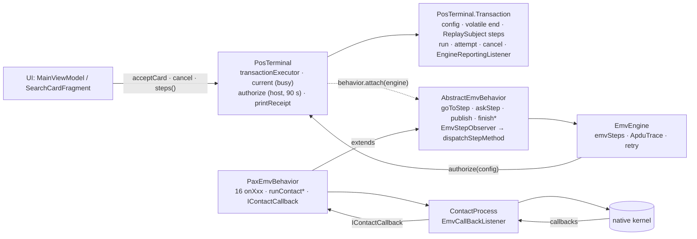
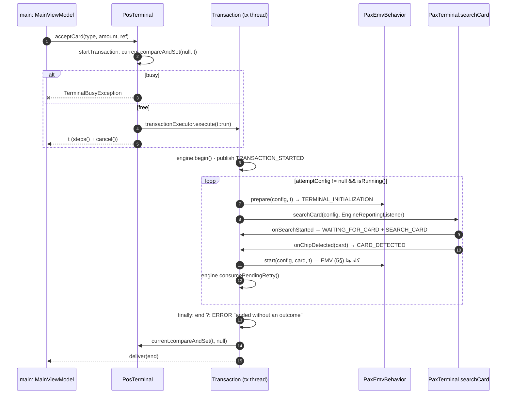
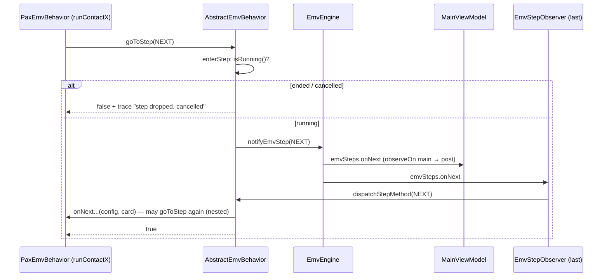
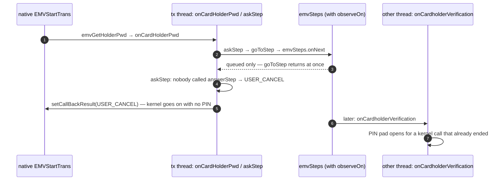
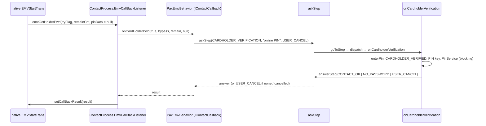
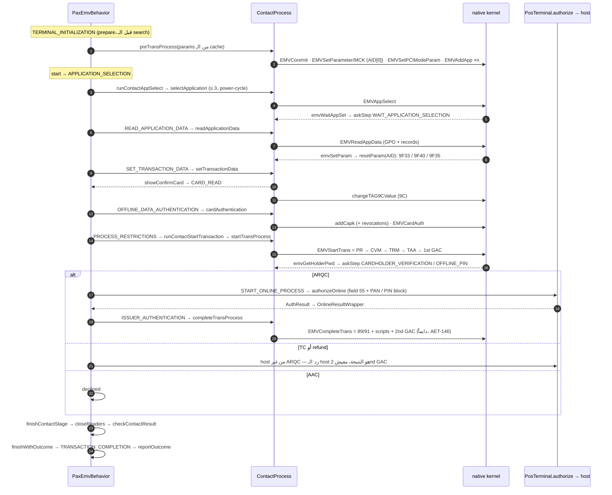
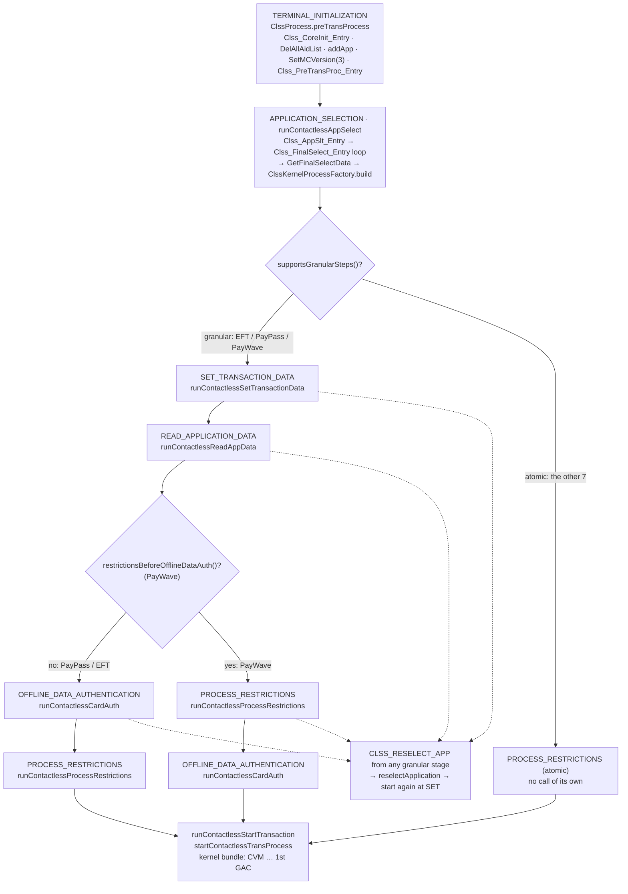
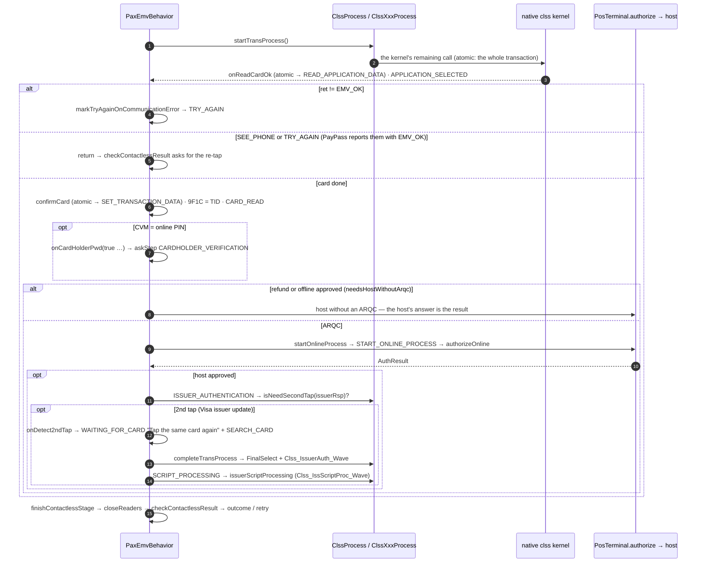

# EasyLink / EmvEnhance — مرجع المشروع

> مكتوب من الكود على `transactionOwnsSteps` (`66a730c`، 2026-10-25). كل اسم method هنا موجود فعلاً.
> الرسومات نفسها (mermaid) موجودة كمان كصفحة: https://claude.ai/artifact/S69zGozrJmfoGCVe3VkAnh
> ⚠ = الكود لسه مش بيعمل اللي المفروض يعمله — الرقم بين قوسين في `doc/BACKLOG.md`.
> لو الكود اتغير والمرجع لأ — الكود هو الصح، وحدّث المرجع.
> ملخص المشروع وقواعد الشغل في `CLAUDE.md`؛ إزاي تضيف vendor في `VENDOR.md`؛ هنا التفاصيل: الـ flows والـ steps.

## الفهرس

1. [الـ Architecture: مين بيملك إيه](#1-الـ-architecture-مين-بيملك-إيه)
2. [PosTerminal والـ transaction thread](#2-posterminal-والـ-transaction-thread)
3. [EmvEngine والـ dispatch: من goToStep لحد onXxx](#3-emvengine-والـ-dispatch-من-gotostep-لحد-onxxx)
4. [الـ kernel callbacks و askStep](#4-الـ-kernel-callbacks-و-askstep)
5. [Contact flow](#5-contact-flow)
6. [Contactless flow](#6-contactless-flow)
7. [EMV param apply flow](#7-emv-param-apply-flow)
8. [الـ Threads](#8-الـ-threads)
9. [لما تيجي تعدّل](#9-لما-تيجي-تعدل)

---

## 1. الـ Architecture: مين بيملك إيه

### 1.1 الطبقات والـ modules

```text
┌──────────── :app (src/main) — كل الشاشات، مفيش vendor ──────────────────────────────┐
│ AmountFragment → SearchCardFragment ⇄ MainViewModel (LiveData) · EmvParamActivity     │
└──────────────────────────────────────┬───────────────────────────────────────────────┘
                                       │ PosTerminal بس (+ EmvParams) — الـ UI عمرها ما تشوف Pax*
┌──────────── :core — مفيش أي import vendor ───────────────────────────────────────────┐
│ PosTerminal (abstract)   thread · busy · host · printer · card search (vendor)        │
│   └── PosTerminal.Transaction   end · steps (ReplaySubject) · cancel · run/attempt   │
│ EmvBehavior ◄── AbstractEmvBehavior   goToStep · askStep · publish · finish* · dispatch│
│ EmvEngine                emvSteps · ApduTrace · retry · authorize → PosTerminal      │
└──────────────────────────────────────┬───────────────────────────────────────────────┘
                                       │ flavor: pax | ingenico | fake  → module :vendor-xyz
┌──────────── :vendor-pax ─────────────────────────────────────────────────────────────┐
│ TerminalFactory → PaxTerminal extends PosTerminal   (ICardReaderHelper.polling)       │
│                   PaxEmvBehavior extends AbstractEmvBehavior                          │
│                     implements IContactCallback, IContactlessCallback                 │
│                   PaxKernel { params, contact, contactless, mag } · PaxEmvParams      │
└──────────────────────────────────────┬───────────────────────────────────────────────┘
┌──────────── PAX SDK modules (متتلمسش إلا لسبب EMV واضح) ─────────────────────────────┐
│ :emvlib:dpas   ContactProcess + EmvCallBackListener ──► EMVCallback.EMV* (native)     │
│ :emvlib        ClssProcess ──► ClssKernelProcessFactory ──► Clss{PayPass,PayWave,EFT,  │
│                AE,Jcb,Mir,Pboc,Pure,RuPay,Dpas}Process ──► Clss*Api (native)           │
│ :emvlib:base   ClssKernelProcess, BaseContactProcess                                  │
│ :emvbase       EmvProcessParam, EmvTransParam, TransResult, IContactCallback, ...     │
│ :emvflow       EmvFlowRuntime (DAL), EmvDeviceImpl (APDU, PIN, trace)                 │
│ :emvservice    PinService, MagCardService                                             │
│ :bizentity     GreenDAO + EmvParamService (cache) + ConfigInit + XML parsers + Updater │
│ :bizlib :poslib :commonutils                                                          │
└───────────────────────────────────────────────────────────────────────────────────────┘
┌──────────── :network (vendor-agnostic) ──────────────────────────────────────────────┐
│ SaleCommunicationBehavior (exchange → sale/refund)  · Onboarding · EmvParamDownload   │
└───────────────────────────────────────────────────────────────────────────────────────┘
```

### 1.2 مين بيملك إيه (مالك واحد لكل حاجة)



| الكلاس | بيتعمل فين | بيملك | ممنوع عليه |
|---|---|---|---|
| `EmvEnhanceApp` | `Application.onCreate` | `PosTerminal` واحد طول عمر الـ process (`TerminalFactory.create`) | — |
| `PosTerminal` | `TerminalFactory` | الـ transaction thread، الـ busy (`AtomicReference<Transaction> current`)، الـ host (`authorize` + الـ timeout)، الطابعة، والـ search (الـ vendor بيعمل `searchCard` / `cancelCardSearch`) | أي EMV logic |
| `PosTerminal.Transaction` | `startTransaction` | حالتها كلها: `end` (`null` = شغالة)، steps بتاعتها (`ReplaySubject`، وهو كمان الـ lock)، الـ cancel، الـ attempt loop | تنشر حاجة بعد النهاية |
| `EmvEngine` | constructor بتاع `PosTerminal`، ويتسلّم مرة واحدة: `behavior.attach(engine)` | `emvSteps` (الـ dispatch bus)، `ApduTrace`، طلب الـ retry، والطريق للـ host (`Authorizer` = `PosTerminal::authorize`) | أي transaction state، أي transaction step |
| `AbstractEmvBehavior` | super بتاع الـ vendor behavior | الـ engine (المكان الوحيد اللي بيتحفظ فيه؛ `PosTerminal` بيوصله بـ `behavior.engine()`)، `goToStep` (فحص الـ cancel الوحيد)، `askStep` / `answerStep`، `publish`، `finish*`، field 55 + `authorizeOnline` | threads، busy، host |
| `PaxEmvBehavior` | constructor بتاع `PaxTerminal` | الـ 16 `onXxx`، الـ `runContact*` / `runContactless*`، الـ kernel callbacks، `PaxTransactionState tx` (جديد كل attempt) | حد يناديه غير الـ dispatch |
| `PaxKernel` | `PaxTerminal` | `EmvParamService params`، `ContactProcess contact` (جديد كل attempt)، `ClssProcess contactless`، `MagCardService mag` | — |
| `ContactProcess` | `prepareKernel` | الـ wrapper على الـ native (`EMVAppSelect` … `EMVCompleteTrans`) و `EmvCallBackListener` (لازم يرد بـ `setCallBackResult` على كل طريق) | UI، انتظار شخص |

### 1.3 قواعد معمارية مش بتتكسر

1. **الـ UI والـ core مش بيعرفوا PAX.** الـ vendor module بيتختار بالـ flavor، و`TerminalFactory` هو المكان الوحيد اللي فيه اسم `PaxTerminal`.
2. **الـ `onXxx` protected ومحدش بيناديها مباشرة.** الطريق الوحيد: `goToStep` → `emvSteps` → `dispatchStepMethod` (§3). ده اللي بيخلي كل خطوة تتشاف في الـ UI والـ APDU trace.
3. **الـ engine مبيعرفش الـ transaction**، والـ behavior بيكلم الـ `Transaction` اللي اتسلّمها في `prepare` / `start` (`publish`، `isRunning()`، `isCancelled()`).

---

## 2. PosTerminal والـ transaction thread

### 2.1 مسؤوليات `PosTerminal`

| المسؤولية | فين |
|---|---|
| start / busy | `startTransaction(config)`: `current.compareAndSet(null, t)` على الـ thread اللي نادى (الـ main). مشغول → `TerminalBusyException` على طول، مفيش queue. فاضي → `transactionExecutor.execute(t::run)` ويرجّع `t` |
| thread واحد | `Executors.newSingleThreadExecutor()`: reader واحد، kernel واحد. عمره ما بيتعمله interrupt |
| الـ transaction نفسها | `Transaction`: `run()` (الـ loop)، `attempt()`، `cancel()`، `publish(event)`، `steps()` |
| الـ card search | `searchCard(config, listener)` (vendor) + `EngineReportingListener` بيحوّل events الـ reader لـ steps ويبدأ الـ EMV |
| الـ host | `authorize(config)`: `ONLINE_REQUIRED` / `ONLINE_PROCESSING`، `communication.authorize(config).timeout(90 s).blockingGet()`، `ONLINE_COMPLETED`. أي exception = `AuthResult.failed` (مش decline) |
| الطابعة | `printReceipt(lines)` على thread طباعة لوحده، بالترتيب |
| setup seam | `serialNumber()`، `requiredPermissions()`، `countries()` / `setCountry()`، `emvParams()` (VENDOR.md §2) |

### 2.2 الـ `Transaction` — حالتها كلها في مكان واحد

- `end` (`volatile`، بيتكتب تحت الـ lock بس): `null` = شغالة؛ أول `COMPLETED` / `ERROR`، أو `CANCELLED` بتاع الـ cancel = خلصت. `TransactionStep.isEnd()` = `COMPLETED || ERROR || CANCELLED`.
- `steps` (`ReplaySubject`): steps الـ transaction دي بس، فـ transaction جديدة عمرها ما تعمل replay لنتيجة اللي قبلها. بيعمل replay لكل الـ steps لأي subscriber يجي متأخر (rotation)، ومبيخلصش أبداً (النهاية step عليه). كل subscriber جوه `SafeObserver`: اللي يرمي exception بيتقطع لوحده.
- **الـ lock** = `steps` نفسه: كل publish ماسكه، فمفيش `onNext` اتنين مع بعض، والـ `CANCELLING` عمره ما ييجي بعد النهاية.
- `publish(event)`: بعد النهاية → dropped + note في الـ trace. step نهاية → يتحط في `end` بس (مبيتنشرش دلوقتي). غير كده → `deliver` (log + trace + `onNext`).

### 2.3 بداية الـ transaction thread



بالكلام، thread بـ thread:

```text
[main]  AmountFragment → SearchCardFragment.onViewCreated → MainViewModel.acceptCard(type, amount, ref)
[main]  PosTerminal.acceptCard → startTransaction(new TransactionConfig(type, amount, ANY).withReferenceNumber)
          current.compareAndSet(null, t)   false → TerminalBusyException → getTerminalBusy()
          transactionExecutor.execute(t::run)  → يرجّع t على طول (MainViewModel.transaction)
──────────────────────────────────────────────────────────────────────────────────
[tx]    Transaction.run()
          engine.begin()                    retry = 0، trace جديد
          publish(TRANSACTION_STARTED)      مرة واحدة
          while (attemptConfig != null && isRunning())  attemptConfig = attempt(attemptConfig)
[tx]    attempt(config)
          behavior.prepare(config, this)    → TERMINAL_INITIALIZATION → onTerminalInitialization → prepareKernel
               false → ERROR "Terminal initialization failed"، return null
          searchCard(config, new EngineReportingListener(config))     ← vendor، blocking
               onSearchStarted → WAITING_FOR_CARD (+ retry prompt) + EmvStep SEARCH_CARD
               onSearchRetry   → WAITING_FOR_CARD "tap again…" (نفس الـ search)
               onChip/Contactless/Magstripe/ManualDetected → handleCardFound:
                    CARD_DETECTED → behavior.start(config, card, this)   ← EMV كله synchronous هنا
               onSearchTimeout / onSearchCancelled / onReaderError → ERROR
               (أي callback بعد ما الـ transaction خلصت → isStale → متجاهَل)
          return engine.consumePendingRetry()   ← config الـ retry أو null
[tx]    finally (تحت الـ lock):
          end == null → ERROR "Transaction ended without an outcome"
          current.compareAndSet(this, null)     ← الـ terminal فاضي
          deliver(end)                          ← COMPLETED / ERROR / CANCELLED، مرة واحدة
──────────────────────────────────────────────────────────────────────────────────
[main]  SearchCardFragment: transaction.steps() (observeOn main) → outcome / result panel
        MainViewModel: emvSteps (observeOn main) → banner؛ ApduTrace.changes() → trace
```

ليه النهاية بتتنشر بعد ما الـ terminal يفضى: الشاشة اللي تشوف `COMPLETED` تقدر تبدأ الـ sale الجاية على طول من غير `TerminalBusyException`.

### 2.4 الـ cancel

```text
[main] زرار Cancel / Back / onCleared → MainViewModel.cancel → transaction.cancel()
         [lock] end != null؟ → ولا حاجة (خلصت، أو cancel تاني)
         [lock] end = CANCELLED؛ deliver(CANCELLING "Cancelling — finishing with the card")
         cancelCardSearch()   → PAX: ICardReaderHelper.stopPolling()
[tx]   isSearchCancelled() / isRunning() = false
       الـ EMV بيقف عند أول goToStep (§3) → الـ stage بيقفل الـ readers (finishContactStage)
       الـ host call نفسه مبيتقطعش (ممكن يكون اتوافق عليه) — بيستنى الرد أو الـ timeout
       اتلغت قبل ما run يبدأ؟ → run بيشتغل برضه، الـ loop مبيدخلش، وبيفضّي الـ terminal
       finally: current = null، وبعدين CANCELLED يتنشر — مرة واحدة
```

⚠ cancel وإحنا مستنيين الـ host بيخلّص الـ sale بـ CANCELLED حتى لو الـ host وافق والكارت أخد TC (خطر #1 في الـ handoff؛ مفيش reversal: BACKLOG 0.5).

### 2.5 الـ retry (fallback / try again / see phone / try another interface)

مفيش `startTransaction` جديد. الـ behavior بيقول `engine.requestRetry(config.withMode(X), prompt)`؛ بعد ما `behavior.start` يرجع، `attempt` بيرجّع `consumePendingRetry()` والـ loop بيعمل attempt تاني **على نفس الـ thread ونفس الـ transaction**. الـ trace بيكمل بـ `RETRY #n`، والـ prompt بيظهر في `WAITING_FOR_CARD` كـ `KEY_RETRY_PROMPT`. retry بعد الـ cancel بيتساب ("retry dropped — the transaction is over").

| الـ outcome | الـ mode الجديد | الـ prompt |
|---|---|---|
| `fallback()` (contact) | `MAGSTRIPE` | Chip not readable — swipe the card |
| `tryAnotherInterface()` | `CHIP` | Insert the card |
| `tryAgain()` | نفس الـ mode | Card not read — tap again… |
| `seePhone()` | `CONTACTLESS` | See phone — verify on your phone, then tap again |

`seePhone` و `tryAgain` (ومعاهم `markTryAgainOnCommunicationError` اللي بيطلب `tryAgain`) بيشاركوا `MAX_TAP_RETRIES = 3` على `engine.getRetryCount()` — بعدهم decline.
⚠ الـ retry state (العدد، الـ config، الـ prompt) عايش في الـ engine مش في الـ `Transaction`.

### 2.6 الـ TransactionSteps ومين بينشرها

`IDLE → TRANSACTION_STARTED → WAITING_FOR_CARD → CARD_DETECTED → APPLICATION_SELECTED → CARD_READ → CARDHOLDER_VERIFIED → ONLINE_REQUIRED → ONLINE_PROCESSING → ONLINE_COMPLETED → APPROVED|DECLINED → COMPLETED`، أو `ERROR` في أي لحظة، أو `CANCELLING` ثم `CANCELLED`.

| TransactionStep | فين |
|---|---|
| TRANSACTION_STARTED | `Transaction.run` (مرة واحدة، حتى مع الـ retry) |
| WAITING_FOR_CARD | `EngineReportingListener.onSearchStarted` / `onSearchRetry` / `onCardRemoved`، `PaxEmvBehavior.onDetect2ndTap` |
| CARD_DETECTED | `EngineReportingListener.handleCardFound` |
| APPLICATION_SELECTED | `answerApplicationSelection` (contact)، `onReadCardOk` (clss) |
| CARD_READ | contact: `showConfirmCard`؛ clss: `confirmCard`؛ mag/manual: `onReadApplicationData` |
| CARDHOLDER_VERIFIED | `enterPin` (`KEY_ONLINE_PIN`، `KEY_PIN_BYPASS`، `KEY_PIN_TRIES_LEFT`) |
| ONLINE_REQUIRED / PROCESSING / COMPLETED | `PosTerminal.authorize` — حوالين نداء الـ host |
| APPROVED / DECLINED + COMPLETED | `reportOutcome` → `finishApproved/Declined(event)` (PAN/TVR/TAC/IAC/field 55)، أو `finishApproved/Declined(String)` (mag/manual) |
| ERROR | `finishError` / `PosTerminal.errorEvent` (init، reader، kernel، online failed، exception) |
| CANCELLING / CANCELLED | `Transaction.cancel()` |

⚠ الـ outcome publish مرتين (APPROVED، وبعدين COMPLETED كـ end): cancel بين الاتنين يدّي الـ UI APPROVED وبعدها CANCELLED.

---

## 3. EmvEngine والـ dispatch: من goToStep لحد onXxx

### 3.1 نوعين من الـ events

| | `TransactionStep` | `EmvStep` |
|---|---|---|
| لمين | الـ business / الـ UI | مهندس EMV / الـ banner / الـ trace، **و الـ dispatch** |
| مكانه | `Transaction.steps()` (واحد لكل transaction) | `EmvEngine.emvSteps` (واحد للـ terminal) |
| الـ subject | `ReplaySubject`، كل publish تحت الـ lock، كل subscriber `SafeObserver` | `PublishSubject` **مش serialized**، مفيش `observeOn` |
| replay؟ | آه، كل steps الـ transaction | لأ |
| بيشغّل كود؟ | لأ | **آه** — كل step بيشغّل الـ `onXxx` بتاعه |
| بعد النهاية | dropped + note | مبيتنشرش (`enterStep` بيشوف `isRunning()`) |

### 3.2 `EmvEngine` — الـ bus بس

- `notifyEmvStep(step, detail)`: `apduTrace.kernelStep(...)` ثم `emvSteps.onNext(event)` — كل subscriber بياخده قبل ما يرجع.
- `begin()`: retry = 0، الـ prompt والـ pending retry = null، `apduTrace.beginTransaction()`.
- `requestRetry` / `consumePendingRetry` / `consumeRetryPrompt` / `getRetryCount`.
- `authorize(config)` → الـ `Authorizer` اللي `PosTerminal` اداهوله (`PosTerminal::authorize`).
- مفيش فيه `isRunning` ولا أي transaction state: السؤال "الـ step ده لسه ينفع يتنشر؟" بيتسأل للـ `Transaction` قبل `notifyEmvStep`.

### 3.3 `goToStep` بيعمل إيه بالظبط



```text
vendor code: goToStep(EmvStep.X, detail)
  └─ AbstractEmvBehavior.goToStep
       ├─ step == null → unknownStep → finishError (مرة واحدة)
       ├─ activeConfig == null → false
       └─ enterStep(X, detail)
            ├─ !isRunning() → dropped ("step dropped, cancelled" / "the transaction has ended") → false
            └─ engine.notifyEmvStep(X, detail)
                 ├─ apduTrace.kernelStep(...)
                 └─ emvSteps.onNext(event)                  ← synchronous، نفس الـ thread
                      ├─ MainViewModel (observeOn main → banner) — post بس
                      └─ EmvStepObserver (آخر subscriber)
                           └─ dispatchStepMethod(X) → onX(activeConfig, activeCard)
                                └─ ممكن جوّاه goToStep(Y) → re-entrant، Y يخلص قبل ما X يرجع
                           exception جوه onX → finishError(message)
  ← goToStep بيرجع true بعد ما onX (وكل اللي نادته) خلصت
```

ليه كده:
- **synchronous ومفيش `observeOn` / `subscribeOn`**: الـ kernel بينادي callback ومستني return value؛ لازم الـ step يكون خلص قبل ما الـ callback يرجع (§4). والـ step بيعمل APDU / PIN / host، يعني blocking.
- **`initEmvObserver()` في كل `prepare` و `start`** عشان `EmvStepObserver` يفضل **آخر** subscriber. لو مكانش آخر، الـ subscribers اللي بعده كانوا هيشوفوا الـ step الجاي قبل الحالي (الجاي بيتنشر من جوه الحالي).
- **`goToStep` بيرجّع `false` بعد الـ cancel**: الـ stage اللي ماسك resource (الـ ICC reader) بيقفله بنفسه (`advanceContactStage` → `finishContactStage`).
- ⚠ subscriber يتضاف في نص الـ transaction بيشوف الـ steps بترتيب غلط (لأنه بعد الـ observer).

### 3.4 ليه الـ dispatch لازم يفضل synchronous (مفيش `observeOn` ولا serialize)

`observeOn(X)` معناه إن الـ `onNext` يتحط في queue ويشتغل بعدين على thread تاني، و`goToStep` يرجع على طول. لو اتعمل ده على الـ `EmvStepObserver`، الـ `onXxx` هيشتغل بره الـ transaction thread. مثال الـ PIN:



```text
[tx]  native EMVStartTrans → emvGetHolderPwd → onCardHolderPwd → askStep(CARDHOLDER_VERIFICATION)
[tx]    goToStep → emvSteps.onNext → (observeOn) الـ step اتحط في queue وخلاص، goToStep رجع
[tx]    askStep: محدش عمل answerStep → يرجّع USER_CANCEL
[tx]  setCallBackResult(USER_CANCEL) → الـ kernel كمّل من غير PIN
[io]  بعدين: onCardholderVerification بيفتح الـ PIN pad لـ kernel call خلص خلاص
```

| لو عملنا | إيه اللي هيحصل | ليه |
|---|---|---|
| `observeOn` على الـ observer | `askStep` يرجّع `USER_CANCEL` قبل ما الـ PIN pad أو الـ dialog يفتح | الـ step بيشتغل بعد ما `goToStep` رجع، فمحدش جاوب في الوقت ده |
| `observeOn` على الـ observer | تداخل على الـ kernel: `onXxx` بينادي native (`EMVReadAppData`، `EMVCardAuth`) والـ transaction thread لسه جوه native call، أو بيقفل الـ readers في `finishContactStage` | الـ PAX kernel والـ reader مش thread-safe: كل حاجة لازم على thread واحد بالترتيب |
| `observeOn` على الـ observer | الترتيب يبوظ: `runContactAppSelect` يكمل على أساس إن الـ READ خلص ونتيجته في `tx.transResult`، وهي لسه مخلصتش | كل stage بيقرا نتيجة اللي قبله بعد ما `goToStep` يرجع |
| `emvSteps.toSerialized()` | الـ step الجاي ميشتغلش جوه الحالي: يتحط في queue لحد ما الـ `onNext` الحالي يخلص | كل `onXxx` بينادي `goToStep(NEXT)` من جوه `onNext`، والـ serialize بيأجّل الـ `onNext` المتداخل. فـ `askStep` يرجّع fail-closed والـ stage يلاقي النتيجة ناقصة |

من غير الاتنين، الـ dispatch بيبقى زي نداء method عادي: `goToStep` → `onNext` → `onXxx`، كله على الـ transaction thread وبيخلص قبل ما `goToStep` يرجع.
**الـ UI عادي تعمل `observeOn(main)`** (`MainViewModel` على `emvSteps`)، لأنها بتعرض الـ banner بس: مبتشغّلش EMV ومحدش مستني منها رد. الشرط ده على الـ `EmvStepObserver` بس.

### 3.5 إزاي الـ transaction بتخلص

| من فين | بيعمل إيه |
|---|---|
| `finishApproved/Declined(String)` (mag/manual) | APPROVED/DECLINED + COMPLETED |
| `finishWithOutcome(step, detail, msg)` (chip/clss) | `tx.outcome` → `goToStep(TRANSACTION_COMPLETION)` → `onTransactionCompletion` → `reportOutcome` → `finishApproved/Declined(event)` |
| `finishError(msg)` | ERROR |
| exception جوه أي `onXxx` | `EmvStepObserver.onNext` يمسكه → `finishError` |
| `Transaction.cancel()` | `end = CANCELLED` + CANCELLING + `cancelCardSearch()` |
| الـ search خلص من غير outcome | `finally` بتاع `run`: ERROR "Transaction ended without an outcome" |

أول end → `Transaction.end` → أي step بعده dropped (الـ EmvStep والـ TransactionStep الاتنين)، والنهاية بتتنشر مرة واحدة من الـ `finally`.

### 3.6 جدول الـ 17 EmvStep في PAX

| # | EmvStep | مين بينشره | Contact (`onXxx` بيعمل) | Contactless granular (EFT/PayPass/PayWave) | Contactless atomic | Mag / Manual |
|---|---|---|---|---|---|---|
| 0 | TERMINAL_INITIALIZATION | `AbstractEmvBehavior.prepare` | `prepareKernel` | = | = | = (بيرجع true بدري) |
| 1 | SEARCH_CARD | `EngineReportingListener.onSearchStarted` / `onSearchRetry`، `onDetect2ndTap` | فاضي (الـ search في `PosTerminal`) | = | = | = |
| 2 | APPLICATION_SELECTION | `start()` → `firstStepAfterSearch` | `runContactAppSelect` | `runContactlessAppSelect` | = | مش بيتوصل |
| 3 | WAIT_APPLICATION_SELECTION | `onWaitAppSelect(first)` → askStep | `answerApplicationSelection` | = (نادر) | = | — |
| 4 | FINAL_APPLICATION_SELECTION | `onWaitAppSelect(retry)` → askStep | `answerApplicationSelection` | = | = | — |
| 5 | READ_APPLICATION_DATA | contact: بعد 2؛ granular: بعد 6؛ atomic: `onReadCardOk`؛ mag: `start()` | `runContactReadAppData` | `runContactlessReadAppData` | فاضي | `CARD_READ` → `START_ONLINE_PROCESS` |
| 6 | SET_TRANSACTION_DATA | contact: بعد 5؛ granular: بعد 2؛ atomic: `confirmCard` | `runContactSetTransactionData` | `runContactlessSetTransactionData` | فاضي | — |
| 7 | OFFLINE_DATA_AUTHENTICATION | بعد 6 (contact)، بعد 5 (granular)، بعد 8 (PayWave) | `runContactCardAuth` | `runContactlessCardAuth` | مش بيتنشر | — |
| 8 | PROCESS_RESTRICTIONS | بعد 7؛ PayWave بعد 5؛ atomic بعد 2 | `runContactStartTransaction` (EMVStartTrans) | `runContactlessProcessRestrictions` | → `runContactlessStartTransaction` | — |
| 9 | CARDHOLDER_VERIFICATION | `onCardHolderPwd` (online: askStep؛ offline: goToStep) | online: `enterPin` + answer | online PIN بعد الـ bundle | = | — |
| 10 | OFFLINE_PIN_VERIFICATION | `onCardHolderPwd(offline)` → askStep | `enterPin` (pad بس — الـ kernel بيعمل verify) | مش مدعوم | — | — |
| 11 | TERMINAL_RISK_MANAGEMENT | **مش بيتنشر في PAX** | فاضي (جوه EMVStartTrans) | فاضي | فاضي | — |
| 12 | TERMINAL_ACTION_ANALYSIS | **مش بيتنشر في PAX** | فاضي | فاضي | فاضي | — |
| 13 | START_ONLINE_PROCESS | `startOnlineProcess()`؛ mag: من 5 | `authorizeOnline()` لو `tx.onlineRequested` | = | = | `authorizeOnline()` → 16 |
| 14 | ISSUER_AUTHENTICATION | `runIssuerAuthentication` | `EMVCompleteTrans` (2nd GAC) لو `tx.issuerResponse` | 2nd tap + `completeTransProcess` | = | — |
| 15 | SCRIPT_PROCESSING | `runIssuerScriptProcessing` (2nd tap)؛ `completeApproved` (إعلان) | فاضي (EMVCompleteTrans عملها) | `processIssuerScripts` | = | — |
| 16 | TRANSACTION_COMPLETION | `finishWithOutcome`؛ mag: من 13 | `reportOutcome(tx.outcome)` | = | = | `finishApproved/Declined` |

> "فاضي" = body فيه comment بيقول الـ kernel عمل الحاجة دي — مش stub. كل الـ `onXxx` abstract (ما عدا `onSearchCard`) عشان vendor ينسى phase ياخد compile error مش no-op ساكت.
> ⚠ الـ 1st GAC ملوش step لوحده (جوه `EMVStartTrans`).

---

## 4. الـ kernel callbacks و askStep

### 4.1 تلت طبقات

الـ native kernel وهو جوه `EMVAppSelect` أو `EMVStartTrans` بيوقف ويستنى رد على callback، والرد لازم يرجع بـ `setCallBackResult` على **كل** طريق (وإلا الـ kernel يفضل مستني).

| الطبقة | فين | بتعمل إيه |
|---|---|---|
| native callback | `ContactProcess.EmvCallBackListener` (implements `EMVCallback.EmvCallbackListener`؛ بيتسجّل في `setEmvAndMCKParam` جوه `preTransProcess`) | بتترجم البيانات (`EMV_APPLIST[]` → `CandidateAID`)، تنادي الـ `IContactCallback`، وترد بـ `emvCallback.setCallBackResult(...)`. الـ listener رمى exception → `EMV_USER_CANCEL`؛ مفيش listener → `EMV_DATA_ERR` |
| thin adapter | `PaxEmvBehavior` كـ `IContactCallback`: `onWaitAppSelect`، `onCardHolderPwd`، `showConfirmCard` (اتسجّل بـ `kernel.contact.registerEmvProcessListener(this)`) | مفيش UI. بيحط الطلب في `tx` (`tx.candidates`، `tx.pinRequest`) ويسأل الـ step: `askStep(step, detail, USER_CANCEL)` |
| step method | `onWaitApplicationSelection` / `onFinalApplicationSelection`، `onCardholderVerification`، `onOfflinePinVerification` | الشغل الحقيقي (dialog، PIN pad) ثم `answerStep(value)` |

### 4.2 `askStep` / `answerStep`

```java
// callback (adapter)
return askStep(EmvStep.CARDHOLDER_VERIFICATION, "online PIN", USER_CANCEL /* failClosed */);

// step method
protected void onCardholderVerification(...) { answerStep(enterPin(tx.pinRequest)); }
```

- `askStep` بيعمل stack من `StepAnswer` (يدعم nesting)، يعمل `goToStep`، ويرجّع اللي اتعمله `answerStep`.
- محدش جاوب (cancel، الـ transaction خلصت، exception، أو نسيت `answerStep`)، أو جاوب بعد النهاية → بيرجّع **`failClosed`** ويكتب `no answer for …` في الـ trace. **الـ kernel عمره ما يستنى للأبد.**
- شغال بس لأن الـ step بيخلص قبل ما `goToStep` يرجع (§3.3).
- `answerStep` من غير `askStep` = ولا حاجة.

### 4.3 مثال: online PIN (contact)



```text
[tx] runContactStartTransaction → startContactTransProcess → kernel.contact.startTransProcess()
       → EMVCallback.EMVStartTrans (native)
       native يحتاج PIN → EmvCallBackListener.emvGetHolderPwd
         → emvProcessListener.onCardHolderPwd(true, bypass, remain, null)   ← PaxEmvBehavior
              tx.pinRequest = new PinRequest(...)
              askStep(CARDHOLDER_VERIFICATION, "online PIN", USER_CANCEL)
                → goToStep → emvSteps → onCardholderVerification
                     → enterPin(request): CARDHOLDER_VERIFIED، provisionOnlinePinKey،
                       PaxPinPad + PinService.getEncryptedPinData (blocking)
                     → answerStep(CONTACT_OK | NO_PASSWORD | USER_CANCEL)
              ← الإجابة   (finally: tx.pinRequest = null)
         ← emvCallback.setCallBackResult(result)
       native يكمل: CVM → TRM → TAA → 1st GAC
```

- **Offline PIN**: `goToStep(CARDHOLDER_VERIFICATION, "PIN")` إعلان بس، ثم `askStep(OFFLINE_PIN_VERIFICATION)`؛ الـ pad بس، والـ kernel بيعمل verify مع الكارت. pin تاني (`pinData[0] != 0`) بيرد عليه الـ listener من غير ما يسأل.
- **App selection**: `emvWaitAppSel` → `onWaitAppSelect(tryCnt <= 0, cands)` → `askStep(WAIT_ / FINAL_APPLICATION_SELECTION)` → `answerApplicationSelection` (APPLICATION_SELECTED، dialog `PaxAppSelectDialog.selectBlocking` لو `showsAppSelectDialog`، وإلا `CONTACT_OK` = index 0). ⚠ `showsAppSelectDialog` بقى `candidates >= 1` في كل الـ builds (`0e12c79`، مش مقصود).
- **Data callbacks** بتفضل في `ContactProcess` ومبتسألش step: `emvInputAmount`، `emvSetParam` (→ `resetParam(AID)`)، `emvUnknowTLVData`. `certVerify` (`EMV_DATA_ERR`) و `emvVerifyPINfailed` (`EMV_OK`) بيردوا بـ `setCallBackResult`.

---

## 5. Contact flow

### 5.1 الرسمة كاملة (ترتيب الـ kernel نفسه)



### 5.2 الـ stages (كل stage = native call واحد = EmvStep واحد)

| EmvStep | runner في `PaxEmvBehavior` | `ContactProcess` | native | callbacks جوّاه |
|---|---|---|---|---|
| TERMINAL_INITIALIZATION | `onTerminalInitialization` → `prepareKernel` → `runPreTransProcess` | `preTransProcess` | `EMVCoreInit`، `EMVSetParameter` / `EMVSetMCKParam` (AID[0])، `EMVSetPCIModeParam`، `EMVAddApp` | — |
| APPLICATION_SELECTION | `runContactAppSelect` (+ `selectApplicationWithRetry`: 3 محاولات، power-cycle 200ms) | `selectApplication` | `EMVAppSelect` | `emvWaitAppSel` → `onWaitAppSelect` (WAIT/FINAL) |
| READ_APPLICATION_DATA | `runContactReadAppData` | `readApplicationData` | `EMVReadAppData` (GPO + read records) | `emvSetParam` → `resetParam(AID)` |
| SET_TRANSACTION_DATA | `runContactSetTransactionData` | `setTransactionData` | — | `showConfirmCard` (CARD_READ) + `changeTAG9CValue` (9C) |
| OFFLINE_DATA_AUTHENTICATION | `runContactCardAuth` | `cardAuthentication` | `addCapk` + `EMVCardAuth` | — |
| PROCESS_RESTRICTIONS | `runContactStartTransaction` → `startContactTransProcess` | `startTransProcess` | `EMVStartTrans` = PR → CVM → TRM → TAA → **1st GAC** | `emvGetHolderPwd` → `onCardHolderPwd` |
| START_ONLINE_PROCESS | `startOnlineProcess()` → `onStartOnlineProcess` → `authorizeOnline` | — | — (host) | — |
| ISSUER_AUTHENTICATION | `runIssuerAuthentication` → `completeContactIssuerAuthentication` | `completeTransProcess` | `EMVCompleteTrans` = 89/91 + scripts + **2nd GAC** | — |
| SCRIPT_PROCESSING | إعلان بس من `completeApproved` | — | (اتعمل جوه EMVCompleteTrans) | — |
| TRANSACTION_COMPLETION | `finishContactStage` → `checkContactResult` → `finishWithOutcome` → `onTransactionCompletion` → `reportOutcome` | — | — | — |

كل runner بنفس الشكل:

```text
tx.transResult = kernel.contact.xxx()
proceed = ret == EMV_OK && !isContactTransactionFinished()   (transResult.getTransResult() == null)
exception → finishError
!proceed → registerEmvProcessListener(null) + finishContactStage   (يقفل الـ readers + الـ PIN pad، ثم checkContactResult)
proceed  → advanceContactStage(NEXT)   = goToStep(NEXT)، ولو مرجعش true → finishContactStage
```

الـ ICC reader فاضل مفتوح من app select لحد start transaction، عشان كده `advanceContactStage` بيقفل بنفسه لو `goToStep` اتلغى — وإلا الـ cleanup كان هيضيع. `finishContactStage` بعد cancel: بيقفل ومبيبلّغش نتيجة ("result not reported").

### 5.3 الترتيب ده ليه

ده ترتيب الـ PAX contact kernel نفسه: `EMVAppSelect` → `EMVReadAppData` → (confirm card + 9C) → `EMVCardAuth` → `EMVStartTrans` → `EMVCompleteTrans`. الـ SET_TRANSACTION_DATA في الـ contact **بعد** الـ read (عكس الـ contactless) لأن الـ contact kernel بياخد المبلغ في `preTransProcess` / `EMVStartTrans` (`emvInputAmount`)، والـ stage دي بتأكد الكارت وتظبط 9C بعد ما الـ PAN اتقرا.

### 5.4 الـ parameters جوه الـ contact kernel

- `preTransProcess` (كل attempt، `ContactProcess` جديد): `EMVCoreInit` → `setEmvAndMCKParam` بـ **أول AID** كـ default (+ `forceOnline = 1`، وبيسجّل `EmvCallBackListener`) → `EMVSetPCIModeParam` → `EMVAddApp` لكل AID. الـ params جاية من `kernel.params.getCachedEmvParam()` (§7.3).
- بعد اختيار الـ application: `emvSetParam` → `resetParam(aid)`: يدوّر على الـ AID (full أو partial) ويحط 9F33 / 9F40 / 9F35 بتوعه بـ `EMVSetParameter` **و** `EMVSetTLVData`.
  ⚠ الـ PIN bypass بتاع الـ AID المختار **مبيوصلش للـ kernel**: `resetParam` بينادي `EMVGetMCKParam` مكان `EMVSetMCKParam` (BACKLOG 0.7).
- **9F03 عمره ما يتكتب في الـ contact kernel**؛ `readIccTag` بيرد عليه zeros.

### 5.5 الـ online والـ 2nd GAC (`startContactTransProcess`)

| الكارت قال إيه في 1st GAC | بيحصل إيه |
|---|---|
| `ret != EMV_OK` | يرجع الكود → decline/error |
| refund (أي حاجة) أو TC "offline approved" | `needsHostWithoutArqc` → host من غير ARQC → `hostOutcome` → **رد الـ host هو النتيجة** (مفيش 2nd GAC) |
| ARQC (`RESULT_REQ_ONLINE`) | `startOnlineProcess` → `runIssuerAuthentication` → **2nd GAC دايماً** (EMV Book 3، AET-146) حتى لو الـ host رفض أو فشل |
| AAC (مش refund) | decline |

`startOnlineProcess()`: `tx.onlineRequested = true` → `goToStep(START_ONLINE_PROCESS)` → `onStartOnlineProcess` → `tx.lastAuth = authorizeOnline()` (field 55 من `readIccTag`، فاضي → online failed من غير ما يبعت؛ `addOnlineRequestData`: PAN، PIN block، المفتاح المشفّر، `EmvTransactionResult`) → `engine.authorize` → `PosTerminal.authorize`. الـ step متلغي → `lastAuth = null` → "online step did not run — online failed". `toOnlineResultWrapper`: null/failed → FAILED، approved → APPROVE (auth code، RC، ARPC، scripts)، غير كده → DENIAL.

`runIssuerAuthentication`: `tx.issuerResponse = online` → `goToStep(ISSUER_AUTHENTICATION)` → `onIssuerAuthentication` → `completeIssuerAuthentication`. الـ step متلغي (cancel) → الـ 2nd GAC بيتعمل برضه ("issuer authentication step did not run — completing with the card anyway").

بعد الـ 2nd GAC (`completeContactIssuerAuthentication`):

| الـ host | الكارت في 2nd GAC | النتيجة |
|---|---|---|
| APPROVE | TC | `RESULT_ONLINE_APPROVED` |
| APPROVE | غير كده | `RESULT_ONLINE_CARD_DENIED` |
| FAILED | أي حاجة | `RESULT_ONLINE_FAILED` / `..._CARD_APPROVED` → **online failed** |
| DENIAL | — | `RESULT_ONLINE_DENIED` |

### 5.6 النتيجة (`checkContactResult` → outcome)

| TransResultEnum | method | Outcome |
|---|---|---|
| ONLINE_APPROVED | `onlineApproved` → `completeApproved` (+ SCRIPT_PROCESSING إعلان) | APPROVED |
| ONLINE_DENIED | `onlineDenied` | DECLINED |
| ONLINE_CARD_DENIED | `onlineCardDenied` | DECLINED |
| ONLINE_FAILED / FAILED_CARD_APPROVED | `onlineFailed` | ERROR |
| OFFLINE_APPROVED | `offlineApproved` → **online failed** (مفيش offline approve) | ERROR |
| OFFLINE_DENIED / default / `null` | `offlineDenied` | DECLINED |
| SIMPLE_FLOW_END | `simpleFlowEnd` | APPROVED |
| FALLBACK | `fallback()` → retry MAGSTRIPE | — |

---


## 6. Contactless flow

نفس الـ dispatch (§3) ونفس الـ `askStep` (§4). الفرق إن الـ kernel بيتختار بعد الـ application selection (`ClssKernelProcessFactory`). فيه نوعين (`ClssKernelProcess.supportsGranularSteps()`):
- **granular: EFT، PayPass، PayWave.** الـ SDK بتاعهم فيه native call لكل phase، فكل phase step لوحده.
- **atomic: Amex، JCB، Mir، PBOC، Pure، RuPay، DPAS.** الـ transaction كلها call واحد (`startTransProcess`). الـ steps بتتنشر من الـ callbacks (`onReadCardOk` → READ_APPLICATION_DATA، `confirmCard` → SET_TRANSACTION_DATA)، والـ `onXxx` بتاعها فاضي.

### 6.1 الرسمة: الـ stages



### 6.2 قبل الـ tap: الـ entry point

`prepareKernel` → `runPreTransProcess` → `ClssProcess.preTransProcess`:
`Clss_CoreInit_Entry` → `Clss_DelAllAidList_Entry` / `DelAllPreProcInfo` → `ClssEntryAddAid.addApp()` (AIDs كل kernel عنده rows؛ kernel اتمسح = مفيش AIDs = مش بيتختار) → `Clss_SetMCVersion_Entry(3)` → `Clss_PreTransProc_Entry` (limits per AID).
لو فشل → `kernel.contactlessReady = false` → `PaxTerminal` مش هيسمع على الـ PICC خالص في الـ transaction دي ("contactless disabled for this transaction").

### 6.3 Application selection (`runContactlessAppSelect`)

`kernel.contactless.registerClssProcessListener(this)` → `ClssProcess.selectApplication`: `Clss_AppSlt_Entry` → loop على `Clss_FinalSelect_Entry` (`EMV_RSP_ERR` / `APP_BLOCK` / `ICC_BLOCK` / `CLSS_RESELECT_APP` → `Clss_DelCurCandApp_Entry` والـ candidate الجاي) → `Clss_GetPreProcInterFlg_Entry` + `Clss_GetFinalSelectData_Entry` → `ClssKernelProcessFactory(kernType).build()` بالـ params والـ listener.
بعدها: `firstStageAfterAppSelect()` → granular: `SET_TRANSACTION_DATA`؛ atomic: `PROCESS_RESTRICTIONS`.

كل runner contactless بنفس شكل الـ contact (§5.2)، وزيادة عليه:

```text
tx.clsTransResult = kernel.contactless.xxx()
ret == CLSS_RESELECT_APP → reselectApplication() (Clss_DelCurCandApp_Entry + select تاني) → firstStageAfterAppSelect()
markTryAgainOnCommunicationError(ret)   ICC_CMD_ERR / ICC_RESET_ERR / CLSS_TRY_AGAIN → RESULT_TRY_AGAIN
proceed = ret == EMV_OK && !isContactlessTransactionFinished()
!proceed → unregisterClssProcessListener + captureSummaryAfterCardRead (بعد الـ READ) + finishContactlessStage
proceed  → advanceContactlessStage(NEXT)
```

الـ atomic بيعمل نفس الـ reselect loop جوه `ClssProcess.startTransProcess`.

### 6.4 ترتيب كل kernel (= ترتيب الـ kernel نفسه)

| EmvStep | PayPass (`ClssPayPassProcess`) | PayWave (`ClssPayWaveProcess`) | EFT (`ClssEFTProcess`) |
|---|---|---|---|
| SET_TRANSACTION_DATA | `coreInit` (`Clss_CoreInit_MC`، `SetParam_MC`، FinalSelectData) + `setPayPassParam` (DF8117/18/19/1F، limits) | `coreInit` (`CoreInit_Wave`، **ReaderParam** فيه `aucTmCap` = 9F33، FinalSelectData) + `setTransParam` (`SetVisaAidParam_Wave` floor/limits، `SetTransData_Wave`) | `CoreInit_EFT` + ReaderParam + AidParam + `SetTransData_EFT` |
| READ_APPLICATION_DATA | `Clss_InitiateApp_MC` + `Clss_ReadData_MC` | `Clss_Proctrans_Wave` (GPO + records + الـ AC type) — see phone / use contact / AAC هنا | `Clss_InitApp_EFT` + `Clss_ReadAppData_EFT` |
| ↓ الترتيب | ODA ثم PR | **PR ثم ODA** (`restrictionsBeforeOfflineDataAuth() = true`) | ODA ثم PR |
| OFFLINE_DATA_AUTHENTICATION | تحميل CAPK + revocation بس (M/Chip) — الـ ODA نفسه جوه `TransProc` | `Clss_CardAuth_Wave` (لو TC ومش refund، أو TTQ byte1 bit1) | `PreTAAProc` + CAPK + `Clss_CardAuth_EFT` |
| PROCESS_RESTRICTIONS | ولا حاجة (مفيش call) | `Clss_ProcRestric_Wave` (qVSDC/Wave2) | `Clss_ProcRestrict_EFT` |
| الـ bundle (`startTransProcess`) | `Clss_TransProc_MC_MChip`/`_Mag` = ODA+PR+CVM+TRM+TAA+GAC، ثم see phone (UIRD 0x20 أو DF4B)، `outcomeParamSet` → `genTransResult` | `genTransResult`: `Clss_GetCvmType_Wave` + الـ AC type (AAC من READ → decline) | `Clss_CVMProc_EFT` + `Clss_PostTAAProc_EFT` |
| 2nd tap / completion | `completeTransProcess` | FinalSelect + `Clss_IssuerAuth_Wave` | `Clss_CompleteOnlineTrans_EFT` — ⚠ مبيتناداش: `isNeedSecondTap` بيرجع false لـ EFT (و Amex / JCB / Pure / PBOC)، فالـ approve بيفضل زي ما هو (BACKLOG 2.3) |
| SCRIPT_PROCESSING | default (OK) | `Clss_IssScriptProc_Wave` + `onRemoveCard` | default |

> **9F33**: Visa / contact = قيمة واحدة 3 bytes. PayPass = tags منفصلة (DF8117 card data input، DF8118 CVM required، DF8119 no CVM، DF811F security) والـ kernel هو اللي بيبني 9F33. متجمعهمش في قيمة واحدة.

### 6.5 بعد الـ stages: `startContactlessTransProcess`



```text
tx.clsTransResult = kernel.contactless.startTransProcess()
ret != OK → markTryAgainOnCommunicationError (ICC_CMD_ERR / ICC_RESET_ERR / CLSS_TRY_AGAIN → TRY_AGAIN)؛ return
SEE_PHONE / TRY_AGAIN مع EMV_OK (PayPass) → return (الـ retry في checkContactlessResult)
confirmCard()               ← بننادي الـ callback بنفسنا: SET_TRANSACTION_DATA (atomic بس)،
                              9F1C = TID من الـ cache، CARD_READ
CVM online PIN؟ → onCardHolderPwd(true, bypass, 0, null)
        NO_PASSWORD = bypass → online من غير PIN؛ أي رد تاني غير OK → ERROR "Online PIN not entered"
refund / offline approved → needsHostWithoutArqc → startOnlineProcess → hostOutcome (رد الـ host هو النتيجة)
ARQC → startOnlineProcess()
        host مش approved → النتيجة = رد الـ host (onlineDenied / onlineFailed بيعلنوا ISSUER_AUTHENTICATION)
        approved → runIssuerAuthentication → completeContactlessIssuerAuthentication:
             isNeedSecondTap? → onDetect2ndTap → completeTransProcess → OK → runIssuerScriptProcessing
             مش محتاج → ONLINE_APPROVED زي ما هو
```

⚠ `onDetect2ndTap` بينشر الـ prompt بس — مفيش polling ولا استنا للكارت قبل `Clss_FinalSelect_Entry` (BACKLOG 1.4، form #12).

### 6.6 النتيجة (`checkContactlessResult`)

| الحالة | method | النهاية |
|---|---|---|
| `RESULT_CLSS_SEE_PHONE` (أي ret) | `seePhone` (+ `clsLastNeedSeePhone = true` للـ tap الجاي) | retry CONTACTLESS، وبعد 3 decline |
| `RESULT_TRY_AGAIN` (أي ret) | `tryAgain` | retry نفس الـ mode، وبعد 3 decline |
| OK + ONLINE_APPROVED | `onlineApproved` | APPROVED |
| OK + OFFLINE_APPROVED | `offlineApproved` → online failed | ERROR |
| OK + SIMPLE_FLOW_END | `simpleFlowEnd` | APPROVED |
| OK + غير كده | `offlineDenied(CLSS_DECLINE)` | DECLINED |
| TRY_ANOTHER_INTERFACE / `CLSS_USE_CONTACT` | `tryAnotherInterface` | retry CHIP |
| ONLINE_DENIED / CARD_DENIED / OFFLINE_DENIED | زي الـ contact | DECLINED |
| ONLINE_FAILED | `onlineFailed` | ERROR |

الـ See Phone والـ Try Again بيتشافوا قبل ما نبص على الـ result code، فلما PayPass أو Mir يرجّعوهم مع `EMV_OK` بيعملوا retry مش decline (كانت BACKLOG 0.6). `tryAgain` و `seePhone` الاتنين ليهم حد `MAX_TAP_RETRIES = 3` (كانت BACKLOG 0.14)، والعدّاد هو `engine.getRetryCount()` (بيعدّ أي retry، حتى الـ fallback).
CDCVM (`CVM_CONSUMER_DEVICE`) مع OK = الموبايل عمل verify خلاص = CVM ناجح عادي. `RESULT_CLSS_SEE_PHONE` بس هو اللي معناه "اعمل verify على الموبايل وتاب تاني".

### 6.7 الـ callbacks بتاعة `IContactlessCallback`

| callback | مين بيناديه | بيعمل |
|---|---|---|
| `onReadCardOk` | الـ kernel بعد ما يقرا | atomic: `goToStep(READ_APPLICATION_DATA)`؛ `APPLICATION_SELECTED` |
| `confirmCard` | `startContactlessTransProcess` (إحنا) | atomic: `goToStep(SET_TRANSACTION_DATA)`؛ 9F1C؛ `CARD_READ` |
| `onWaitAppSelect` | shared مع الـ contact | askStep |
| `onCardHolderPwd` | shared | askStep |
| `startOnlineProcess` | shared | §5.5 |
| `onRemoveCard` | PayPass / PayWave | log بس |
| `onDetect2ndTap` | الـ completion | prompt + SEARCH_CARD |
| `needSeePhone` | الـ kernel في الـ tap الجاي — Amex / Mir / Pure بس | بيرجّع `clsLastNeedSeePhone` ويصفّره |

⚠ `clsLastNeedSeePhone` بيفضل من transaction للي بعدها، وPayPass و PayWave مبيقروهوش (BACKLOG 2.1). ⚠ `finishContactlessStage` بيقفل الـ readers بس، مبيقفلش أي dialog.

> الـ contact والـ contactless **مفصولين عن قصد** (runners منفصلة، state منفصلة: `transResult` / `clsTransResult`). الحاجات الـ shared هي الـ callbacks اللي الـ interfaces الاتنين بيطلبوها بنفس الـ signature بس.

---

## 7. EMV param apply flow

الـ params ليها 4 أماكن: **JSON assets** (أول boot، احتياطي) → **GreenDAO DB** (الحقيقة) → **in-memory cache** (`EmvParamService.cache`، static، نسخة واحدة للـ process) → **الـ native kernel** (كل attempt).

```text
download zip → parse XML (EmvXmlParamParser / ClssXmlParamParser)
            → GreenDAO (section واحد = DB transaction واحدة: delete + insert)
            → EmvParamService.invalidate()          (cache = null)
            → أول transaction: getCachedEmvParam() → loadFromDatabase() → toEmvProcessParam (الـ 13 param)
            → preTransProcess (contact / contactless)
```

### 7.1 أول boot: الـ seed

```text
EmvEnhanceApp.onCreate → TerminalFactory.create → new PaxTerminal → PosTerminal ctor → initializeVendor
  → ensureEmvConfigInitialized: pref "emv_config_initialized"؟ آه → skip
       لأ → thread "ConfigInit": new ConfigInit().init() ثم pref = true (بعد ما الـ seed يخلص)
         config.json → ConfigParamService
         acquirer.json / issuer.json / card_range.json → AcquirerIssuerService
         contactAid.json, capk.json, amex/paypass/paywave/dpas/eft/jcb/mir/pboc/pure/rupay.json
           → EmvParamService.insertXxx → GreenDAO   (الأخطاء بتتكتب في الـ log بس)
         EmvParamService.invalidate()
```

⚠ الـ seed على thread لوحده، و sale ممكن تبدأ في النص (BACKLOG 3.1). ⚠ 76 من 88 CAPK في `capk.json` منتهية.

### 7.2 الـ download من الـ host

```text
[main] EmvParamActivity "Download EMV params" → params.download()   (PaxEmvParams)
[io]   refuseWhileBusy()   ← terminal.isBusy() → IllegalStateException، مفيش حاجة اتكتبت
       OnboardingClient.ensureValidAccessToken(HostHeaders.build(sn), state)
       → EmvParamDownloadClient.download(buildAuthenticated(sn, token), "pax") → byte[]
       refuseWhileBusy()   ← تاني، قبل الـ apply مباشرة
       → EmvParamUpdater.applyFromZip(bytes)
           unzip: *.emv → emvXml ، *.clss → clssXml
           saveForDiagnosis (debug بس) → Android/data/<pkg>/files/emv_param/
           applyEmvXml: EmvXmlParamParser.parse   (EMVPARAM/AIDLIST/AID، EMVPARAM/CAPKLIST/CAPK، REVOCATIONLIST)
               AIDs موجودة؟  → replace("contact AID"): EmvAid deleteAll + insertEmvAid
               CAPKs موجودة؟ → replace: Capk + CapkRevoke deleteAll + insertEmvCapk
               (section مش موجود أو فاضي = يتساب زي ما هو، BACKLOG 3.4)
           applyClssXml: ClssXmlParamParser.parse(xml, TerminalWideValues(contactAids))
               PayPass / PayWave / Amex(+DRL): replace
               removeKernelsNotInPackage: الـ clss package هو الحقيقة كلها
                   PayPass/PayWave/Amex مش في الـ package → اتمسحوا
                   DPAS/EFT/JCB/Mir/PBOC/Pure/RuPay (مالهمش parser) → اتمسحوا
           replace = DB transaction واحدة (callInTx): insert فشل → الـ delete بيرجع
           result.changedDatabase() → EmvParamService.invalidate()
[main] result.summarize() على الشاشة
```

جوه الـ parser:
- CAPK من غير RID / KeyID صح بيتساب ("CAPK without a valid RID/KeyID — skipped").
- PayWave: `TERMINALCAPABILITIES` (مشتركة لكل الـ AIDs) → `terminalType` (9F35)، `securityCapability`، `terminalCapability` (9F33 كاملة 3 bytes).
- PayWave floor limit = `ContactlessFloorLimit` (+Supported)، ولو مش موجود → `TerminalFloorLimit`.
- **`OTHERCONFIGURATION` (TID/MCC/merchant) مش بيتاخد من الـ XML** — قرار.
- Terminal-wide values (9F35، 9F40، security) لـ clss AIDs اللي ناقصاها: من الـ contact XML في نفس الـ package، وإلا من الـ contact AIDs اللي في الـ DB.

### 7.3 التحميل للـ kernel (كل attempt)

```text
prepare → onTerminalInitialization → prepareKernel(config)
  EmvDeviceImpl.setApduTrace(engine.apduTrace())
  EmvFlowRuntime.init / isReady   (DAL)
  initializeTerminalIfNeeded:
      EmvParamService.isLoaded()؟ آه → ولا حاجة
      لأ → kernel.params.getCachedEmvParam()   ← loadFromDatabase، والـ trace بيكتب الوقت
  closeReaders(true)              (defensive)
  kernel.contact = new ContactProcess()
  runPreTransProcess(config, INSERT|INTERNAL_WAVE):
      EmvTransParam: 9C من procCode، المبلغ، amount other = 0، TID (من الـ cache)، currency، date/time،
                     trace no = 0، FLOWTYPE_COMPLETE، PCI mode، PIN lengths، 60 s timeout
      EmvProcessParam: termConfig + CAPKs + transParam (+ contact AIDs | + الـ 10 clss params)
      kernel.contact.preTransProcess      فشل → يشيل INSERT
      kernel.contactless.preTransProcess  فشل → يشيل WAVE ("contactless disabled for this transaction")
  kernel.contactReady / contactlessReady  → PaxTerminal.searchCard يختار الـ readers
```

`getCachedEmvParam()`: الـ `cache` static واحد (`synchronized`)؛ `null` → `loadFromDatabase()`: بيقرا كل الجداول، و `toEmvProcessParam(...)` بيحط الـ 13 param (AIDs، CAPK + revocations، termConfig، Amex، PayPass، PayWave، DPAS، EFT، JCB، Mir، PBOC، Pure، RuPay) — جدول فاضي = list فاضية، عمره ما `null`. أي كتابة في الـ DB (download، seed) → `invalidate()` → الـ transaction الجاية بتحمّل تاني. ليه مش كل مرة: التحميل من الـ DB تقيل.

> `5755adb` رجّع الـ `setXxxParam` اللي `03b1cde` شالها من `loadFromDatabase` (كل sale كانت بتقع بـ NPE في `ContactProcess.preTransProcess`). الحارس: `EmvParamServiceCacheTest`.

### 7.4 الـ params بتوصل للكارت إمتى

| param | بيدخل الـ kernel فين |
|---|---|
| contact AIDs + أول AID كـ default | `ContactProcess.preTransProcess` (`EMVAddApp`، `setEmvAndMCKParam`) |
| 9F33/9F40/9F35 بتاعة الـ AID المختار | `emvSetParam` → `resetParam` (بعد الـ selection، جوه `EMVReadAppData`) |
| CAPK + revocation | contact: `cardAuthentication` → `addCapk`؛ clss: ODA stage → `addCapkRevList` |
| clss AIDs + limits | `ClssEntryAddAid.addApp` + `Clss_PreTransProc_Entry` |
| params الـ kernel نفسه (TTQ، 9F33، floor، CVM limit، DF81xx) | `setTransactionData` بتاع كل kernel (granular) أو جوه الـ bundle (atomic) |
| TID لـ field 55 في clss | `confirmCard` → `setTlv(9F1C)` |

### 7.5 تشوف إيه اللي محمّل (شاشة EMV Params)

- زرارين فوق الـ categories (`MaterialButtonToggleGroup`):
  - **Cached EMV params** (الـ default): `EmvParams.cachedRows(category)` → `PaxTerminal.kernelParams()` = `EmvParamService.loaded()` — **عمره ما بيحمّل**. فاضي → "The cache is empty — it loads at the first transaction"؛ category `null` في cache متحمّل → "… is not in the kernel's cache" (bug).
  - **DB EMV params**: `EmvParams.rows(category)` → GreenDAO بس.
  - دوسة على row → كل الـ fields من نفس المصدر (`describe`: hex، nested). مفيش رجوع من الـ cache للـ DB.
- زرار "Downloaded XML" (debug): آخر `emv_param.emv` / `clss_param.clss` اتحمّلوا.
- تغيير في الـ schema = `SCHEMA_VERSION` 1 من غير migrations → **uninstall**.

---

## 8. الـ Threads

| Thread | بيشغّل | ممنوع |
|---|---|---|
| main | الـ UI، `acceptCard` (+ الـ busy CAS)، `transaction.cancel()`، الـ LiveData، الـ dialogs (`PaxAppSelectDialog`، `PaxPinPad`) | أي blocking (EMV، host، print، DB) |
| transaction (`Executors.newSingleThreadExecutor`) | `Transaction.run`: attempt loop → prepare → search → EMV كله → host (`blockingGet`) → retry → النهاية | interrupt؛ أكتر من transaction (`current`) |
| print (single thread) | `printReceipt` بالترتيب | — |
| `Schedulers.io()` | download الـ params، onboarding | — |
| `ConfigInit` | seed أول boot | — |
| thread لكل list في شاشة EMV Params | `rows` / `cachedRows` / `details` | — |

الـ kernel وكل الـ callbacks على الـ transaction thread بس. الـ transaction thread **بيستنى** الـ main: `PaxAppSelectDialog.selectBlocking()` والـ PIN pad. عشان كده الـ dialog لازم يتقفل في كل نهاية (`finishContactStage` بيعمل `activePinPad.dismiss()`).
⚠ (BACKLOG 1.2–1.3): الـ cancel مبيقطعش الـ online PIN (60 ثانية)؛ كل offline PIN بيعمل `PaxPinPad` جديد؛ `finishContactlessStage` مبيقفلش أي dialog.

---

## 9. لما تيجي تعدّل

1. **phase جديدة أو ترتيب جديد**: ابدأ من ترتيب الـ native kernel (الـ SDK doc / الـ ClssXxxProcess)، مش من ترتيب الـ enum. الـ step اسمه = اللي الـ kernel بيعمله فعلاً.
2. **شغل حقيقي جوه الـ `onXxx`**، والـ callback يرجّع الإجابة بس (`askStep`). متحطش شغل UI جوه الـ callback.
3. **fail closed**: أي إجابة مش واصلة = `USER_CANCEL` / online failed / decline. مفيش offline approve. كل callback بيرد بـ `setCallBackResult`.
4. **contact ≠ contactless**: runner جديد لكل واحد، حتى لو الكود شبه بعض.
5. **متناديش `onXxx` مباشرة** — `goToStep`.
6. **متعملش `observeOn` على `emvSteps` في الـ behavior** ولا تـ serialize الـ subject (الـ dispatch لازم synchronous).
7. **الـ transaction state في الـ `Transaction` بس** — متعملش flag تاني (busy = `current`، النهاية/الـ cancel = `end`).
8. **PAX SDK modules** (`emvbase`، `emvlib*`، `poslib`، `commonutils`): تتلمس بس لما الـ kernel نفسه يحتاج، وبنفس ترتيب الـ native calls.
9. **schema** اتغيرت → DAO بإيدك (ordinal، DDL، bind، read) + uninstall على الجهاز.
10. اختبر: `:core` (76)، `:bizentity` (25: XML + DAO + `EmvParamServiceCacheTest`) — وبعدين الجهاز بصفوف `report_easylink.xlsx`.

---

# Appendix — package layout (merged from the old doc/README.md; the vendor part predates the vendor modules, see VENDOR.md)

### Package layout

### `:core` — `com.emvenhance.core.*`

| Package | Contents |
|---------|----------|
| `terminal` | `PosTerminal` (owns host + printer), `EmvBehavior` (EMV only) |
| `engine` | `EmvEngine` |
| `card` | `EntryMethod`, `CardPresence`, `CardSearchListener`, `TransactionConfig` |
| `event` | `TransactionStep(Event)`, `EmvStep(Event)` |
| `host` | `CommunicationBehavior`, `PrinterBehavior`, `AuthResult` — owned by PosTerminal |

### `:network` — `com.emvenhance.network.*`

| Package | Contents |
|---------|----------|
| *(root)* | `HostApiConnection` (Retrofit), `HostApiClient`, `RetrofitCommunicationBehavior` — real `CommunicationBehavior` impl, online purchase + 2nd GAC issuer data; `SaleCommunicationBehavior` — the encrypted-envelope alternative (`cacore/exchange` + `cacore/sale`), see below |
| `env` | `EnvironmentProvider` — holds `BuildConfig.baseUrl` from `:app`'s "environment" flavor dimension |
| `model` | `PurchaseRequest`, `PurchaseResponse` (the `crypto/purchase` shape) plus `GeneralRequest`/`GeneralResponse`/`DataModel` (the generic encrypted envelope, shared with `onboarding`) and `ExchangeRequest`/`ExchangeResponse`/`SaleRequest`/`SaleExtraData`/`SaleResponse` (the payloads that travel inside that envelope for `SaleCommunicationBehavior`) |
| `tlv` | `BerTlv`, `IssuerResponseFields` — minimal BER-TLV reader plus the shared ARPC/issuer-script tag extraction both `CommunicationBehavior` impls use |
| `onboarding` | `OnboardingClient`, `OnboardingApiConnection`, `OnboardingState`, `ChallengeGenerator`, `OnboardingException` — the offline (pair terminal) and online (per-bank TMK provisioning) onboarding cycles; see `onboarding.model` for the six endpoints' request/response shapes |
| `crypto` | `RsaPublicKeyEncryptor` — RSA-wraps a symmetric session key (online PIN key or transaction key) with the host's public key from onboarding, so the host can independently recover it; `AesEnvelopeCrypto` — AES-encrypts/decrypts the `encSerializedRequest`/`encSerializedResponse` body under that key. See `app/src/pax/.../PaxEmvBehavior#provisionOnlinePinKey` for the PIN-key use, `SaleCommunicationBehavior` for the transaction-key use |

`HostApiConnection.emvFileDownload` + `EmvParamDownloadClient` fetch the EMV/CLSS parameter
package as raw bytes only — see `:bizentity` below for where those bytes get unzipped, parsed,
and applied.

`SaleCommunicationBehavior` is the encrypted-envelope sale flow, wired into `PaxTerminal` —
`exchange()` (establishes a fresh per-transaction TEK, RSA-wrapped for the host, plus the online
PEK if one was provisioned) then `sale()` (the actual authorization) — built from
`TransactionConfig#getEmvResult()`, the `EmvTransactionResult` a vendor `EmvBehavior` assembles
from the kernel right before going online (see `PaxEmvBehavior#buildEmvTransactionResult`). Its
`Account-Id`/bearer-token headers are read fresh off `OnboardingState#getAccountId`/`#getToken`
on every call — `OnboardingActivity`'s Account ID/Token fields persist there on every successful
onboarding run, so whatever a technician last entered on that screen is what a live sale uses; no
separate credentials screen. `RetrofitCommunicationBehavior`
(`crypto/purchase`, plain JSON, no TEK/PEK envelope) is still available as the non-default
alternative. Several of `SaleCommunicationBehavior`'s request fields (the CVM code, the per-issuer
`cardType`/`dcc` values) are reconstructions flagged in its own and its model classes' javadoc —
no source was available for the old project's real `GeneralRequest`/`SaleRequest`/`PinEnterMode`
shapes, only their call sites.

### `:bizentity` — `com.pax.configservice.*`, `com.pax.bizentity.*` (PAX-only)

`ConfigInit` seeds the EMV/CLSS GreenDAO tables once, at first boot, from the bundled JSON assets
under `src/main/assets` (`contactAid.json`, `capk.json`, `paypass.json`, …) — those stay in place
as the offline first-boot fallback. Downloading a fresh parameter package and re-applying it later
is a separate, repeatable path:

| Package | Contents |
|---------|----------|
| `configservice.xml` | `EmvXmlParamParser` (contact: `emv_param.emv` → AID/CAPK/revocation, with the ICS/CARDSCHEME profile join `contactAid.json`'s per-AID fields need), `ClssXmlParamParser` (contactless: `clss_param.clss` → PayPass/PayWave/Amex — DPAS/EFT/JCB/MIR/PBOC/PURE/RUPAY aren't covered, see its javadoc) |
| `configservice.impl.EmvParamUpdater` | Unzips a downloaded package, parses each file, and re-applies it through the same `EmvParamService` insert methods `ConfigInit` uses — clearing each affected table first so a repeat download replaces rather than accumulates |

`app/src/pax/.../PaxEmvParamUpdateService` wires the two together (`EmvParamDownloadClient` for
the bytes, `EmvParamUpdater` to apply them), returning `EmvParamUpdateResult` (which sections
applied, with row counts, or the first error) rather than a bare boolean so a caller can show what
actually happened.

`app/src/pax/.../ui/EmvParamActivity` is that caller — the EMV-param category browser screen also
has a "Download EMV params" button above the browser (shows `EmvParamUpdateResult.summarize()`).
It has no credentials UI of its own: its `Account-Id`/bearer-token headers come from
`OnboardingState#getAccountId`/`#getToken`, entered on the separate `app/src/pax/.../ui/OnboardingActivity`
screen — Account ID / Token fields plus a single "Start onboarding" button
(runs `OnboardingClient#runOfflineCycle`, shows success or the failure message), saving the
credentials on every successful run. Neither screen is wired into app startup — both are
debug/setup actions a technician triggers, reachable from `MainActivity`'s debug panel. Same
placeholder header convention as before (`Account-Id` verbatim, `Token` as a bearer
`Authorization` header), since neither endpoint's real header contract is known yet (see
`OnboardingActivity#buildHeaders`).

**No reference parser was available** to build `EmvXmlParamParser`/`ClssXmlParamParser` against —
their javadoc flags every field mapping that's a best-effort reconstruction (tag names, the
ICS/CARDSCHEME join, and a handful of `EmvAid` fields — `onlinePin`/`priority`/`randTransSel`/
`velocityCheck`/`floorLimitCheckFlg` — with no source tag in the sample file at all) rather than
a verified one. Review against real EMV certification testing before relying on this for a live
update.

### `:emvflow` — `com.emvenhance.emvflow.*`

| Package | Contents |
|---------|----------|
| `runtime` | `EmvFlowRuntime` (DAL / WMRouter lazy init) |
| `preprocess` | `EmvPreProcessFacade` |
| `progress` | `EmvStepProgress` |
| `device` | `EmvDeviceImpl`, cipher mode |
| `pin` | `IPinTask` |

### `:emvservice:export` — `com.pax.emvservice.export.*`

| Package | Contents |
|---------|----------|
| `api` | `IEmvBase`, `IEmvCallback`, `IEmvCardInfoService`, … |
| `contact` / `contactless` | Contact / CLSS service + result listeners |
| `mag` / `manual` | Magstripe / manual entry APIs |
| `pin` / `version` / `constant` / `exceptions` | Supporting APIs |

### `:emvservice:emv` — `com.pax.emvservice.emv.*`

| Package | Contents |
|---------|----------|
| `init` | `EmvInit` |
| `contact` / `contactless` / `mag` / `manual` / `pin` / `version` | Concrete Router services |

### `:emvbase` — `com.pax.emvbase.*` (unchanged roots)

`constant` · `param` (common/contact/clss) · `process` (contact/contactless/entity/enums) · `utils`

### `:app` — vendors

```text
vendor.TerminalFactory
vendor.pax / vendor.fake / vendor.ingenico
```

### Vendors

```text
TerminalFactory.create(VENDOR)
  PAX      → PaxTerminal → PaxEmvBehavior
  INGENICO → IngenicoTerminal → IngenicoEmvBehavior (stub)
  FAKE     → FakeTerminal → FakeEmvBehavior
```

Gradle: `./gradlew :app:assembleDebug -PVENDOR=PAX`

PAX card readers (chip / mag / contactless / PIN) need Neptune Lite permissions in
the **pax** flavor manifest (`app/src/pax/AndroidManifest.xml`):

```xml
<uses-permission android:name="com.pax.permission.ICC" />
<uses-permission android:name="com.pax.permission.PICC" />
<uses-permission android:name="com.pax.permission.MAGCARD" />
<uses-permission android:name="com.pax.permission.PED" />
<uses-permission android:name="com.pax.permission.PRINTER" />
```

Missing `ICC` is `IccDevException ICC#101` / `IccException: Not Permission for icc` on
`icc.close()`. Rebuild and reinstall the **pax** APK after adding them. If they stay
denied on the device, install via PAXSTORE / a PAX-signed package — PayDroid treats
these as signature permissions on some firmware.

### Card search events

`CardSearchListener`: started · chip · contactless · mag · manual · removed · timeout · cancelled · error.
