# EasyLink / EmvEnhance — مرجع المشروع

> كُتب من الكود على `transactionOwnsSteps-oct27` (2026-10-29). كل اسم دالة هنا موجود فعلًا في الكود.
> **هذا هو المرجع الخاص بالكود بعد 27/10.** كود ما قبل 27/10 (`30cd5aa`) على الفرع `transactionOwnsSteps` وله مرجعه الخاص.
> آخر تجربة على الجهاز عند `19cc019`: الـ chip و tap again (البند #11)، وكلاهما نجح. باقي بنود نموذج الاختبار لم تُجرَّب على هذا الفرع بعد.
> ما أُضيف بعد `19cc019` (لم يُجرَّب على الجهاز): التأكيد / الإلغاء عند الـ host (§2.7)؛ ترقيم الـ GENERATE AC من جديد مع كل إعادة محاولة (§2.5)؛ الـ EMV يبلّغ بنتيجته والـ `Transaction` هي التي تُنهي العملية (§3.5، `28d79cb`)؛ مكتبات PAX داخل الـ vendor في `vendor-pax/libs` (§1.1)؛ تقسيم packages الـ core حسب المالك (§1.2)؛ العملية تسير بخطواتها الخاصة (§2.3)؛ وفي 28/10: البحث عن البطاقة وإعادة المحاولة داخل الـ EMV (`9a911d1`)، وتشغيل خطوات العملية بشكل متزامن (`8843cb1`)، والنهاية الآمنة (`9278c35`)، وتسجيل الـ listener الخاص بالـ kernel مرة واحدة (`ca1b16a`)؛ وفي 29/10: كل خطوة تقود العملية لها دالتها في `dispatchTransactionStep`، ومنها النتيجة والنهاية والتأكيد / الإلغاء (`7403d1e`، `be471e4`، §2.6)، وحالة إعادة المحاولة في `AbstractEmvBehavior` (`962eac7`)، و `PaxKernelSession` (`3962bc1`) و `PaxCardData` (`b6df905`)، وتصنيف فشل الـ host في `failureOf` (`73de5b6`).
> الرسوم نفسها (mermaid) متاحة كصفحة أيضًا: https://claude.ai/artifact/S69zGozrJmfoGCVe3VkAnh
> ⚠ = سلوك لم يُصلَح بعد، والرقم بين القوسين هو رقمه في `doc/BACKLOG.md`.
> إذا تغيّر الكود ولم يتغير المرجع، فالكود هو الصحيح، ويجب تحديث المرجع.
> ملخص المشروع وقواعد العمل في `CLAUDE.md`؛ وطريقة إضافة vendor في `VENDOR.md`؛ وهنا التفاصيل: المسارات والخطوات.

## الفهرس

1. [المعمارية: من يملك ماذا](#1-المعمارية-من-يملك-ماذا)
2. [PosTerminal والعملية](#2-posterminal-والعملية) — و§2.7: [التأكيد أو الإلغاء عند الـ host](#27-النهاية-الآمنة-التأكيد-أو-الإلغاء-عند-الـ-host)
3. [EmvEngine وتشغيل الخطوات: من goToStep إلى onXxx](#3-emvengine-وتشغيل-الخطوات-من-gotostep-إلى-onxxx)
4. [ردود الـ kernel و askStep](#4-ردود-الـ-kernel-و-askstep)
5. [مسار الـ contact](#5-مسار-الـ-contact)
6. [مسار الـ contactless](#6-مسار-الـ-contactless)
7. [الـ EMV params](#7-الـ-emv-params)
8. [الـ Threads](#8-الـ-threads)
9. [عند التعديل](#9-عند-التعديل)

---

## 1. المعمارية: من يملك ماذا

### 1.1 الهرم: الطبقات

يتكوّن الكود من أربع طبقات، وكل طبقة تتعامل مع التي تحتها فقط. الـ **CORE** هو المنسّق: لا تتعامل واجهة المستخدم إلا معه (مدخل واحد = Facade: `PosTerminal`)، وهو الذي يشغّل الـ vendor الذي بُني معه التطبيق (`TerminalFactory` الخاص بالـ flavor).

```text
                          ┌──────────────────────┐
                          │          UI          │  screens
                          └──────────┬───────────┘
                                     ▼  talks to CORE only
                ┏━━━━━━━━━━━━━━━━━━━━━━━━━━━━━━━━━━━━━━━━━━┓
                ┃                                          ┃
                ┃         CORE  (the conductor)            ┃  one door for the UI (Facade)
                ┃                                          ┃  runs any vendor
                ┗━━━━━━━━━━━━━━━━━━━━┳━━━━━━━━━━━━━━━━━━━━━┛
                                     ▼  drives the vendor the build picked
        ┌──────────────────────────────────┐ ┌ ─ ─ ─ ─ ─ ─ ─ ─ ─ ─ ─ ─ ─ ─ ┐
        │           VENDOR PAX             │      VENDOR INGENICO
        │           (A920, live)           │ │      (stub, no SDK yet)      │
        └────────────────┬─────────────────┘ └ ─ ─ ─ ─ ─ ─ ┬ ─ ─ ─ ─ ─ ─ ─ ┘
                         ▼  each vendor talks to its own SDK ▼
  ┌──────────────────────────────────────────────┐ ┌ ─ ─ ─ ─ ─ ─ ─ ─ ─ ─ ─ ─ ─ ─ ─ ┐
  │                 EMV LIBS (PAX)               │       INGENICO SDK
  │         PAX libraries + native kernels       │ │     (not in the project)      │
  └──────────────────────────────────────────────┘ └ ─ ─ ─ ─ ─ ─ ─ ─ ─ ─ ─ ─ ─ ─ ─ ┘
```

- **UI**: الشاشات. تتعامل مع الـ CORE فقط.
- **CORE**: المنسّق، وأكبر طبقة. مدخل واحد لواجهة المستخدم (`PosTerminal`)، ويشغّل الـ vendor المبني.
- **VENDOR PAX** / **VENDOR INGENICO**: كل منهما ينفّذ واجهات الـ CORE بالـ SDK الخاص به. الـ Ingenico ما زال نسخة مبدئية (الخط المتقطع).
- **EMV LIBS**: مكتبات PAX والـ kernels الـ native، وكلها داخل الـ vendor في `vendor-pax/libs/` (اسم الـ Gradle module هو اسم المجلد: `:vendor-pax:libs:sdk:poslib`، `:vendor-pax:libs:ours:bizentity`…، لذلك يجمعها Android Studio أيضًا). لا يعتمد عليها إلا `vendor-pax`.
  - `vendor-pax/libs/sdk/`: كود PAX نفسه — `emvlib` (مع `dpas` و `base`)، `emvbase`، `emvservice`، `bizlib`، `poslib`، `commonutils`. لا يُعدَّل إلا لسبب EMV واضح.
  - `vendor-pax/libs/ours/`: modules خاصة بـ PAX لكننا نكتبها ونعدّلها — `emvflow` (بيئة التشغيل: DAL، APDU، PIN، trace) و `bizentity` (قاعدة البيانات والـ params: `EmvParamService`، قارئات الـ XML، `EmvParamUpdater`، وعليها اختبارات).

الهرم نفسه بالتفصيل، وبين كل طبقتين الواجهة الوحيدة التي تمر بينهما:

```text
UI  :app (src/main)            AmountFragment → SearchCardFragment ⇄ MainViewModel · EmvParamActivity · OnboardingActivity
                               no PAX import: sees PosTerminal and EmvParams only
  ▼ acceptCard · cancel · steps() · emvSteps · apduTrace · printReceipt
CORE  :core  (conductor)       PosTerminal (Facade: thread · busy · host · printer · safe end)
                               PosTerminal.Transaction · EmvEngine
                               AbstractEmvBehavior (run: attempts, card search, retry · 17 onXxx · goToStep · askStep · field 55)
                               picks the vendor: the flavor's TerminalFactory (pax / ingenico / fake)
  beside it: NETWORK :network  implements CommunicationBehavior: exchange → sale/refund · ack · reverse · onboarding · params download
  ▼ TerminalFactory.create() · AbstractEmvBehavior.onXxx (onSearchCard = the card search) / cancelCardSearch / readIccTag
VENDOR PAX  :vendor-pax        PaxTerminal (host · printer · setup) · PaxEmvBehavior (17 onXxx, runContact*/runContactless*, kernel callbacks)
                               PaxCardSearch (polling) · PaxKernel · PaxEmvParams · PaxPinPad · PaxAppSelectDialog
VENDOR INGENICO  :vendor-ingenico   IngenicoTerminal · IngenicoEmvBehavior   (stub: a fake card until the SDK)
  ▼ native calls (callbacks coming back: IContactCallback · IContactlessCallback)
EMV LIBS (PAX)                 :emvlib:dpas ContactProcess → EMVCallback.EMV* · :emvlib ClssProcess → Clss*Process → Clss*Api
                               :emvlib:base · :emvbase · :emvflow (APDU, PIN) · :emvservice · :bizentity (GreenDAO + EmvParamService)
                               :bizlib · :poslib · :commonutils  →  at the bottom: the certified native kernels
INGENICO SDK                   Tetra / Axium — not in the project yet
```

- **الاستدعاءات تتجه إلى الأسفل فقط.** ما يصعد هو الخطوات (`Transaction.steps()`، `emvSteps`)، وردود الـ kernel العائدة إلى الـ vendor الخاص بها.
- **إضافة vendor جديد** = module فيه `TerminalFactory`، وكلاس يرث `PosTerminal` (الإعدادات)، وكلاس يرث `AbstractEmvBehavior` (الخطوات، ومنها البحث عن البطاقة)؛ ولا تتغير واجهة المستخدم ولا الـ CORE (`VENDOR.md`). ويثبت `:vendor-fake` أن الـ CORE يعمل دون أي SDK.

### 1.2 مكوّنات كل طبقة

**UI** — `:app (src/main)`. تطلب من الـ CORE وتعرض ما يعود منه، ولا تحتفظ بأي حالة للعملية ولا تعرف أي vendor.

| الجزء | الكلاس | الوظيفة |
|---|---|---|
| البدء | `EmvEnhanceApp` | `PosTerminal` واحد طوال عمر التطبيق (`TerminalFactory.create`)، وعنوان الـ host |
| البيع | `MainActivity` | الشاشة الرئيسية: أزرار فقط |
| | `AmountActivity` / `AmountFragment` | النوع والمبلغ، ثم شاشة البطاقة |
| | `SearchCardFragment` | شاشة العملية: الشريط العلوي، الإلغاء، النتيجة |
| | `MainViewModel` | يربط `PosTerminal` بالـ LiveData: `acceptCard`، `cancel`، الخطوات، الـ trace |
| | `Event` | قيمة تُقرأ مرة واحدة (بسبب تدوير الشاشة) |
| الإعدادات | `EmvParamActivity` / `EmvParamListFragment` | الـ EMV params: الـ cache / قاعدة البيانات، والتنزيل |
| | `OnboardingActivity` | تسجيل الجهاز، و mToken، و PIN bypass |
| | `CountryListActivity` | الدولة والعملة |

**CORE — المنسّق** — `:core`. العملية من بدايتها إلى نهايتها بالكود نفسه لأي vendor؛ ويتعامل مع الـ vendor عبر واجهات (abstract classes و interfaces).

| package | الكلاس | الوظيفة |
|---|---|---|
| `terminal` (الجهاز) | `PosTerminal` | الـ Facade: المدخل الوحيد لواجهة المستخدم. thread واحد، حالة الانشغال، الـ host (90 ثانية)، الطابعة، والنهاية الآمنة |
| | `PosTerminal.Transaction` | عملية واحدة: `end`، الخطوات، الإلغاء، الطلبات المرسلة إلى الـ host |
| | `EmvBehavior` / `AbstractEmvBehavior` | حد الـ vendor: `run` · `cancelCardSearch` · `dispose`؛ الـ EMV كله بما فيه البحث (`onSearchCard`) وإعادة المحاولة؛ `goToStep`، `askStep`، والـ 17 `onXxx`. موجود هنا لا في `emv` لأنه يستدعي `Transaction` باستدعاءات package-private (`publish`، `emvFinished`…) |
| | `TerminalBusyException` | محاولة بدء عملية بينما أخرى قيد التنفيذ |
| `transaction` (العملية) | `TransactionConfig` / `TransactionType` | النوع، المبلغ، طريقة البطاقة، field 55، الـ PIN block، `asyncRequestId`؛ sale / refund / cash in |
| | `TransactionStep(Event)` | خطوات العملية: تُعرض على الشاشة، و TRANSACTION_STARTED / CANCELLING تشغّلان دالتيهما (بشكل متزامن)؛ و ACKNOWLEDGING / REVERSING جزء من النهاية الآمنة |
| `emv` | `EmvEngine` | يرسل كل خطوة EMV إلى من يشغّلها وإلى الشريط العلوي، ويحتفظ بالـ APDU trace. لا علاقة له بحالة العملية |
| | `EmvStep(Event)` | الخطوات الـ 17 الخاصة بالـ kernel |
| | `EmvTransactionResult` / `Field55` | ما قُرئ من البطاقة ويحتاجه الـ host؛ وبناء field 55 من الـ tags |
| | `ApduTrace` | سجل الـ APDU والخطوات (debug) |
| `card` | `CardPresence` / `CardSearchListener` / `EntryMethod` | البطاقة التي عُثر عليها، وأحداث البحث؛ chip / tap / swipe / manual |
| `host` (البنك) | `CommunicationBehavior` | الـ host: `authorize` · `acknowledge` · `reverse` |
| | `AuthResult` | approved / declined / failed / notSent |
| | `HostNotReachedException` | "من المستحيل أن يكون الـ host قد وافق": لا إلغاء |
| | `PrinterBehavior` / `HostDefaults` | الطابعة؛ host وطابعة وهميان للعرض التجريبي |
| `cardholder` (انتظار العميل) | `AbstractAppSelectDialog` | اختيار التطبيق: الانتظار، المهلة، ولا يختار الأول تلقائيًا |
| | `PinPadBehavior` / `AbstractPinPadBehavior` / `PinKey` | شاشة الـ PIN: النقاط والأزرار فقط (التشفير من مهام الـ SDK) |
| `param` · `util` | `EmvParams` / `EmvLog` | واجهة شاشة الـ params؛ السجلات |

**NETWORK** — `:network`. التواصل مع الـ host الخاص بنا. ينفّذ `CommunicationBehavior` ولا يعرف أي vendor.

| الجزء | الكلاس | الوظيفة |
|---|---|---|
| البيع | `SaleCommunicationBehavior` | exchange ← sale / refund، والتأكيد، والإلغاء، وتصنيف كل فشل (هل وصل إلى الـ host أم لا) |
| | `HostApiConnection` / `HostApiClient` | الـ endpoints (Retrofit) والـ client |
| | `HostHeaders` / `HostSettings` / `HostAppKeys` | الـ headers: الـ token، و mToken (يُعدَّل من الجهاز)، والمفاتيح الثابتة |
| | `PosEntryModeCodes` | 051 / 071 / 901 / 011 |
| `crypto` · `tlv` | `RsaPublicKeyEncryptor` / `AesEnvelopeCrypto` | تشفير الـ TEK بمفتاح الـ host؛ تشفير الطلب والرد |
| | `BerTlv` / `IssuerResponseFields` | قراءة الـ ARPC والـ scripts من رد الـ host |
| `onboarding` · params | `OnboardingClient` / `OnboardingState` | تسجيل الجهاز، والمفاتيح، والـ token وتجديده |
| | `EmvParamDownloadClient` | ملف الـ params (البيانات فقط؛ القراءة لدى PAX) |
| | `EnvironmentProvider` / `PinBypassSettings` | عنوان الـ host؛ إعداد الـ PIN bypass |

**VENDOR PAX** — `:vendor-pax`. ينفّذ واجهات الـ CORE بـ SDK الخاص بـ PAX، وهو المكان الوحيد الذي يظهر فيه اسم PAX.

| الجزء | الكلاس | الوظيفة |
|---|---|---|
| البدء | `TerminalFactory` | المكان الوحيد الذي يُنشئ `PaxTerminal` |
| | `VendorApplication` / `PaxHardwarePermissions` | الـ Application الخاص بـ PAX (`BaseApplication`)؛ صلاحيات ICC / Mag / PICC |
| البطاقة والـ EMV | `PaxTerminal` | `extends PosTerminal`: الـ host والطابعة الفعليان، والإعدادات |
| | `PaxEmvBehavior` | `extends AbstractEmvBehavior`: الـ 17 `onXxx` (استدعاء native لكل خطوة)، وردود الـ kernel |
| | `PaxCardSearch` | البحث عن البطاقة (polling): عمل الخطوة `SEARCH_CARD`، و `stop()` عند الإلغاء |
| | `PaxKernelSession` | ملاحظات الـ kernel خلال محاولة واحدة على بطاقة واحدة (ليست العملية نفسها)؛ تُنشأ من جديد في كل محاولة |
| | `PaxCardData` | بيانات البطاقة كنص (دوال ثابتة بلا حالة ولا استدعاء kernel): الـ PAN من track 2 أو من tag 5A، وإخفاء الـ PAN، والـ tags النصية؛ عليها أول اختبارات PAX (`PaxCardDataTest`) |
| | `PaxKernel` | params، contact، contactless، mag |
| الشاشات والأجهزة | `PaxPinPad` / `PaxAppSelectDialog` / `PaxPrinter` / `PaxEmvParams` | الـ PIN، اختيار التطبيق، الطابعة، بيانات شاشة EMV Params |

**VENDOR INGENICO** — `:vendor-ingenico`. الواجهات نفسها لكن بنسخة مبدئية (بطاقة ونتيجة وهميتان) إلى أن يُضاف الـ SDK: `TerminalFactory`، `VendorApplication`، `IngenicoTerminal` (`extends PosTerminal`)، `IngenicoEmvBehavior` (`extends AbstractEmvBehavior`، وبحثه الوهمي في `onSearchCard`).

**EMV LIBS (PAX)** — المجلد `vendor-pax/libs/` (`sdk/` كود PAX، و `ours/` كودنا: `emvflow` و `bizentity`). الـ SDK والـ kernels الـ native المعتمدة؛ لا يتعامل معها إلا vendor-pax.

| الجزء | الـ module | الوظيفة |
|---|---|---|
| الـ kernels | `:emvlib:dpas` — `ContactProcess` | الـ contact kernel (`EMVAppSelect` … `EMVCompleteTrans`) و `EmvCallBackListener` |
| | `:emvlib` — `ClssProcess` + `Clss*Process` | الـ contactless: kernel لكل scheme |
| | `:emvlib:base` / `:emvbase` | الكلاسات الأساسية، والـ params، والنتائج، والـ callbacks |
| الجهاز | `:emvflow` / `:emvservice` | DAL، APDU، PIN؛ `PinService`، `MagCardService` |
| | `:poslib` / `:commonutils` / `:bizlib` | أدوات PAX |
| الـ params | `:bizentity` | GreenDAO، `EmvParamService` (الـ cache)، قارئات الـ XML، `EmvParamUpdater`، `ConfigInit` |

### 1.3 الطبقات والـ modules (المربعات بالكلاسات)

```text
┌──────────── :app (src/main) — all screens, no vendor ────────────────────────────────┐
│ AmountFragment → SearchCardFragment ⇄ MainViewModel (LiveData) · EmvParamActivity     │
└──────────────────────────────────────┬───────────────────────────────────────────────┘
                                       │ PosTerminal only (+ EmvParams) — the UI never sees Pax*
┌──────────── :core — no vendor import ────────────────────────────────────────────────┐
│ PosTerminal (abstract)   thread · busy · host · printer · safe end (ack / reverse)    │
│   └── PosTerminal.Transaction   end · steps (ReplaySubject) · cancel · runTransaction │
│         · online (every request sent + its answer) · closeOnline → ack / reverse    │
│ CommunicationBehavior    authorize · acknowledge · reverse  (+ HostNotReachedException)│
│ EmvBehavior ◄── AbstractEmvBehavior   run (attempts · SEARCH_CARD · retry) · goToStep │
│                                       askStep · publish · finish* · dispatch          │
│ EmvEngine                emvSteps · ApduTrace · retry · authorize → PosTerminal      │
└──────────────────────────────────────┬───────────────────────────────────────────────┘
                                       │ flavor: pax | ingenico | fake  → module :vendor-xyz
┌──────────── :vendor-pax ─────────────────────────────────────────────────────────────┐
│ TerminalFactory → PaxTerminal extends PosTerminal   (host · printer · setup)          │
│                   PaxEmvBehavior extends AbstractEmvBehavior                          │
│                     implements IContactCallback, IContactlessCallback                 │
│                   PaxCardSearch (ICardReaderHelper.polling) · PaxKernel · PaxEmvParams │
└──────────────────────────────────────┬───────────────────────────────────────────────┘
┌──────────── vendor-pax/libs/ — sdk/ = PAX's code (touch only for an EMV reason) · ours/ = emvflow, bizentity ┐
│ :emvlib:dpas   ContactProcess + EmvCallBackListener ──► EMVCallback.EMV* (native)     │
│ :emvlib        ClssProcess ──► ClssKernelProcessFactory ──► Clss{PayPass,PayWave,EFT,  │
│                AE,Jcb,Mir,Pboc,Pure,RuPay,Dpas}Process ──► Clss*Api (native)           │
│ :emvlib:base   ClssKernelProcess, BaseContactProcess                                  │
│ :emvbase       EmvProcessParam, EmvTransParam, TransResult, IContactCallback, ...     │
│ :emvflow       EmvFlowRuntime (DAL), EmvDeviceImpl (APDU, PIN, trace)                 │
│ :emvservice    PinService, MagCardService                                             │
│ :bizentity     GreenDAO + EmvParamService (cache) + ConfigInit + XML parsers + Updater │
│ :bizlib :poslib :commonutils                                                          │
└───────────────────────────────────────────────────────────────────────────────────────┘
┌──────────── :network (vendor-agnostic) ──────────────────────────────────────────────┐
│ SaleCommunicationBehavior (exchange → sale/refund · acknowledgement · reverse)        │
│   · Onboarding · EmvParamDownload                                                     │
└───────────────────────────────────────────────────────────────────────────────────────┘
```

### 1.4 من يملك ماذا (مالك واحد لكل شيء)

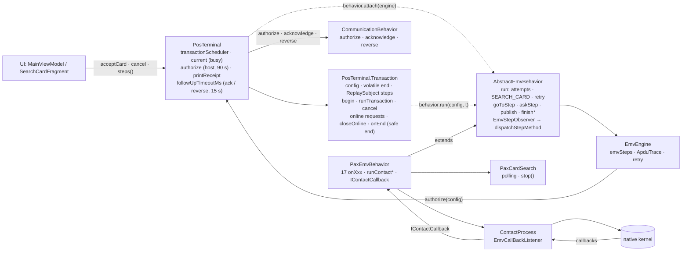

**`PosTerminal` هو الجهاز نفسه**: جهاز نقطة البيع الذي يستخدمه الكاشير أيًّا كان نوعه (PAX A920، Ingenico…). لكل جهاز الأجزاء نفسها، ولكل جزء field:

```java
// PosTerminal = the POS machine
protected final AbstractEmvBehavior   behavior;       // the card: EMV with the card (search + reader + kernel)
protected final CommunicationBehavior communication;  // HTTP to the bank / the facilitator
protected final PrinterBehavior       printer;        // the printer: the receipt
private   final Scheduler             transactionScheduler; // one sale at a time, one thread
```

| الجزء في الجهاز | في الكود | ماذا يفعل |
|---|---|---|
| البطاقة | `EmvBehavior` (`PaxEmvBehavior` على PAX) | يبحث عن البطاقة ويقرؤها، وينفّذ خطوات الـ EMV مع الـ kernel، ويجهّز الطلب للبنك |
| البنك | `CommunicationBehavior` (`SaleCommunicationBehavior`) | اتصال HTTP بالبنك أو الـ facilitator: `authorize` (sale / refund)، ثم مع النهاية `acknowledge` أو `reverse` |
| الطابعة | `PrinterBehavior` (`PaxPrinter`) | الإيصال، على thread مستقل وبالترتيب |
| الجهاز نفسه | `PosTerminal` | عملية واحدة في كل مرة (thread واحد، `current` = مشغول)، ويشغّل الـ EMV (`behavior.run`، والبحث بداخله)، ويربط الأجزاء معًا |

| الكلاس | ما يمثله في الواقع | مسؤول عن (وحده) | ممنوع عليه |
|---|---|---|---|
| `PosTerminal` | الجهاز | • عملية واحدة في كل مرة: thread واحد، و `current` = مشغول<br>• البنك: `authorize` (بحد أقصى 90 ثانية)، وتسمية كل طلب (`asyncRequestId`)<br>• النهاية الآمنة: التأكيد أو الإلغاء قبل أن يصبح متاحًا (15 ثانية)<br>• الطابعة | أي منطق EMV، والبحث عن البطاقة (من مهام الـ EMV) |
| `PosTerminal.Transaction` | العملية الواحدة (بيع / استرداد) | • حالتها: `end` (`null` = قيد التنفيذ)<br>• الخطوات التي تراها الشاشة (`ReplaySubject`، وهو أيضًا الـ lock)<br>• الإلغاء<br>• الطلبات المرسلة إلى البنك وردودها (`online`) | نشر أي شيء بعد انتهائها |
| `AbstractEmvBehavior` | التعامل مع البطاقة (المشترك بين الـ vendors) | • `run`: المحاولات، والبحث عن البطاقة (`SEARCH_CARD`)، وإعادة المحاولة<br>• الـ 17 خطوة (`onXxx`)، و `goToStep` (نقطة فحص الإلغاء الوحيدة)، و `askStep` / `answerStep`، و `publish`، و `finish*`<br>• field 55، والطلب إلى البنك (`authorizeOnline`)<br>• الـ engine: field من نوع `private`، لا يكتب فيه إلا `attach`، والجميع يقرؤه بـ `engine()` | الـ threads، حالة الانشغال، البنك مباشرة |
| `PaxEmvBehavior` | التعامل مع البطاقة على PAX | • الـ `onXxx`: استدعاء native لكل خطوة، `runContact*` / `runContactless*`<br>• ردود الـ kernel<br>• `onSearchCard` ← `PaxCardSearch`<br>• `PaxKernelSession tx` جديد في كل محاولة (في `onTerminalInitialization`) | أن يستدعيه أحد غير الـ dispatch |
| `EmvEngine` | شريط خطوات الـ EMV | • `emvSteps` (التشغيل والشريط العلوي)<br>• `ApduTrace`<br>• الطريق إلى البنك (`Authorizer` = `PosTerminal::authorize`)<br>يُنشأ في constructor الـ `PosTerminal` ويُسلَّم مرة واحدة: `behavior.attach(engine)` | أي حالة للعملية |
| `SaleCommunicationBehavior` | اتصال HTTP بالبنك / الـ facilitator | • exchange ← sale / refund (envelope)<br>• التأكيد / الإلغاء (JSON عادي، وheaders البيع)<br>• تصنيف الفشل: هل وصل إلى البنك أم لا (`classify`) | أن يقرر التأكيد أو الإلغاء (هذا قرار `PosTerminal`) |
| `PaxPrinter` | الطابعة | • طباعة الإيصال | — |
| `EmvEnhanceApp` | تشغيل التطبيق | • جهاز واحد (`PosTerminal`) طوال عمر التطبيق (`TerminalFactory.create`) | — |
| `PaxKernel` | الـ kernels الخاصة بـ PAX | • `EmvParamService params`، `ContactProcess contact` (جديد في كل محاولة)، `ClssProcess contactless`، `MagCardService mag` | — |
| `ContactProcess` | الغلاف حول الـ kernel | • من `EMVAppSelect` إلى `EMVCompleteTrans`<br>• `EmvCallBackListener`: يجب أن يرد بـ `setCallBackResult` في كل الحالات | واجهة المستخدم، انتظار شخص |

### 1.5 قواعد معمارية ثابتة

1. **واجهة المستخدم والـ core لا يعرفان PAX.** يُختار الـ vendor module بالـ flavor، و `TerminalFactory` هو المكان الوحيد الذي يظهر فيه اسم `PaxTerminal`.
2. **دوال `onXxx` من نوع protected ولا يستدعيها أحد مباشرة.** الطريق الوحيد: `goToStep` ← `emvSteps` ← `dispatchStepMethod` (§3)، وبذلك تظهر كل خطوة في الشاشة والـ APDU trace.
3. **الـ engine لا يعرف العملية**، والـ behavior يتعامل مع الـ `Transaction` التي تسلّمها في `run` (`publish`، `isRunning()`، `isCancelled()`).
4. **`EmvBehavior` = دورة حياة الـ EMV فقط:** `run`، `cancelCardSearch`، `dispose` (يتحقق منها `EmvBehaviorContractTest`). الـ engine (`attach` / `engine()`) خاص بـ `AbstractEmvBehavior`، ولذلك نوع `PosTerminal.behavior` هو `AbstractEmvBehavior`.
5. **الـ EMV يبلّغ، والـ `Transaction` تُنهي.** يعلن الـ EMV نتيجته بـ `finish*` فقط، و `Transaction.emvFinished` هي التي تضبط النهاية (§3.5). إذا نشر الـ behavior بنفسه APPROVED / DECLINED / خطوة نهاية عبر `publish` فإنها تُتجاهل.
6. **البحث عن البطاقة وإعادة المحاولة من مسؤولية الـ EMV** (كالـ Entry Point في EMV Book B): `SEARCH_CARD` هي إحدى خطوات الـ EMV، ولا تشغّل `onSearchCard` إلا حين ينشرها `run` نفسه؛ أي `SEARCH_CARD` تُنشر من داخل الـ EMV (مثل طلب الـ tap الثاني) تُعرض فقط ولا تبدأ بحثًا ثانيًا.

---

## 2. PosTerminal والعملية

### 2.1 مسؤوليات `PosTerminal`

| المسؤولية | أين |
|---|---|
| البدء / الانشغال | `startTransaction(config)`: `current.compareAndSet(null, t)` على الـ thread المستدعي (الـ main). إن كان مشغولًا تُرمى `TerminalBusyException` فورًا دون طابور. وإن كان متاحًا: `t.begin()` (TRANSACTION_STARTED) ثم يعيد `t` |
| thread واحد | `Executors.newSingleThreadExecutor()`: قارئ واحد و kernel واحد، ولا يُقاطَع أبدًا |
| العملية نفسها | `Transaction`: `begin()`، `publish(event)`، `dispatchTransactionStep` (§2.6)، `runTransaction`، `emvFinished`، `onOutcome`، `onEnd()` (النهاية الآمنة)، `cancel()`، `steps()` |
| الـ EMV كله (بما فيه البحث والإعادة) | `behavior.run(config, transaction)` — ليس من مسؤولية `PosTerminal` (§2.3، §2.5) |
| الـ host | `authorize(config)`: تنشر `ONLINE_REQUIRED` / `ONLINE_PROCESSING`، وتسمّي الطلب (`asyncRequestId` = UUID) وتسجّله على الـ `Transaction`، ثم `communication.authorize(sent).timeout(90 s).blockingGet()`، ثم `ONLINE_COMPLETED`. وعند الفشل تصنّفه `failureOf(e)`: `HostNotReachedException` (مباشرة أو كسبب) تعني `AuthResult.notSent`؛ وانتهاء المهلة أو أي استثناء آخر يعني `AuthResult.failed` (وكلاهما ليس رفضًا) |
| النهاية الآمنة | تقرر `Transaction.closeOnline()` التأكيد أو الإلغاء لكل طلب، ويُرسل الاستدعاء ويُنتظر على الـ transaction thread (ACKNOWLEDGING / REVERSING، بحد أقصى 15 ثانية) **قبل** أن يصبح الجهاز متاحًا (§2.7) |
| الطابعة | `printReceipt(lines)` على thread طباعة مستقل، بالترتيب |
| إعدادات الـ vendor | `serialNumber()`، `requiredPermissions()`، `countries()` / `setCountry()`، `emvParams()` (VENDOR.md §2) |

### 2.2 الـ `Transaction`: كل حالتها في مكان واحد

- `end` (`volatile`، ولا يُكتب إلا داخل الـ lock): `null` تعني قيد التنفيذ؛ وأول `COMPLETED` / `ERROR`، أو `CANCELLED` الناتجة عن الإلغاء، تعني أنها انتهت. `TransactionStep.isEnd()` = `COMPLETED || ERROR || CANCELLED`.
- `steps` (`ReplaySubject`): خطوات هذه العملية وحدها، فلا تعيد عملية جديدة عرض نتيجة سابقتها. يعيد كل الخطوات لأي مشترك متأخر (عند تدوير الشاشة)، ولا يكتمل أبدًا (النهاية خطوة عليه). كل مشترك محاط بـ `SafeObserver`: من يرمي استثناءً يُفصل وحده.
- **الـ lock** هو `steps` نفسه: كل نشر يمسكه، فلا يحدث `onNext` مرتين في وقت واحد، ولا تأتي `CANCELLING` بعد النهاية أبدًا.
- `publish(event)`: بعد النهاية تُتجاهل الخطوة مع ملاحظة في الـ trace. خطوة النهاية تُحفظ في `end` فقط (ولا تُنشر الآن). وغير ذلك: `deliver` (السجل + الـ trace + `onNext`) داخل الـ lock، ثم بعد الـ lock `dispatchTransactionStep`: تُنفَّذ دالة الخطوة فورًا وعلى الـ thread نفسه (بشكل متزامن كما في خطوات الـ EMV).

### 2.3 بداية العملية ونهايتها

منذ 28/10 (`9a911d1`، `8843cb1`، `9278c35`): الـ EMV يملك مساره من البداية، بما في ذلك البحث عن البطاقة (`SEARCH_CARD`) وإعادة المحاولة (كالـ Entry Point في EMV Book B)؛ وخطوات العملية تشغّل دوالها بشكل متزامن؛ ونهاية العملية آمنة (التأكيد أو الإلغاء قبل أن يصبح الجهاز متاحًا). لم يُجرَّب على الجهاز بعد.

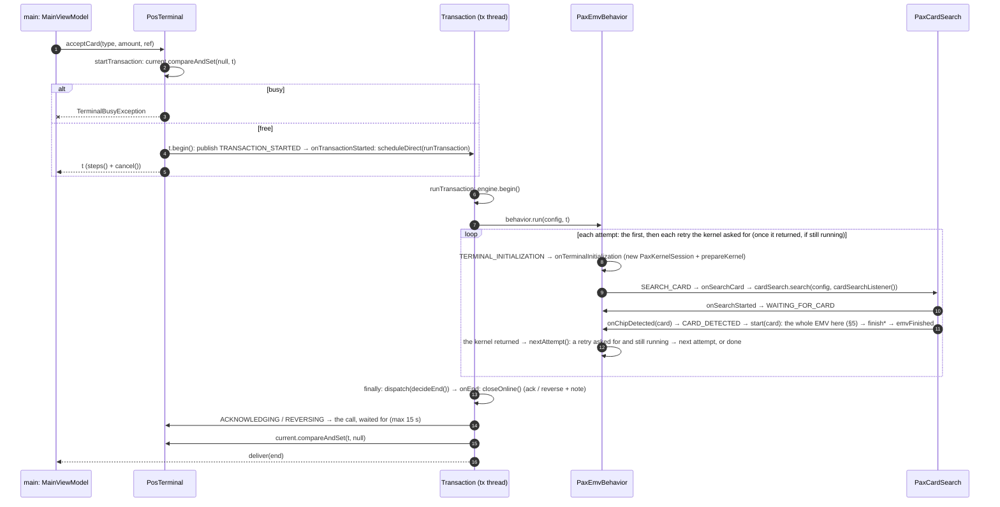

المسار نفسه موزعًا على الـ threads:

```text
[main]  AmountFragment → SearchCardFragment.onViewCreated → MainViewModel.acceptCard(type, amount, ref)
[main]  PosTerminal.acceptCard → startTransaction(new TransactionConfig(type, amount, ANY).withReferenceNumber)
          current.compareAndSet(null, t)   false → TerminalBusyException → getTerminalBusy()
          t.begin(): publish(TRANSACTION_STARTED)
                       → dispatchTransactionStep (synchronous, after the lock)
                       → onTransactionStarted: transactionScheduler.scheduleDirect(runTransaction)
                     → returns t at once (MainViewModel.transaction)
──────────────────────────────────────────────────────────────────────────────────
[tx]    runTransaction:
          engine.begin() (a new trace) + TRANSACTION_STARTED written into the new trace
          still running → behavior.run(config, this)        ← the whole EMV, retries included
          any exception → ERROR; in the finally, always → dispatch(decideEnd()) → onEnd()
[tx]    AbstractEmvBehavior.run — retry state reset (no retry pending, count 0), then attempt after attempt:
          prepare(config, t)   → TERMINAL_INITIALIZATION → onTerminalInitialization
                                  (PAX: a new PaxKernelSession + prepareKernel; failure → finishError)
          searchCard()         → SEARCH_CARD (prompt: the retry's own, or the entry mode's)
                                  → onSearchCard → the vendor's polling, blocking
               onSearchStarted → WAITING_FOR_CARD (+ retry prompt)
               onSearchRetry   → WAITING_FOR_CARD "tap again…" (same search; no second SEARCH_CARD)
               onChip/Contactless/Magstripe/ManualDetected → CARD_DETECTED → start(card):
                    first post-search step → the whole EMV, synchronous, here → finish* → emvFinished
               onSearchTimeout / onSearchCancelled / onReaderError → ERROR
               (a callback after its own transaction ended → ignored)
          nextAttempt()        → the retry requestRetry recorded, and still running (a plain if)
                                  → "RETRY #n" in the trace → next attempt;
                                  cancelled → "retry dropped — the transaction is over"
[tx]    decideEnd() [lock]: end == null → ERROR "Transaction ended without an outcome"
        dispatch(end) → onEnd() — the safe end, once:
          [lock] closeOnline() (§2.7)
          each ack / reverse in order: ACKNOWLEDGING / REVERSING delivered, then dispatched →
            onAcknowledging / onReversing: the call waited for (max 15 s)
          [lock] current.compareAndSet(this, null) ← terminal free; deliver(end), once
──────────────────────────────────────────────────────────────────────────────────
[main]  SearchCardFragment: transaction.steps() (observeOn main) → outcome / result panel
        MainViewModel: emvSteps (observeOn main) → banner; ApduTrace.changes() → trace
```

لماذا تُنشر النهاية بعد أن يصبح الجهاز متاحًا: الشاشة التي ترى `COMPLETED` تستطيع بدء العملية التالية فورًا دون `TerminalBusyException`، والـ host قد أُبلغ بالنتيجة قبل ذلك.

### 2.4 الإلغاء

```text
[main] Cancel / Back / onCleared → MainViewModel.cancel → transaction.cancel()
         [lock] end != null? → nothing (ended, a second cancel, or inside the safe end)
         [lock] end = CANCELLED; deliver(CANCELLING "Cancelling — finishing with the card")
         after the lock: dispatch(CANCELLING) → onCancelling → behavior.cancelCardSearch()
                                                  (PAX: PaxCardSearch.stop → ICardReaderHelper.stopPolling())
[tx]   isRunning() = false: the polling stops, and the EMV stops at its next goToStep (§3)
       the stage closes the readers (finishContactStage)
       a host call already sent is not cut: its answer or its timeout is waited for
       cancelled before runTransaction ran? → it still runs, behavior.run is not called → onEnd
       onEnd: (a reversal if a request was sent) → current = null, then CANCELLED is published, once
```

إذا أُلغيت العملية أثناء انتظار رد الـ host، تنتهي بـ CANCELLED حتى لو وافق الـ host وأعطت البطاقة TC، ويُرسل لذلك الطلب **reversal** (§2.7) قبل أن يصبح الجهاز متاحًا. ⚠ يُرسل الإلغاء مرة واحدة: إذا فشل يُسجَّل في الـ log والـ trace فقط، دون سجل محفوظ لإعادة الإرسال. ⚠ إلغاء يصل قبل أول `polling()` بلحظة قد يتأخر حتى 30 ثانية (BACKLOG 1.17).

### 2.5 إعادة المحاولة (fallback / try again / see phone / try another interface)

من مسؤولية الـ EMV (28/10): ينتهي الـ kernel بـ Outcome ويعود، ثم يبدأ الـ EMV من جديد من `SEARCH_CARD`، كما يفعل الـ Entry Point في EMV Book B. لا يوجد `startTransaction` جديد ولا خطوة خاصة بالعملية (أُزيلت `NEXT_ATTEMPT`). يطلب الـ behavior الإعادة من داخل الـ kernel عبر `requestRetry(config.withMode(X), prompt)` (دالة `protected` في `AbstractEmvBehavior`)؛ وعند عودة المحاولة بالكامل، تأخذ `AbstractEmvBehavior.run` الطلب عبر `nextAttempt()`، فإن كانت العملية ما زالت قائمة (شرط بسيط دون lock) تبدأ محاولة جديدة **على الـ thread نفسه وللعملية نفسها**: `TERMINAL_INITIALIZATION` ثم `SEARCH_CARD`. يستمر الـ trace بـ `RETRY #n` (ثم `ApduTrace.beginAttempt()`: أول GENERATE AC في المحاولة الجديدة يُسمّى 1st من جديد، والثاني `ISSUER AUTHENTICATION (2nd GENERATE AC)`)، وتظهر الرسالة في `SEARCH_CARD` وفي `WAITING_FOR_CARD` بالمفتاح `KEY_RETRY_PROMPT`. تُتجاهل إعادة المحاولة بعد الإلغاء ("retry dropped — the transaction is over").

| النتيجة | طريقة الإدخال الجديدة | الرسالة |
|---|---|---|
| `fallback()` (contact) | `MAGSTRIPE` | Chip not readable — swipe the card |
| `tryAnotherInterface()` | `CHIP` | Insert the card |
| `tryAgain()` | الطريقة نفسها | Card not read — tap again… |
| `seePhone()` | `CONTACTLESS` | See phone — verify on your phone, then tap again |

تشترك `seePhone` و `tryAgain` (ومعهما `markTryAgainOnCommunicationError` التي تطلب `tryAgain`) في الحد `MAX_TAP_RETRIES = 3` على `retryCount()`، وبعده يكون الرفض.
حالة الإعادة كلها (الـ config التالي، الرسالة، العدد) في `AbstractEmvBehavior` منذ `962eac7`، فكاتبها وقارئها هو الـ EMV نفسه؛ وتُصفَّر في بداية `run` لكل عملية.

### 2.6 خطوات العملية (TransactionSteps) ومن ينشرها

`IDLE → TRANSACTION_STARTED → WAITING_FOR_CARD (مرة أخرى مع كل إعادة) → CARD_DETECTED → APPLICATION_SELECTED → CARD_READ → CARDHOLDER_VERIFIED → ONLINE_REQUIRED → ONLINE_PROCESSING → ONLINE_COMPLETED → APPROVED|DECLINED → (ACKNOWLEDGING|REVERSING) → COMPLETED`، أو `ERROR` في أي لحظة، أو `CANCELLING` ثم `CANCELLED`.

الخطوات التي تشغّل دالة (`dispatchTransactionStep`، بشكل متزامن على الـ thread الذي نشرها، كما تفعل خطوات الـ EMV):

```java
switch (event.getStep()) {
    case TRANSACTION_STARTED:            onTransactionStarted(event); // the transaction goes to its thread
    case CANCELLING:                     onCancelling();              // the card search stops
    case ACKNOWLEDGING:                  onAcknowledging(event);      // the host is told the sale is done
    case REVERSING:                      onReversing(event);          // the host reverses a request
    case APPROVED: case DECLINED:        onOutcome(event);            // the card's outcome decides the end
    case COMPLETED: case ERROR: case CANCELLED: onEnd();              // the safe end
    default: // a report for the screen
}
```

- الخطوة العادية تُسلَّم أولًا (داخل الـ lock) ثم تُشغَّل دالتها خارج الـ lock.
- **استثناءان تسلّمهما دالتهما بنفسها:** النتيجة (`onOutcome` تسلّم APPROVED / DECLINED وتضبط النهاية COMPLETED في مسكة واحدة للـ lock، فلا يقع إلغاء بينهما)، والنهاية (`onEnd` تسلّمها بعد أن يصبح الجهاز متاحًا).
- خطوة النهاية لا يرسلها إلى الـ dispatch إلا الـ `finally` الخاص بـ `runTransaction` (عبر `decideEnd()`)؛ أما `publish` لخطوة نهاية فيحفظها في `end` فقط.
- `ONLINE_*` تبقى تقارير: هي داخل `authorize` التي تعيد الرد مباشرة إلى الـ kernel من أجل الـ 2nd GENERATE AC (§5.5)، ودالة خطوة لا تعيد قيمة.

| الخطوة | من ينشرها |
|---|---|
| TRANSACTION_STARTED | `Transaction.begin` (مرة واحدة، حتى مع الإعادات)، وهي التي تنقل العملية إلى الـ thread الخاص بها |
| WAITING_FOR_CARD | `CardSearchReporter.onSearchStarted` / `onSearchRetry` (`AbstractEmvBehavior`)، و `PaxEmvBehavior.onDetect2ndTap` |
| CARD_DETECTED | `CardSearchReporter.cardFound` |
| APPLICATION_SELECTED | `answerApplicationSelection` (contact)، `onReadCardOk` (contactless) |
| CARD_READ | contact: `showConfirmCard`؛ contactless: `confirmCard`؛ mag/manual: `onReadApplicationData` |
| CARDHOLDER_VERIFIED | `enterPin` (`KEY_ONLINE_PIN`، `KEY_PIN_BYPASS`، `KEY_PIN_TRIES_LEFT`) |
| ONLINE_REQUIRED / PROCESSING / COMPLETED | `PosTerminal.authorize`، حول استدعاء الـ host |
| APPROVED / DECLINED + COMPLETED | `Transaction.emvFinished` ← `publish` ← `onOutcome`، حين يبلّغ الـ EMV عبر `reportOutcome` ← `finishApproved/Declined(event)` (PAN/TVR/TAC/IAC/field 55)، أو `finishApproved/Declined(String)` (mag/manual) |
| ACKNOWLEDGING / REVERSING | `Transaction.onEnd` (من قائمة `closeOnline`)، بعد تحديد النهاية وقبل أن يصبح الجهاز متاحًا؛ كل خطوة تحمل `KEY_REQUEST_ID` (§2.7) |
| ERROR | الـ EMV: `finishError` ← `Transaction.emvFinished`؛ البحث: `CardSearchReporter` (انتهاء المهلة، القارئ، الإلغاء)؛ الجهاز: `PosTerminal.errorEvent` (استثناء في `runTransaction`) |
| CANCELLING / CANCELLED | `Transaction.cancel()` |

تُضبط النتيجة والنهاية معًا في `onOutcome` (داخل الـ lock): إلغاء يسبقها يجعل النتيجة تُتجاهل فلا ترى الشاشة إلا CANCELLED (ومع الـ host: إلغاء إن كان قد وافق، §2.7)؛ وإلغاء بعدها لا يفعل شيئًا. (كانت ⚠ "APPROVED ثم CANCELLED" قائمة حتى `28d79cb`.)

### 2.7 النهاية الآمنة: التأكيد أو الإلغاء عند الـ host

يجب إغلاق كل طلب أُرسل إلى الـ host عند انتهاء العملية: إما **acknowledgement** (العملية اكتملت ويحتفظ بها الـ host) أو **reversal** (يلغيها الـ host). الواجهة هي نفسها في التطبيق القديم: `orchestration/acknowledgement` و `orchestration/reverse`، والـ body هو `{asyncRequestId, transactionType}` (`PURCHASE` / `REFUND`)، بصيغة JSON عادية دون exchange ولا envelope، وبـ headers البيع نفسها (الـ token و `mToken`). أي حالة غير 200 تُعد خطأ.

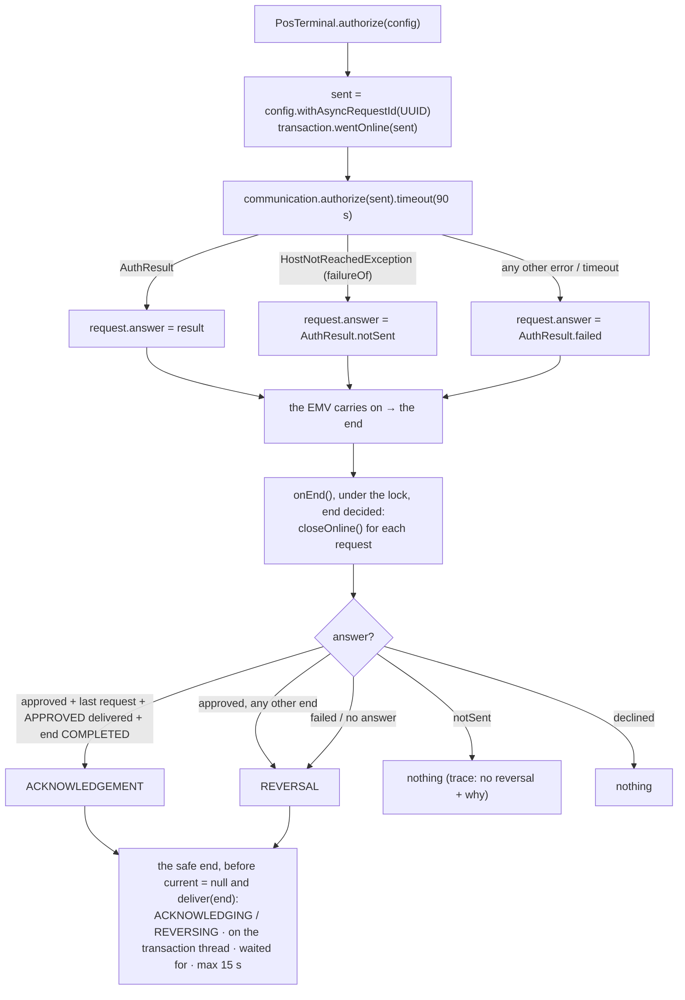

| الحالة | ما يُرسل | السبب |
|---|---|---|
| وافق الـ host، ونشرت العملية APPROVED وانتهت بـ COMPLETED، وهذا آخر طلب | acknowledge | اكتملت العملية |
| وافق الـ host لكن النهاية مختلفة: أعطت البطاقة AAC في الـ 2nd GENERATE AC، أو إلغاء، أو خطأ | reverse | الـ host يعتبرها مقبولة والبطاقة / الجهاز لا |
| طلب قديم تلاه طلب آخر في العملية نفسها | reverse | الأخير وحده يمكن تأكيده |
| أُرسل ولم يأتِ رد صالح: انتهاء المهلة، انقطاع الاتصال، 5xx، أي 4xx غير 401/403، envelope تالف | reverse | ربما وافق الـ host |
| `notSent`: من المستحيل أن يكون الـ host قد وافق | لا شيء | انظر أدناه |
| رفض الـ host (declined) | لا شيء | لا شيء يُلغى |
| لم تتصل العملية بالـ host | لا شيء | لا يوجد طلب |

**`notSent`** (`HostNotReachedException` ← `AuthResult.notSent`، وكل من `isFailed()` و `isNotSent()` صحيحة؛ تُعرف في `PosTerminal.failureOf` سواء جاء الاستثناء مباشرة أو كسبب): لا يقررها إلا الـ network، والافتراضي هو الإلغاء:

| مكان الفشل (`SaleCommunicationBehavior`) | النتيجة |
|---|---|
| لم يُرسل: CASH_IN، استرداد بلا مرجع، لا EMV result / public key / access token، فشل التشفير (RSA / AES) | notSent |
| `Token refresh: …` | notSent |
| `Exchange: …` — أي فشل في الـ exchange (`exchangeError`) | notSent: لم يُرسل البيع |
| `Sale:` / `Refund:` HTTP 401/403، أو حالة 401/403 داخل الـ envelope (token / صلاحيات) | notSent |
| `Sale:` / `Refund:` `ConnectException` / `UnknownHostException` | notSent |
| `Sale:` / `Refund:` أي شيء آخر (`classify` ← `SaleException`) | failed ← reverse |
| مهلة الـ 90 ثانية في `PosTerminal` | failed ← reverse (لا نعرف أين توقف) |

يظهر اسم المرحلة في رسالة الـ ERROR وفي الـ trace: `Online Failed: Exchange: HTTP 403 Forbidden`. الـ trace (الوسم `HOST`):

```text
!!! HOST ACKNOWLEDGEMENT for request <id>
!!! HOST REVERSAL for request <id>: approved, not completed
!!! HOST REVERSAL for request <id>: no usable host answer — Sale: timeout
!!! HOST no reversal for request <id>: the host could not have approved it — Exchange: HTTP 403 Forbidden
!!! HOST Acknowledgement <id> sent        /   Reversal <id> failed — not retried: …
```

- لا يتغير شيء بالنسبة للبطاقة: `failed` و `notSent` كلاهما `RESULT_ONLINE_FAILED` (2nd GENERATE AC بـ AAC). الفرق في الإلغاء فقط.
- الاستدعاء (`9278c35`، النهاية الآمنة؛ خطوات لها دوال منذ `7403d1e`): تُسلَّم الخطوة `ACKNOWLEDGING` / `REVERSING` (وتحمل `asyncRequestId` في `KEY_REQUEST_ID`)، ثم تشغّل `onAcknowledging` / `onReversing` الاستدعاء `Completable.defer(() -> communication.acknowledge/reverse(sent))` على الـ transaction thread، مع `timeout(followUpTimeoutMs())` = 15 ثانية و `blockingAwait`. يبقى الجهاز مشغولًا حتى ينتهي، فترى الشاشة `APPROVED ← ACKNOWLEDGING ← COMPLETED`، وأي محاولة بيع في أثناء ذلك تُرفض بـ `TerminalBusyException`. تُسجَّل النتيجة في `EmvLog` وفي الـ trace. (حتى `9278c35` كان الإرسال على `followUpScheduler` مستقل، بعد أن يصبح الجهاز متاحًا، بمهلة 90 ثانية ودون انتظار.)
- لـ `CommunicationBehavior.acknowledge` / `reverse` قيمة افتراضية `Completable.complete()`، فلا يتأثر أي host لا ينفّذهما. ولا يرسل `SaleCommunicationBehavior` شيئًا لطلب بلا اسم أو لم يُرسل أصلًا (`whyNotSent`).
- ⚠ لا يوجد سجل محفوظ (حفظ وإعادة إرسال بعد إعادة التشغيل). إلغاء فاشل يُسجَّل في الـ trace فقط، وعلى الـ host أن يلغي العملية بنفسه حين لا يصله تأكيد (BACKLOG 0.15).
- ⚠ لم يُجرَّب على الجهاز ولا مع الـ host. احتياج الإلغاء والتأكيد إلى `mToken` افتراض ("headers البيع نفسها").
- الاختبارات: `PosTerminalHostFollowUpTest` (كل صف في الجدولين، والنهاية الآمنة)، `ReverseAcknowledgementTest`، `OnlineFailureClassifyTest`.

---

## 3. EmvEngine وتشغيل الخطوات: من goToStep إلى onXxx

### 3.1 نوعان من الأحداث

| | `TransactionStep` | `EmvStep` |
|---|---|---|
| لمن | منطق العمل / واجهة المستخدم | مهندس الـ EMV / الشريط العلوي / الـ trace، **والتشغيل** |
| مكانها | `Transaction.steps()` (واحد لكل عملية) | `EmvEngine.emvSteps` (واحد للجهاز) |
| الـ subject | `ReplaySubject`، كل نشر داخل الـ lock، وكل مشترك `SafeObserver` | `PublishSubject` **غير serialized** ودون `observeOn` |
| إعادة العرض للمتأخر؟ | نعم، كل خطوات العملية | لا |
| تشغّل كودًا؟ | الخطوات التي تقود العملية (البداية، الإلغاء، التأكيد / الإلغاء عند الـ host، النتيجة، النهاية — §2.6)، بشكل متزامن؛ والباقي تقارير | **نعم**، كل خطوة تشغّل دالة `onXxx` الخاصة بها |
| بعد النهاية | تُتجاهل مع ملاحظة | لا تُنشر (`enterStep` يتحقق من `isRunning()`) |

### 3.2 `EmvEngine`: ناقل الخطوات فقط

- `notifyEmvStep(step, detail)`: `apduTrace.kernelStep(...)` ثم `emvSteps.onNext(event)`، ويتلقاها كل مشترك قبل أن تعود.
- `begin()`: `apduTrace.beginTransaction()` (trace جديد لكل عملية).
- لا يحمل حالة إعادة المحاولة: انتقلت إلى `AbstractEmvBehavior` (`requestRetry` / `retryCount()`، §2.5) في `962eac7`.
- `authorize(config)` ← الـ `Authorizer` الذي أعطاه إياه `PosTerminal` (`PosTerminal::authorize`).
- لا يحتوي على `isRunning` ولا على أي حالة للعملية: سؤال "هل يمكن نشر هذه الخطوة؟" يُطرح على الـ `Transaction` قبل `notifyEmvStep`.

### 3.3 ماذا تفعل `goToStep` بالضبط

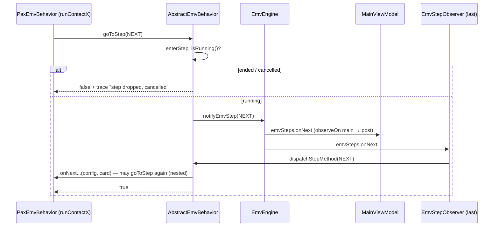

```text
vendor code: goToStep(EmvStep.X, detail)
  └─ AbstractEmvBehavior.goToStep
       ├─ step == null → unknownStep → finishError (once)
       ├─ activeConfig == null → false
       └─ enterStep(X, detail)
            ├─ !isRunning() → dropped ("step dropped, cancelled" / "the transaction has ended") → false
            └─ engine.notifyEmvStep(X, detail)
                 ├─ apduTrace.kernelStep(...)
                 └─ emvSteps.onNext(event)                  ← synchronous, same thread
                      ├─ MainViewModel (observeOn main → banner) — post only
                      └─ EmvStepObserver (last subscriber)
                           └─ dispatchStepMethod(X) → onX(activeConfig, activeCard)
                                └─ may goToStep(Y) inside → re-entrant, Y finishes before X returns
                           exception inside onX → finishError(message)
  ← goToStep returns true once onX (and everything it called) has finished
```

لماذا هكذا:
- **متزامن، بلا `observeOn` / `subscribeOn`**: يستدعي الـ kernel الـ callback وينتظر قيمة؛ فيجب أن تنتهي الخطوة قبل أن يعود الـ callback (§4). والخطوة تنفّذ APDU / PIN / اتصالًا بالـ host، أي أنها blocking.
- **يُستدعى `initEmvObserver()` في بداية كل محاولة** (`prepare` داخل حلقة `run`) ليشترك `EmvStepObserver` ويبقى **آخر** مشترك. لو لم يكن الأخير لرأى المشتركون بعده الخطوة التالية قبل الحالية (لأن التالية تُنشر من داخل الحالية). والتطبيق يشترك في `emvSteps` قبل العملية لا أثناء البحث. ⚠ مشترك يُضاف أثناء البحث سيرى الخطوات المتداخلة بترتيب خاطئ.
- **تعيد `goToStep` القيمة `false` بعد الإلغاء**: المرحلة التي تمسك بمورد (قارئ الـ ICC) تحرره بنفسها (`advanceContactStage` ← `finishContactStage`).
- **`SEARCH_CARD` حالة خاصة:** لا تشغّل `onSearchCard` (البحث الفعلي) إلا حين تنشرها `searchCard()` في حلقة `run`. أي `SEARCH_CARD` تُنشر من داخل الـ EMV (مثل `onDetect2ndTap`) تظهر في الشريط العلوي والـ trace فقط، مع ملاحظة "shown, no second search"، ولا تبدأ بحثًا ثانيًا داخل الأول.

### 3.4 لماذا يجب أن يبقى التشغيل متزامنًا (بلا `observeOn` وبلا serialize)

تعني `observeOn(X)` أن يوضع `onNext` في طابور ويُنفَّذ لاحقًا على thread آخر، وأن تعود `goToStep` فورًا. لو طُبّق ذلك على `EmvStepObserver` لعملت `onXxx` خارج الـ transaction thread. مثال الـ PIN:

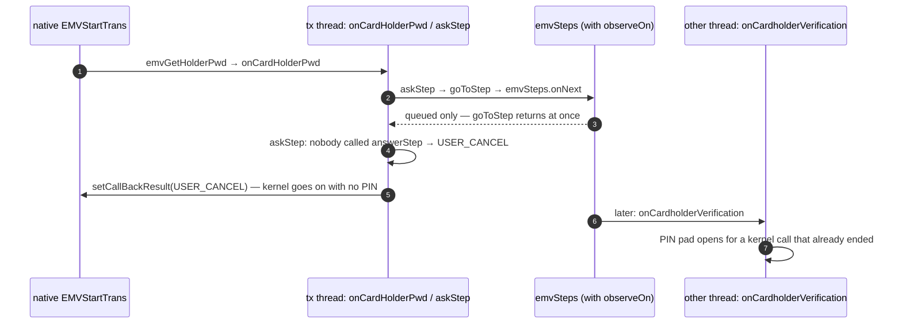

```text
[tx]  native EMVStartTrans → emvGetHolderPwd → onCardHolderPwd → askStep(CARDHOLDER_VERIFICATION)
[tx]    goToStep → emvSteps.onNext → (observeOn) the step is only queued, goToStep returned
[tx]    askStep: nobody called answerStep → returns USER_CANCEL
[tx]  setCallBackResult(USER_CANCEL) → the kernel carries on without a PIN
[io]  later: onCardholderVerification opens the PIN pad for a kernel call that has already ended
```

| لو استخدمنا | ما الذي سيحدث | السبب |
|---|---|---|
| `observeOn` على الـ observer | تعيد `askStep` القيمة `USER_CANCEL` قبل أن تُفتح شاشة الـ PIN أو نافذة الاختيار | تعمل الخطوة بعد عودة `goToStep`، فلا يكون أحد قد أجاب في تلك اللحظة |
| `observeOn` على الـ observer | تداخل على الـ kernel: تستدعي `onXxx` دالة native (`EMVReadAppData`، `EMVCardAuth`) بينما الـ transaction thread ما زال داخل استدعاء native آخر، أو تغلق القارئات في `finishContactStage` | الـ kernel الخاص بـ PAX والقارئ ليسا thread-safe: يجب أن يجري كل شيء على thread واحد وبالترتيب |
| `observeOn` على الـ observer | يختل الترتيب: يكمل `runContactAppSelect` على افتراض أن القراءة انتهت ونتيجتها في `tx.transResult`، وهي لم تنتهِ بعد | كل مرحلة تقرأ نتيجة سابقتها بعد عودة `goToStep` |
| `emvSteps.toSerialized()` | لا تعمل الخطوة التالية داخل الحالية، بل توضع في طابور حتى ينتهي `onNext` الحالي | كل `onXxx` تستدعي `goToStep(NEXT)` من داخل `onNext`، والـ serialize يؤجّل الاستدعاء المتداخل، فتعيد `askStep` قيمة الأمان وتجد المرحلة النتيجة ناقصة |

بدونهما يصبح التشغيل مثل استدعاء دالة عادي: `goToStep` ← `onNext` ← `onXxx`، كله على الـ transaction thread، وينتهي قبل أن تعود `goToStep`.
**لا مانع أن تستخدم واجهة المستخدم `observeOn(main)`** (`MainViewModel` على `emvSteps`) لأنها تعرض الشريط العلوي فقط، ولا تشغّل EMV، ولا ينتظر أحد ردًا منها. هذا الشرط خاص بـ `EmvStepObserver` وحده.

### 3.5 كيف تنتهي العملية

**الـ EMV يبلّغ، والـ `Transaction` تُنهي** (`28d79cb`):

```text
EMV  (AbstractEmvBehavior)                         Transaction
finishApproved / finishDeclined / finishError  ──► emvFinished(outcome) → publish(...)
                                                     APPROVED / DECLINED → dispatch → onOutcome [lock]:
                                                         end != null (a cancel came first) → dropped + note
                                                         otherwise → delivered, end = COMPLETED
                                                     ERROR         → publish: end = ERROR (dropped if ended)
                                                     anything else → publish(ERROR "EMV finished with no outcome")
```

لا تقلب قرار البطاقة أبدًا (الرفض لا يصبح موافقة). وهذا هو المكان الذي سيُتخذ فيه قرار Mastercard single tap (يطلب الـ host PIN بعد انتهاء الـ EMV — BACKLOG 4.11).

| المصدر | ماذا يحدث |
|---|---|
| `finishApproved/Declined(String)` (mag/manual) | ← `emvFinished` ← `onOutcome`: APPROVED/DECLINED ثم COMPLETED |
| `finishWithOutcome(step, detail, msg)` (chip / contactless) | `tx.outcome` ← `goToStep(TRANSACTION_COMPLETION)` ← `onTransactionCompletion` ← `reportOutcome` ← `finishApproved/Declined(event)` ← `emvFinished` |
| `finishError(msg)` | ← `emvFinished`: ERROR |
| استثناء داخل أي `onXxx` | يلتقطه `EmvStepObserver.onNext` ← `finishError` |
| `publish(APPROVED / DECLINED / خطوة نهاية)` من الـ behavior | تُتجاهل مع ملاحظة في الـ trace: النهاية لـ `finish*` وحدها |
| `Transaction.cancel()` | `end = CANCELLED` + CANCELLING ← `onCancelling` ← `behavior.cancelCardSearch()` |
| انتهى البحث أو الـ EMV دون نتيجة | `decideEnd` (في `finally` الخاص بـ `runTransaction`): ERROR "Transaction ended without an outcome" |

أول نهاية تُحفظ في `Transaction.end`، وأي خطوة بعدها تُتجاهل (خطوات الـ EMV وخطوات العملية معًا)، وتُسلَّم النهاية مرة واحدة من `onEnd`.

### 3.6 جدول الخطوات الـ 17 في PAX

| # | EmvStep | من ينشرها | Contact (ماذا تفعل `onXxx`) | Contactless granular (EFT/PayPass/PayWave) | Contactless atomic | Mag / Manual |
|---|---|---|---|---|---|---|
| 0 | TERMINAL_INITIALIZATION | `AbstractEmvBehavior.prepare` (بداية كل محاولة) | `PaxKernelSession` جديد + `prepareKernel` | = | = | = (تعيد true مبكرًا) |
| 1 | SEARCH_CARD | `AbstractEmvBehavior.searchCard` (بعد التهيئة، ومرة أخرى مع كل إعادة)؛ و `onDetect2ndTap` (للعرض فقط) | `PaxCardSearch.search` (الـ polling) | = | = | = |
| 2 | APPLICATION_SELECTION | `start(card)` ← `firstStepAfterSearch` | `runContactAppSelect` | `runContactlessAppSelect` | = | لا تُستدعى |
| 3 | WAIT_APPLICATION_SELECTION | `onWaitAppSelect(first)` ← askStep | `answerApplicationSelection` | = (نادرًا) | = | — |
| 4 | FINAL_APPLICATION_SELECTION | `onWaitAppSelect(retry)` ← askStep | `answerApplicationSelection` | = | = | — |
| 5 | READ_APPLICATION_DATA | contact: بعد 2؛ granular: بعد 6؛ atomic: `onReadCardOk`؛ mag: `start(card)` | `runContactReadAppData` | `runContactlessReadAppData` | فارغة | `CARD_READ` ← `START_ONLINE_PROCESS` |
| 6 | SET_TRANSACTION_DATA | contact: بعد 5؛ granular: بعد 2؛ atomic: `confirmCard` | `runContactSetTransactionData` | `runContactlessSetTransactionData` | فارغة | — |
| 7 | OFFLINE_DATA_AUTHENTICATION | بعد 6 (contact)، بعد 5 (granular)، بعد 8 (PayWave) | `runContactCardAuth` | `runContactlessCardAuth` | لا تُنشر | — |
| 8 | PROCESS_RESTRICTIONS | بعد 7؛ PayWave بعد 5؛ atomic بعد 2 | `runContactStartTransaction` (EMVStartTrans) | `runContactlessProcessRestrictions` | ← `runContactlessStartTransaction` | — |
| 9 | CARDHOLDER_VERIFICATION | `onCardHolderPwd` (online: askStep؛ offline: goToStep) | online: `enterPin` + الرد | online PIN بعد الاستدعاء الواحد | = | — |
| 10 | OFFLINE_PIN_VERIFICATION | `onCardHolderPwd(offline)` ← askStep | `enterPin` (الشاشة فقط، والـ kernel يتحقق) | غير مدعومة | — | — |
| 11 | TERMINAL_RISK_MANAGEMENT | **لا تُنشر في PAX** | فارغة (داخل EMVStartTrans) | فارغة | فارغة | — |
| 12 | TERMINAL_ACTION_ANALYSIS | **لا تُنشر في PAX** | فارغة | فارغة | فارغة | — |
| 13 | START_ONLINE_PROCESS | `startOnlineProcess()` (الوحيد للـ chip / contactless)؛ mag: من 5 | `authorizeOnline()` | = | = | `authorizeOnline()` ← 16 |
| 14 | ISSUER_AUTHENTICATION | `runIssuerAuthentication` | `EMVCompleteTrans` (2nd GAC) إن وُجد `tx.issuerResponse` | الـ tap الثاني + `completeTransProcess` | = | — |
| 15 | SCRIPT_PROCESSING | `runIssuerScriptProcessing` (الـ tap الثاني)؛ `completeApproved` (إعلان) | فارغة (تمت داخل EMVCompleteTrans) | `processIssuerScripts` | = | — |
| 16 | TRANSACTION_COMPLETION | `finishWithOutcome`؛ mag: من 13 | `reportOutcome(tx.outcome)` | = | = | `finishApproved/Declined` |

> "فارغة" = جسم الدالة تعليق يذكر أن الـ kernel قام بالعمل، وليست نسخة ناقصة. كل دوال `onXxx` الـ 17 abstract (بما فيها `onSearchCard`)، فإن نسي vendor مرحلة يحصل على خطأ ترجمة لا على دالة فارغة صامتة.
> ⚠ ليس للـ 1st GAC خطوة مستقلة (هو داخل `EMVStartTrans`).

---

## 4. ردود الـ kernel و askStep

### 4.1 ثلاث طبقات

حين يكون الـ native kernel داخل `EMVAppSelect` أو `EMVStartTrans` فإنه يتوقف وينتظر ردًا على callback. ويجب أن يعود الرد عبر `setCallBackResult` في **كل** المسارات، وإلا بقي الـ kernel ينتظر.

| الطبقة | المكان | ما تفعله |
|---|---|---|
| الـ native callback | `ContactProcess.EmvCallBackListener` (ينفّذ `EMVCallback.EmvCallbackListener`، ويُسجَّل في `setEmvAndMCKParam` داخل `preTransProcess`) | تحوّل البيانات (`EMV_APPLIST[]` ← `CandidateAID`)، وتستدعي الـ `IContactCallback`، وترد بـ `emvCallback.setCallBackResult(...)`. إن رمى الـ listener استثناءً فالرد `EMV_USER_CANCEL`؛ وإن لم يوجد listener فالرد `EMV_DATA_ERR` |
| المحوّل الرفيع | `PaxEmvBehavior` بصفته `IContactCallback`: `onWaitAppSelect`، `onCardHolderPwd`، `showConfirmCard`. يُسجَّل مرة واحدة في `runContactAppSelect` (`registerEmvProcessListener(this)`) ويُلغى مرة واحدة في `finishContactStage` (`ca1b16a`) | لا واجهة مستخدم فيه. يضع الطلب في `tx` (`tx.candidates`، `tx.pinRequest`) ثم يسأل الخطوة: `askStep(step, detail, USER_CANCEL)` |
| دالة الخطوة | `onWaitApplicationSelection` / `onFinalApplicationSelection`، `onCardholderVerification`، `onOfflinePinVerification` | العمل الفعلي (نافذة الاختيار، لوحة الـ PIN) ثم `answerStep(value)` |

### 4.2 `askStep` / `answerStep`

```java
// callback (adapter)
return askStep(EmvStep.CARDHOLDER_VERIFICATION, "online PIN", USER_CANCEL /* failClosed */);

// step method
protected void onCardholderVerification(...) { answerStep(enterPin(tx.pinRequest)); }
```

- `askStep` يضع مكانًا للرد (`StepAnswer`) في stack، فيدعم التداخل، ثم يستدعي `goToStep`، ويعيد ما وضعته `answerStep`.
- إن لم يُجب أحد (إلغاء، أو انتهاء العملية، أو استثناء، أو نسيان `answerStep`)، أو جاء الرد بعد النهاية، تعيد **`failClosed`** وتكتب `no answer for …` في الـ trace. **لا ينتظر الـ kernel إلى الأبد أبدًا.**
- تعمل فقط لأن الخطوة تنتهي قبل أن تعود `goToStep` (§3.3).
- `answerStep` دون `askStep` لا تفعل شيئًا.

**لماذا نحتاجها والعملية تعمل بدونها؟** (نوقش 28/10) في المسار الطبيعي (أُدخل الـ PIN صحيحًا) لا فرق. فائدتها في الحالات السيئة: يتوقف الـ kernel في لحظات معيّنة **منتظرًا شخصًا** (الـ PIN، اختيار التطبيق)، و `askStep` هي المكان الوحيد الذي يضمن أن يأخذ ردًا صحيحًا مهما حدث:

```text
the kernel: "give me the PIN" (stopped, waiting for a number)
   └─ askStep
        ├─ the PIN was entered                          → CONTACT_OK  → goes on
        ├─ cancel while the cardholder types             → USER_CANCEL → the kernel stops cleanly
        ├─ no answer / exception / the transaction ended → USER_CANCEL → never waits forever
        └─ never: "approve" with no answer
```

الرسم نفسه خطوة بخطوة (offline PIN):

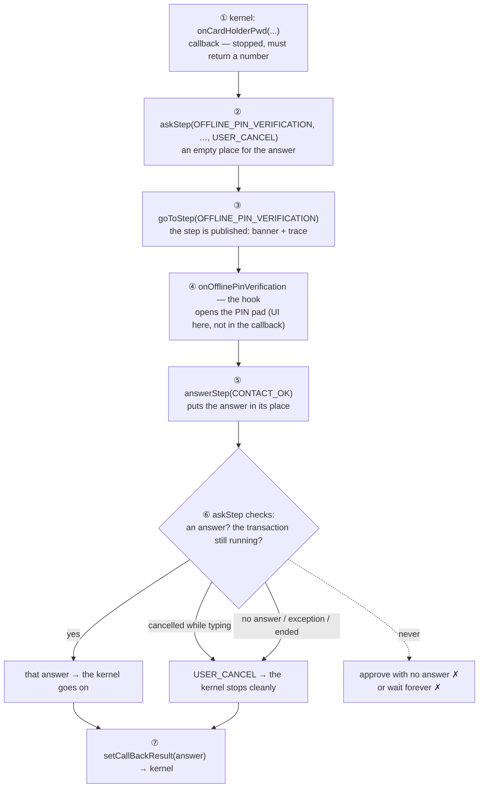

ما تقدّمه:
1. **نقطة تفتيش للإيقاف:** ليست هي التي توقف العملية (الإلغاء يفعل ذلك)، لكنها حين يسأل الـ kernel بعد الإلغاء تجيبه "إلغاء" فورًا. بدونها قد يعيد الـ callback ردًا قديمًا بعد الإلغاء، أو يبقى منتظرًا.
2. **الإغلاق الآمن مضمون** (القاعدة 4): كل مسار خاطئ ينتهي بـ `USER_CANCEL`، في مكان واحد بدل أن يكرره كل callback.
3. **الوضوح:** الخطوة (`CARDHOLDER_VERIFICATION`) تظهر في الشريط العلوي والـ trace، فيُعرف أين توقف الـ kernel ولماذا.

حدودها: لا تغلق شاشة الـ PIN نفسها؛ فعند الإلغاء والشاشة مفتوحة تبقى حتى يُدخل حامل البطاقة الرقم أو تنتهي مهلتها، ثم يكون الرد `USER_CANCEL`. ولا تستطيع إيقاف استدعاء native أثناء تنفيذه: الإيقاف يحدث **بين** الخطوات فقط.

**الخلاصة:** ليست ضرورية لكي تعمل العملية، بل لكي **تتوقف بشكل صحيح**، وهذا ما يهم حين يتعلق الأمر بالمال. ولا يمكن تبسيطها كثيرًا: لكل جزء فيها (`goToStep`، مكان الرد، `failClosed`، فحص "ما زالت قائمة؟"، التداخل المغطى باختبار) سبب. والبديل الأبسط الوحيد أن يفتح الـ callback لوحة الـ PIN بنفسه، وهذا يخالف القاعدتين 1 و 3.

### 4.3 مثال: online PIN (contact)

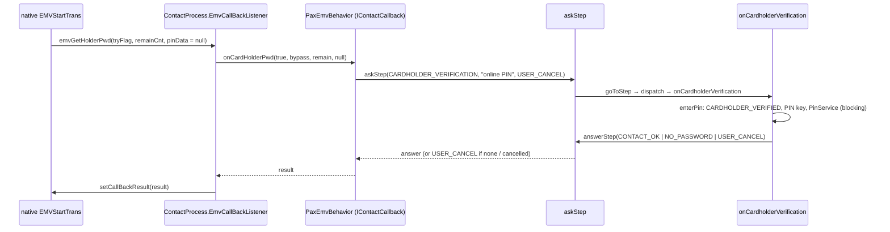

```text
[tx] runContactStartTransaction → startContactTransProcess → kernel.contact.startTransProcess()
       → EMVCallback.EMVStartTrans (native)
       the native call needs a PIN → EmvCallBackListener.emvGetHolderPwd
         → emvProcessListener.onCardHolderPwd(true, bypass, remain, null)   ← PaxEmvBehavior
              tx.pinRequest = new PinRequest(...)
              if online:  askStep(CARDHOLDER_VERIFICATION, "online PIN", USER_CANCEL)
              else:       goToStep(CARDHOLDER_VERIFICATION, "PIN"); askStep(OFFLINE_PIN_VERIFICATION, …)
                → goToStep → emvSteps → onCardholderVerification
                     → enterPin(request): CARDHOLDER_VERIFIED, provisionOnlinePinKey,
                       PaxPinPad + PinService.getEncryptedPinData (blocking)
                     → answerStep(CONTACT_OK | NO_PASSWORD | USER_CANCEL)
              ← the answer   (finally: tx.pinRequest = null)
         ← emvCallback.setCallBackResult(result)
       the native call goes on: CVM → TRM → TAA → 1st GAC
```

- **Offline PIN:** `onCardHolderPwd` فيها فرعان صريحان (if / else، `cebe400`). في الـ offline تُعلَن `goToStep(CARDHOLDER_VERIFICATION, "PIN")` فقط، ثم `askStep(OFFLINE_PIN_VERIFICATION)`؛ تفتح اللوحة فقط، والـ kernel هو الذي يتحقق من الرقم مع البطاقة. أما الطلب الثاني للـ PIN (`pinData[0] != 0`) فيرد عليه الـ listener دون أن يسأل خطوة.
- **اختيار التطبيق:** `emvWaitAppSel` ← `onWaitAppSelect(tryCnt <= 0, cands)` ← `askStep(WAIT_ / FINAL_APPLICATION_SELECTION)` ← `answerApplicationSelection` (تنشر APPLICATION_SELECTED، وتفتح `PaxAppSelectDialog.selectBlocking` إن كانت `showsAppSelectDialog` صحيحة، وإلا فالرد `CONTACT_OK` أي الفهرس 0). في نسخة الإصدار يُختار التطبيق الوحيد تلقائيًا، وفي نسخة الـ debug تظهر النافذة حتى لتطبيق واحد.
- **ردود البيانات** تبقى في `ContactProcess` ولا تسأل خطوة: `emvInputAmount`، `emvSetParam` (← `resetParam(AID)`)، `emvUnknowTLVData`. و `certVerify` (`EMV_DATA_ERR`) و `emvVerifyPINfailed` (`EMV_OK`) ترد بـ `setCallBackResult`.

---

## 5. مسار الـ contact

### 5.1 الرسم الكامل (بترتيب الـ kernel نفسه)

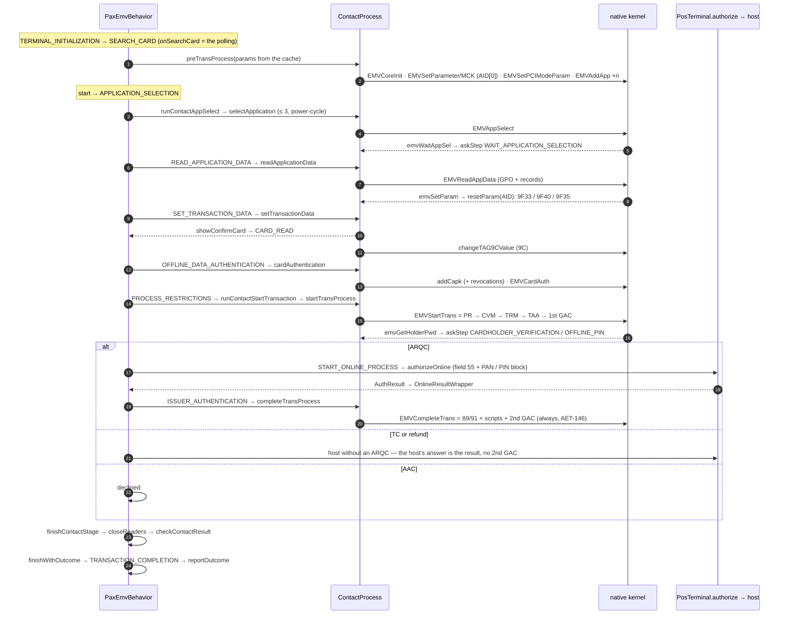

### 5.2 المراحل (كل مرحلة = استدعاء native واحد = EmvStep واحدة)

| EmvStep | الـ runner في `PaxEmvBehavior` | `ContactProcess` | native | الـ callbacks داخله |
|---|---|---|---|---|
| TERMINAL_INITIALIZATION | `onTerminalInitialization` → `prepareKernel` → `runPreTransProcess` | `preTransProcess` | `EMVCoreInit`، `EMVSetParameter` / `EMVSetMCKParam` (AID[0])، `EMVSetPCIModeParam`، `EMVAddApp` | — |
| APPLICATION_SELECTION | `runContactAppSelect` (+ `selectApplicationWithRetry`: 3 محاولات، power-cycle لمدة 200ms) | `selectApplication` | `EMVAppSelect` | `emvWaitAppSel` → `onWaitAppSelect` (WAIT/FINAL) |
| READ_APPLICATION_DATA | `runContactReadAppData` | `readApplicationData` | `EMVReadAppData` (GPO + read records) | `emvSetParam` → `resetParam(AID)` |
| SET_TRANSACTION_DATA | `runContactSetTransactionData` | `setTransactionData` | — | `showConfirmCard` (CARD_READ) + `changeTAG9CValue` (9C) |
| OFFLINE_DATA_AUTHENTICATION | `runContactCardAuth` | `cardAuthentication` | `addCapk` + `EMVCardAuth` | — |
| PROCESS_RESTRICTIONS | `runContactStartTransaction` → `startContactTransProcess` | `startTransProcess` | `EMVStartTrans` = PR → CVM → TRM → TAA → **1st GAC** | `emvGetHolderPwd` → `onCardHolderPwd` |
| START_ONLINE_PROCESS | `startOnlineProcess()` → `onStartOnlineProcess` → `authorizeOnline` | — | — (host) | — |
| ISSUER_AUTHENTICATION | `runIssuerAuthentication` → `completeContactIssuerAuthentication` | `completeTransProcess` | `EMVCompleteTrans` = 89/91 + scripts + **2nd GAC** | — |
| SCRIPT_PROCESSING | إعلان فقط من `completeApproved` | — | (تمت داخل EMVCompleteTrans) | — |
| TRANSACTION_COMPLETION | `finishContactStage` → `checkContactResult` → `finishWithOutcome` → `onTransactionCompletion` → `reportOutcome` | — | — | — |

كل runner له الشكل نفسه:

```text
tx.transResult = kernel.contact.xxx()
proceed = ret == EMV_OK && !isContactTransactionFinished()   (transResult.getTransResult() == null)
exception → finishError
!proceed → finishContactStage   (releases the kernel's listener, closes the readers + the PIN pad, then checkContactResult)
proceed  → advanceContactStage(NEXT)   = goToStep(NEXT); if it doesn't return true → finishContactStage
```

- يبقى قارئ الـ ICC مفتوحًا من اختيار التطبيق حتى بدء العملية، ولذلك تغلق `advanceContactStage` بنفسها إن أُلغيت `goToStep`؛ وإلا ضاع التنظيف.
- `finishContactStage` هي المكان الوحيد الذي يُلغى فيه تسجيل الـ listener (`registerEmvProcessListener(null)`)؛ والتسجيل مرة واحدة في `runContactAppSelect` (`ca1b16a`).
- بعد الإلغاء: تغلق `finishContactStage` القارئات ولا تبلّغ نتيجة ("result not reported").

### 5.3 لماذا هذا الترتيب

هو ترتيب الـ contact kernel الخاص بـ PAX نفسه: `EMVAppSelect` ← `EMVReadAppData` ← (تأكيد البطاقة + 9C) ← `EMVCardAuth` ← `EMVStartTrans` ← `EMVCompleteTrans`. تأتي SET_TRANSACTION_DATA في الـ contact **بعد** القراءة (عكس الـ contactless) لأن الـ contact kernel يأخذ المبلغ في `preTransProcess` / `EMVStartTrans` (`emvInputAmount`)، وهذه المرحلة تؤكد البطاقة وتضبط 9C بعد قراءة الـ PAN.

### 5.4 الـ parameters داخل الـ contact kernel

- `preTransProcess` (في كل محاولة، مع `ContactProcess` جديد): `EMVCoreInit` ← `setEmvAndMCKParam` بـ **أول AID** كقيمة افتراضية (مع `forceOnline = 1`، وتسجيل `EmvCallBackListener`) ← `EMVSetPCIModeParam` ← `EMVAddApp` لكل AID. تأتي الـ params من `kernel.params.getCachedEmvParam()` (§7.3).
- بعد اختيار التطبيق: `emvSetParam` ← `resetParam(aid)`: يبحث عن الـ AID (كاملًا أو جزئيًا) ويضع 9F33 / 9F40 / 9F35 الخاصة به عبر `EMVSetParameter` **و** `EMVSetTLVData`، ومعها الـ MCK الخاص بالـ AID المختار (تجاوز الـ PIN) عبر `EMVSetMCKParam` (كانت BACKLOG 0.7، وأُصلحت).
- **لا يُكتب 9F03 في الـ contact kernel أبدًا**؛ و `readIccTag` تعيده أصفارًا.

### 5.5 الاتصال بالـ host والـ 2nd GAC (`startContactTransProcess`)

| ما قالته البطاقة في الـ 1st GAC | ما يحدث |
|---|---|
| `ret != EMV_OK` | يُعاد الكود ← رفض / خطأ |
| استرداد (أي نتيجة)، أو TC "offline approved" | `needsHostWithoutArqc` ← الـ host دون ARQC ← `hostOutcome` ← **رد الـ host هو النتيجة** (دون 2nd GAC) |
| ARQC (`RESULT_REQ_ONLINE`) | `startOnlineProcess` ← `runIssuerAuthentication` ← **2nd GAC دائمًا** (EMV Book 3، AET-146)، حتى إن رفض الـ host أو فشل الاتصال |
| AAC (ليس استردادًا) | رفض |

`startOnlineProcess()` (الـ callback بعد الـ 1st GAC، وهو المكان الوحيد الذي ينشر هذه الخطوة للـ chip والـ contactless): `tx.lastAuth = null` ← `goToStep(START_ONLINE_PROCESS)` ← `onStartOnlineProcess` ← `tx.lastAuth = authorizeOnline()` (field 55 من `readIccTag`، وإن كان فارغًا فالنتيجة online failed دون إرسال؛ و `addOnlineRequestData` تضيف الـ PAN والـ PIN block والمفتاح المشفّر و `EmvTransactionResult`) ← `engine.authorize` ← `PosTerminal.authorize`. إن أُلغيت الخطوة بقي `lastAuth = null` ← "online step did not run — online failed". ثم `toOnlineResultWrapper`: null / failed ← FAILED؛ approved ← APPROVE (auth code، RC، ARPC، scripts)؛ وغير ذلك ← DENIAL.

**كيف يعود رد الـ host إلى الـ behavior (من أجل الـ 2nd GENERATE AC):** استدعاء يعيد ردًا، لا callback؛ وكل شيء على الـ transaction thread وبالترتيب، والـ kernel ينتظر في المنتصف:

```text
PaxEmvBehavior.onStartOnlineProcess
   tx.lastAuth = authorizeOnline();
         │
         └─ engine.authorize → PosTerminal.authorize → the host
         │      (PosTerminal: ONLINE_* steps, names the request and records it for the ack / reversal, 90 s)
         │
   ◄──── the AuthResult comes straight back here (approved / declined / failed + ARPC + scripts + auth code)
   │
toOnlineResultWrapper(auth)                  ← into PAX's shape
   │   ARPC          → rsp.setAuthData
   │   scripts       → rsp.setScript
   │   response code → rsp.setRespCode
   │
kernel.contact.completeTransProcess(rsp)     ← the 2nd GENERATE AC (completeContactIssuerAuthentication)
   │
the card: TC (approved) or AAC (declined)
   │
finishApproved / finishDeclined
```

نوقش في 28/10: هذا الشكل آمن (يُسجَّل الطلب قبل إرساله) ومريح للـ 2nd GAC، فبقي كما هو؛ ولن تُقسَّم `PosTerminal.authorize`. ولذلك تبقى `ONLINE_*` تقارير لا خطوات لها دوال (§2.6).

`runIssuerAuthentication`: `tx.issuerResponse = online` ← `goToStep(ISSUER_AUTHENTICATION)` ← `onIssuerAuthentication` ← `completeIssuerAuthentication`. إن أُلغيت الخطوة يُنفَّذ الـ 2nd GAC مع ذلك ("issuer authentication step did not run — completing with the card anyway").

بعد الـ 2nd GAC (`completeContactIssuerAuthentication`):

| الـ host | البطاقة في الـ 2nd GAC | النتيجة | بعد النهاية (§2.7) |
|---|---|---|---|
| APPROVE | TC | `RESULT_ONLINE_APPROVED` | acknowledge |
| APPROVE | غير ذلك | `RESULT_ONLINE_CARD_DENIED` | reverse |
| FAILED | أي نتيجة (يطلب الجهاز AAC) | `RESULT_ONLINE_FAILED` / `..._CARD_APPROVED` ← **online failed** | reverse، إلا إن كان `notSent` |
| DENIAL | — | `RESULT_ONLINE_DENIED` | لا شيء |

### 5.6 النتيجة (`checkContactResult` ← outcome)

| TransResultEnum | الدالة | Outcome |
|---|---|---|
| ONLINE_APPROVED | `onlineApproved` ← `completeApproved` (+ إعلان SCRIPT_PROCESSING) | APPROVED |
| ONLINE_DENIED | `onlineDenied` | DECLINED |
| ONLINE_CARD_DENIED | `onlineCardDenied` | DECLINED |
| ONLINE_FAILED / FAILED_CARD_APPROVED | `onlineFailed` | ERROR |
| OFFLINE_APPROVED | `offlineApproved` ← **online failed** (لا موافقة offline) | ERROR |
| OFFLINE_DENIED / default / `null` | `offlineDenied` | DECLINED |
| SIMPLE_FLOW_END | `simpleFlowEnd` | APPROVED |
| FALLBACK | `fallback()` ← إعادة بـ MAGSTRIPE | — |

---

## 6. مسار الـ contactless

التشغيل نفسه (§3) و `askStep` نفسها (§4). الفرق أن الـ kernel يُختار بعد اختيار التطبيق (`ClssKernelProcessFactory`). وهناك نوعان (`ClssKernelProcess.supportsGranularSteps()`):
- **granular: EFT، PayPass، PayWave.** في الـ SDK الخاص بها استدعاء native لكل مرحلة، فلكل مرحلة خطوتها.
- **atomic: Amex، JCB، Mir، PBOC، Pure، RuPay، DPAS.** العملية كلها استدعاء واحد (`startTransProcess`). تُنشر الخطوات من الـ callbacks (`onReadCardOk` ← READ_APPLICATION_DATA، `confirmCard` ← SET_TRANSACTION_DATA)، ودوال `onXxx` الخاصة بها فارغة.

### 6.1 الرسم: المراحل

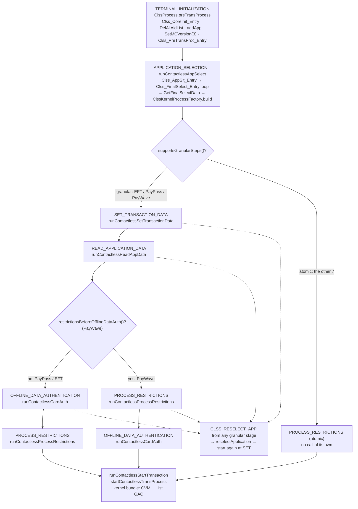

### 6.2 قبل الـ tap: الـ entry point

`prepareKernel` ← `runPreTransProcess` ← `ClssProcess.preTransProcess`:
`Clss_CoreInit_Entry` ← `Clss_DelAllAidList_Entry` / `DelAllPreProcInfo` ← `ClssEntryAddAid.addApp()` (الـ AIDs لكل kernel له صفوف؛ والـ kernel المحذوف لا AIDs له فلا يُختار) ← `Clss_SetMCVersion_Entry(3)` ← `Clss_PreTransProc_Entry` (الحدود لكل AID).
إن فشل: `kernel.contactlessReady = false`، فلا يستمع `PaxCardSearch` إلى الـ PICC في هذه العملية ("contactless disabled for this transaction").

### 6.3 اختيار التطبيق (`runContactlessAppSelect`)

`kernel.contactless.registerClssProcessListener(this)` (مرة واحدة؛ ويُلغى مرة واحدة في `finishContactlessStage`، `ca1b16a`) ← `ClssProcess.selectApplication`: `Clss_AppSlt_Entry` ← حلقة على `Clss_FinalSelect_Entry` (`EMV_RSP_ERR` / `APP_BLOCK` / `ICC_BLOCK` / `CLSS_RESELECT_APP` ← `Clss_DelCurCandApp_Entry` ثم المرشح التالي) ← `Clss_GetPreProcInterFlg_Entry` + `Clss_GetFinalSelectData_Entry` ← `ClssKernelProcessFactory(kernType).build()` بالـ params والـ listener.
بعدها: `firstStageAfterAppSelect()` ← granular: `SET_TRANSACTION_DATA`؛ atomic: `PROCESS_RESTRICTIONS`.

لكل runner في الـ contactless شكل الـ contact نفسه (§5.2)، مع زيادة:

```text
tx.clsTransResult = kernel.contactless.xxx()
ret == CLSS_RESELECT_APP → reselectApplication() (Clss_DelCurCandApp_Entry + select again) → firstStageAfterAppSelect()
markTryAgainOnCommunicationError(ret)   ICC_CMD_ERR / ICC_RESET_ERR / CLSS_TRY_AGAIN → RESULT_TRY_AGAIN
proceed = ret == EMV_OK && !isContactlessTransactionFinished()
!proceed → captureSummaryAfterCardRead (after READ) + finishContactlessStage (releases the listener)
proceed  → advanceContactlessStage(NEXT)
```

ويجري الـ atomic حلقة إعادة الاختيار نفسها داخل `ClssProcess.startTransProcess`.

### 6.4 ترتيب كل kernel (= ترتيب الـ kernel نفسه)

| EmvStep | PayPass (`ClssPayPassProcess`) | PayWave (`ClssPayWaveProcess`) | EFT (`ClssEFTProcess`) |
|---|---|---|---|
| SET_TRANSACTION_DATA | `coreInit` (`Clss_CoreInit_MC`، `SetParam_MC`، FinalSelectData) + `setPayPassParam` (DF8117/18/19/1F، limits) | `coreInit` (`CoreInit_Wave`، **ReaderParam** وفيه `aucTmCap` = 9F33، FinalSelectData) + `setTransParam` (`SetVisaAidParam_Wave` floor/limits، `SetTransData_Wave`) | `CoreInit_EFT` + ReaderParam + AidParam + `SetTransData_EFT` |
| READ_APPLICATION_DATA | `Clss_InitiateApp_MC` + `Clss_ReadData_MC` | `Clss_Proctrans_Wave` (GPO + records + نوع الـ AC)؛ see phone / use contact / AAC تظهر هنا | `Clss_InitApp_EFT` + `Clss_ReadAppData_EFT` |
| ↓ الترتيب | ODA ثم PR | **PR ثم ODA** (`restrictionsBeforeOfflineDataAuth() = true`) | ODA ثم PR |
| OFFLINE_DATA_AUTHENTICATION | تحميل CAPK + revocation فقط (M/Chip)؛ الـ ODA نفسه داخل `TransProc` | `Clss_CardAuth_Wave` (إن كانت TC وليست استردادًا، أو TTQ byte1 bit1) | `PreTAAProc` + CAPK + `Clss_CardAuth_EFT` |
| PROCESS_RESTRICTIONS | لا شيء (لا استدعاء) | `Clss_ProcRestric_Wave` (qVSDC/Wave2) | `Clss_ProcRestrict_EFT` |
| الـ bundle (`startTransProcess`) | `Clss_TransProc_MC_MChip`/`_Mag` = ODA+PR+CVM+TRM+TAA+GAC، ثم see phone (UIRD 0x20 أو DF4B)، `outcomeParamSet` → `genTransResult` | `genTransResult`: `Clss_GetCvmType_Wave` + نوع الـ AC (AAC من READ ← رفض) | `Clss_CVMProc_EFT` + `Clss_PostTAAProc_EFT` |
| 2nd tap / completion | `completeTransProcess` | FinalSelect + `Clss_IssuerAuth_Wave` | `Clss_CompleteOnlineTrans_EFT` — ⚠ لا تُستدعى: `isNeedSecondTap` تعيد false لـ EFT (و Amex / JCB / Pure / PBOC)، فتبقى الموافقة كما هي (BACKLOG 2.3) |
| SCRIPT_PROCESSING | default (OK) | `Clss_IssScriptProc_Wave` + `onRemoveCard` | default |

> **9F33:** في Visa والـ contact قيمة واحدة من 3 bytes. أما PayPass فـ tags منفصلة (DF8117 إدخال بيانات البطاقة، DF8118 مع CVM، DF8119 دون CVM، DF811F الأمان)، والـ kernel هو الذي يبني 9F33. لا تُجمع في قيمة واحدة.

### 6.5 بعد المراحل: `startContactlessTransProcess`

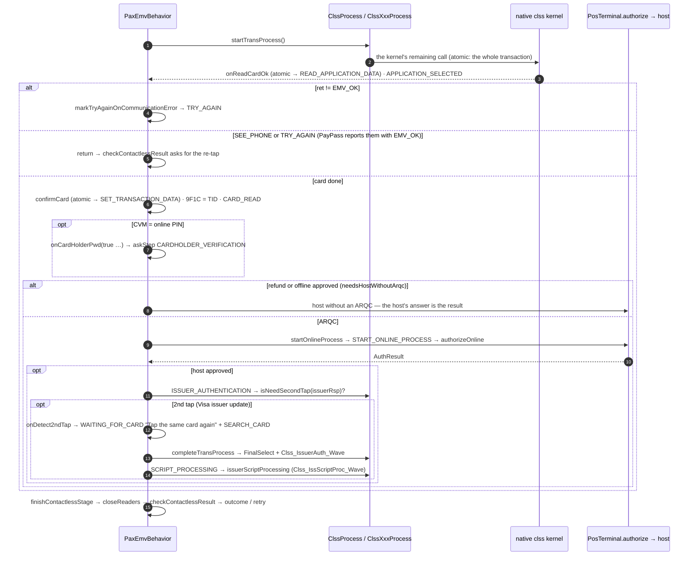

```text
tx.clsTransResult = kernel.contactless.startTransProcess()
ret != OK → markTryAgainOnCommunicationError (ICC_CMD_ERR / ICC_RESET_ERR / CLSS_TRY_AGAIN → TRY_AGAIN); return
SEE_PHONE / TRY_AGAIN with EMV_OK (PayPass) → return (the retry is in checkContactlessResult)
confirmCard()               ← we call the callback ourselves: SET_TRANSACTION_DATA (atomic only),
                              9F1C = TID from the cache, CARD_READ
CVM online PIN? → onCardHolderPwd(true, bypass, 0, null)
        NO_PASSWORD = bypass → online without a PIN; any other answer but OK → ERROR "Online PIN not entered"
refund / offline approved → needsHostWithoutArqc → startOnlineProcess → hostOutcome (the host's answer is the result)
ARQC → startOnlineProcess()
        host not approved → the result = the host's answer (onlineDenied / onlineFailed announce ISSUER_AUTHENTICATION)
        approved → runIssuerAuthentication → completeContactlessIssuerAuthentication:
             isNeedSecondTap? → onDetect2ndTap → completeTransProcess → OK → runIssuerScriptProcessing
             not needed → ONLINE_APPROVED as it is
```

- `onDetect2ndTap` تنشر WAITING_FOR_CARD ("Tap the same card again to finish") و `SEARCH_CARD`؛ وهذه الـ `SEARCH_CARD` **للعرض فقط** (الشريط العلوي والـ trace) ولا تبدأ بحثًا ثانيًا (§3.3، `4ca6040`).
- ⚠ لا يوجد polling ولا انتظار للبطاقة قبل `Clss_FinalSelect_Entry` (BACKLOG 1.4، form #12).
- `scriptsProcessed` (في `PaxKernelSession`) يمنع `completeApproved` من إعلان SCRIPT_PROCESSING مرة ثانية بعد أن نُفّذت في خطوتها مع الـ tap الثاني. ولا يغني عنه `pendingScripts`، لأنه يكون null قبل تسليم الـ scripts وبعد تنفيذها معًا.

### 6.6 النتيجة (`checkContactlessResult`)

| الحالة | الدالة | النهاية |
|---|---|---|
| `RESULT_CLSS_SEE_PHONE` (أي ret) | `seePhone` (+ `clsLastNeedSeePhone = true` للـ tap التالي) | إعادة CONTACTLESS، والرفض بعد 3 |
| `RESULT_TRY_AGAIN` (أي ret) | `tryAgain` | إعادة بالطريقة نفسها، والرفض بعد 3 |
| OK + ONLINE_APPROVED | `onlineApproved` | APPROVED |
| OK + OFFLINE_APPROVED | `offlineApproved` ← online failed | ERROR |
| OK + SIMPLE_FLOW_END | `simpleFlowEnd` | APPROVED |
| OK + غير ذلك | `offlineDenied(CLSS_DECLINE)` | DECLINED |
| TRY_ANOTHER_INTERFACE / `CLSS_USE_CONTACT` | `tryAnotherInterface` | إعادة بـ CHIP |
| ONLINE_DENIED / CARD_DENIED / OFFLINE_DENIED | كما في الـ contact | DECLINED |
| ONLINE_FAILED | `onlineFailed` | ERROR |

يُفحص See Phone و Try Again قبل كود النتيجة، فحين يعيدهما PayPass أو Mir مع `EMV_OK` تكون النتيجة إعادة لا رفضًا (كانت BACKLOG 0.6). ولـ `tryAgain` و `seePhone` حد `MAX_TAP_RETRIES = 3` (كانت BACKLOG 0.14)، والعدّاد هو `retryCount()` في `AbstractEmvBehavior` (يعد كل إعادة، حتى الـ fallback).
CDCVM (`CVM_CONSUMER_DEVICE`) مع OK يعني أن الهاتف أتم التحقق، فهو CVM ناجح عادي. أما `RESULT_CLSS_SEE_PHONE` وحدها فتعني "تحقق على الهاتف ثم أعد الـ tap".

### 6.7 ردود `IContactlessCallback`

| الـ callback | من يستدعيه | ما يفعله |
|---|---|---|
| `onReadCardOk` | الـ kernel بعد القراءة | atomic: `goToStep(READ_APPLICATION_DATA)`؛ `APPLICATION_SELECTED` |
| `confirmCard` | `startContactlessTransProcess` (نحن) | atomic: `goToStep(SET_TRANSACTION_DATA)`؛ 9F1C؛ `CARD_READ` |
| `onWaitAppSelect` | مشترك مع الـ contact | askStep |
| `onCardHolderPwd` | مشترك | askStep |
| `startOnlineProcess` | مشترك | §5.5 |
| `onRemoveCard` | PayPass / PayWave | سطر في الـ log فقط |
| `onDetect2ndTap` | مرحلة الإكمال | الرسالة + SEARCH_CARD (للعرض فقط) |
| `needSeePhone` | الـ kernel في الـ tap التالي — Amex / Mir / Pure فقط | تعيد `clsLastNeedSeePhone` وتصفّره |

⚠ يبقى `clsLastNeedSeePhone` من عملية إلى التي تليها، ولا يقرؤه PayPass ولا PayWave (BACKLOG 2.1). ⚠ `finishContactlessStage` تغلق القارئات فقط، ولا تغلق أي نافذة.

> الـ contact والـ contactless **منفصلان عمدًا** (runners منفصلة، وحالة منفصلة: `transResult` / `clsTransResult`). المشترك بينهما هو الـ callbacks التي تطلبها الواجهتان بالتوقيع نفسه فقط.

---

## 7. الـ EMV params

**ما هي الـ params؟** هي القواعد التي يحتاجها الـ kernel ليتخذ قراره في كل عملية: البطاقات المقبولة (الـ AIDs)، والمفاتيح التي يُتحقَّق بها من أن البطاقة أصلية (الـ CAPKs)، والحدود المالية (مثل المبلغ الذي يُطلب بعده PIN في الدفع اللاتلامسي).

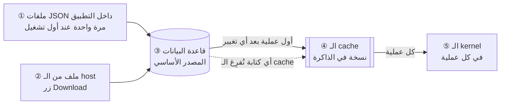

1. **عند أول تشغيل للتطبيق:** تُملأ قاعدة البيانات من ملفات JSON المرفقة بالتطبيق، مرة واحدة فقط.
2. **عند الضغط على Download:** يرسل الـ host ملفًا (XML للـ contact وآخر للـ contactless)، فيُقرأ ويُكتب في قاعدة البيانات بدلًا من القديم.
3. **قاعدة البيانات هي المصدر الأساسي.**
4. **الـ cache نسخة سريعة:** أول عملية بعد أي تغيير تقرأ قاعدة البيانات كاملة وتحتفظ بها في الذاكرة، والعمليات التالية تأخذ منها مباشرة.
5. **الـ kernel لا يحتفظ بشيء:** في **كل** عملية تُحمَّل إليه الـ params من الـ cache من جديد، وتُمسح منه بانتهاء العملية.

مثال: غيّر الـ host حدّ طلب الـ PIN في الدفع اللاتلامسي من 600 إلى 1000 جنيه ← بعد Download أصبحت القيمة في قاعدة البيانات 1000 وأُفرِغ الـ cache ← أول عملية تعيد ملء الـ cache ويستلم الـ kernel القيمة 1000 ← عملية tap بمبلغ 800 تتم دون PIN.

شاشة EMV Params: **DB** = القيم المحفوظة؛ **Cached** = القيم التي سيستلمها الـ kernel الآن (إن كانت فارغة فلم تتم أي عملية منذ آخر تغيير، وليس هناك خطأ).

التفاصيل التقنية (للمراجعة):

تُحفظ الـ params في مكانين فقط، وليس الـ kernel أحدهما:
- **GreenDAO** هو المصدر الأساسي. يُملأ من الـ XML القادم من الـ host، ومن **ملفات JSON** مرة واحدة عند أول تشغيل كبداية احتياطية.
- **الـ cache** (`EmvParamService.cache`، static، نسخة واحدة لكل process) نسخة من قاعدة البيانات في الذاكرة، وهو المصدر الوحيد الذي تُحمَّل منه الـ params **إلى الـ kernel** في كل محاولة (`runPreTransProcess`). لا يخزّن الـ kernel شيئًا: يستلمها من الـ cache في `preTransProcess`، وتُمسح مع `CoreInit` التالي.

```text
download zip → parse XML (EmvXmlParamParser / ClssXmlParamParser)
            → GreenDAO (one section = one DB transaction: delete + insert)
            → EmvParamService.invalidate()          (cache = null)
            → first transaction: getCachedEmvParam() → loadFromDatabase() → toEmvProcessParam (الـ 13 param)
            → preTransProcess (contact / contactless)
```

### 7.1 أول تشغيل: البيانات الأولية

```text
EmvEnhanceApp.onCreate → TerminalFactory.create → new PaxTerminal → PosTerminal ctor → initializeVendor
  → ensureEmvConfigInitialized: pref "emv_config_initialized"? yes → skip
       no → thread "ConfigInit": new ConfigInit().init(), then pref = true (once the seed is done)
         config.json → ConfigParamService
         acquirer.json / issuer.json / card_range.json → AcquirerIssuerService
         contactAid.json, capk.json, amex/paypass/paywave/dpas/eft/jcb/mir/pboc/pure/rupay.json
           → EmvParamService.insertXxx → GreenDAO   (errors go to the log only)
         EmvParamService.invalidate()
```

⚠ تعمل البيانات الأولية على thread مستقل، وقد تبدأ عملية بيع في أثنائها (BACKLOG 3.1). ⚠ 76 من 88 CAPK في `capk.json` منتهية الصلاحية.

### 7.2 التحميل من الـ host

```text
[main] EmvParamActivity "Download EMV params" → params.download()   (PaxEmvParams)
[io]   refuseWhileBusy()   ← terminal.isBusy() → IllegalStateException, nothing written
       OnboardingClient.ensureValidAccessToken(HostHeaders.build(sn), state)
       → EmvParamDownloadClient.download(buildAuthenticated(sn, token), "pax") → byte[]
       refuseWhileBusy()   ← again, right before the apply
       → EmvParamUpdater.applyFromZip(bytes)
           unzip: *.emv → emvXml ، *.clss → clssXml
           saveForDiagnosis (debug only) → Android/data/<pkg>/files/emv_param/
           applyEmvXml: EmvXmlParamParser.parse   (EMVPARAM/AIDLIST/AID، EMVPARAM/CAPKLIST/CAPK، REVOCATIONLIST)
               AIDs present?  → replace("contact AID"): EmvAid deleteAll + insertEmvAid
               CAPKs present? → replace: Capk + CapkRevoke deleteAll + insertEmvCapk
               (a section missing or empty = left as it is, BACKLOG 3.4)
           applyClssXml: ClssXmlParamParser.parse(xml, TerminalWideValues(contactAids))
               PayPass / PayWave / Amex(+DRL): replace
               removeKernelsNotInPackage: the clss package is the whole truth
                   PayPass/PayWave/Amex not in the package → deleted
                   DPAS/EFT/JCB/Mir/PBOC/Pure/RuPay (no parser) → deleted
           replace = one DB transaction (callInTx): an insert fails → the delete is rolled back
           result.changedDatabase() → EmvParamService.invalidate()
[main] result.summarize() on the screen
```

داخل الـ parser:
- يُتجاوز أي CAPK بلا RID / KeyID صحيحين ("CAPK without a valid RID/KeyID — skipped").
- PayWave: `TERMINALCAPABILITIES` (مشتركة بين كل الـ AIDs) ← `terminalType` (9F35)، `securityCapability`، `terminalCapability` (9F33 كاملة، 3 bytes).
- حد الـ floor في PayWave = `ContactlessFloorLimit` (+Supported)، وإن لم يوجد ← `TerminalFloorLimit`.
- **لا يُؤخذ `OTHERCONFIGURATION` (TID / MCC / التاجر) من الـ XML**، وهذا قرار مقصود.
- القيم العامة للجهاز (9F35، 9F40، الأمان) للـ clss AIDs التي ينقصها شيء منها: من الـ contact XML في الحزمة نفسها، وإلا من الـ contact AIDs الموجودة في قاعدة البيانات.

### 7.3 التحميل إلى الـ kernel (في كل محاولة)

```text
prepare → onTerminalInitialization → prepareKernel(config)
  EmvDeviceImpl.setApduTrace(engine.apduTrace())
  EmvFlowRuntime.init / isReady   (DAL)
  initializeTerminalIfNeeded:
      EmvParamService.isLoaded()? yes → nothing
      no → kernel.params.getCachedEmvParam()   ← loadFromDatabase; the trace notes the time
  closeReaders(true)              (defensive)
  kernel.contact = new ContactProcess()
  runPreTransProcess(config, INSERT|INTERNAL_WAVE):
      EmvTransParam: 9C from procCode, the amount, amount other = 0, TID (from the cache), currency, date/time,
                     trace no = 0, FLOWTYPE_COMPLETE, PCI mode, PIN lengths, 60 s timeout
      EmvProcessParam: termConfig + CAPKs + transParam (+ contact AIDs | + the 10 clss params)
      kernel.contact.preTransProcess      fails → INSERT dropped
      kernel.contactless.preTransProcess  fails → WAVE dropped ("contactless disabled for this transaction")
  kernel.contactReady / contactlessReady  → PaxCardSearch.search picks the readers
```

`getCachedEmvParam()`: الـ `cache` static واحد (`synchronized`)؛ إن كان `null` ← `loadFromDatabase()`: تقرأ كل الجداول، و `toEmvProcessParam(...)` تضبط الـ 13 param (AIDs، CAPK + revocations، termConfig، Amex، PayPass، PayWave، DPAS، EFT، JCB، Mir، PBOC، Pure، RuPay). الجدول الفارغ = قائمة فارغة، لا `null` أبدًا. أي كتابة في قاعدة البيانات (تحميل، بيانات أولية) ← `invalidate()` ← تعيد العملية التالية التحميل. ولا يُحمَّل في كل مرة لأن القراءة من قاعدة البيانات ثقيلة.

> أعاد `5755adb` دوال `setXxxParam` التي حذفها `03b1cde` من `loadFromDatabase` (كانت كل عملية بيع تسقط بـ NPE في `ContactProcess.preTransProcess`). والحارس هو `EmvParamServiceCacheTest`.

### 7.4 متى تصل الـ params إلى البطاقة

| الـ param | أين يدخل الـ kernel |
|---|---|
| contact AIDs + أول AID كقيمة افتراضية | `ContactProcess.preTransProcess` (`EMVAddApp`، `setEmvAndMCKParam`) |
| 9F33/9F40/9F35 الخاصة بالـ AID المختار | `emvSetParam` ← `resetParam` (بعد الاختيار، داخل `EMVReadAppData`) |
| CAPK + revocation | contact: `cardAuthentication` ← `addCapk`؛ clss: مرحلة الـ ODA ← `addCapkRevList` |
| clss AIDs + الحدود | `ClssEntryAddAid.addApp` + `Clss_PreTransProc_Entry` |
| params الـ kernel نفسه (TTQ، 9F33، floor، CVM limit، DF81xx) | `setTransactionData` لكل kernel (granular) أو داخل الاستدعاء الواحد (atomic) |
| الـ TID لـ field 55 في الـ clss | `confirmCard` ← `setTlv(9F1C)` |

### 7.5 معرفة ما هو محمّل (شاشة EMV Params)

- زرّان فوق الفئات (`MaterialButtonToggleGroup`):
  - **Cached EMV params** (الافتراضي): `EmvParams.cachedRows(category)` ← `PaxTerminal.kernelParams()` = `EmvParamService.loaded()`، و**لا يحمّل أبدًا**. إن كان فارغًا: "The cache is empty — it loads at the first transaction"؛ وفئة قيمتها `null` في cache محمّل: "… is not in the kernel's cache" (خطأ برمجي).
  - **DB EMV params**: `EmvParams.rows(category)` ← GreenDAO فقط.
  - الضغط على صف يعرض كل الحقول من المصدر نفسه (`describe`: hex، وحقول متداخلة). ولا رجوع من الـ cache إلى قاعدة البيانات.
- زر "Downloaded XML" (debug): آخر `emv_param.emv` / `clss_param.clss` تم تحميلهما.
- أي تغيير في الـ schema = `SCHEMA_VERSION` 1 دون migrations ← يلزم **uninstall**.

---

## 8. الـ Threads

| الـ Thread | ما يشغّله | الممنوع عليه |
|---|---|---|
| main | الواجهة، `acceptCard` (+ فحص الانشغال بـ CAS)، `transaction.cancel()`، الـ LiveData، النوافذ (`PaxAppSelectDialog`، `PaxPinPad`) | أي عمل blocking (EMV، host، طباعة، قاعدة بيانات) |
| transaction (`transactionScheduler` = `Schedulers.from(newSingleThreadExecutor)`) | `runTransaction` (تضعه هنا TRANSACTION_STARTED): الـ EMV كله (التهيئة ← البحث ← الـ EMV ← الـ host بـ `blockingGet`، والإعادات) ← `onEnd` (التأكيد / الإلغاء بـ `blockingAwait`، 15 ثانية) | المقاطعة؛ وأكثر من عملية في وقت واحد (`current`) |
| print (thread واحد) | `printReceipt` بالترتيب | — |
| `Schedulers.io()` | تحميل الـ params، التسجيل (onboarding) | — |
| `ConfigInit` | البيانات الأولية عند أول تشغيل | — |
| thread لكل قائمة في شاشة EMV Params | `rows` / `cachedRows` / `details` | — |

يعمل الـ kernel وكل الـ callbacks على الـ transaction thread فقط. وهذا الـ thread **ينتظر** الـ main في `PaxAppSelectDialog.selectBlocking()` ولوحة الـ PIN؛ ولذلك يجب أن تُغلق النافذة في كل نهاية (`finishContactStage` تستدعي `activePinPad.dismiss()`).
⚠ (BACKLOG 1.2): الإلغاء لا يقطع إدخال الـ online PIN (60 ثانية)؛ و `finishContactlessStage` لا تغلق أي نافذة. (لوحة الـ offline PIN القديمة تُغلق قبل الجديدة: أُصلحت 1.3.)

---

## 9. عند التعديل

1. **مرحلة جديدة أو ترتيب جديد:** ابدأ من ترتيب الـ native kernel (وثائق الـ SDK / `ClssXxxProcess`)، لا من ترتيب الـ enum. اسم الخطوة = ما يفعله الـ kernel فعلًا.
2. **العمل الفعلي داخل `onXxx`**، والـ callback يعيد الإجابة فقط (`askStep`). لا عمل واجهة داخل الـ callback.
3. **الإغلاق الآمن:** أي إجابة لم تصل = `USER_CANCEL` / online failed / رفض. لا موافقة offline. وكل callback يرد بـ `setCallBackResult`.
4. **contact ≠ contactless:** runner جديد لكل منهما، حتى إن تشابه الكود.
5. **لا تستدعِ `onXxx` مباشرة**، بل `goToStep`.
6. **لا `observeOn` على `emvSteps` داخل الـ behavior** ولا serialize للـ subject (التشغيل يجب أن يبقى متزامنًا).
7. **حالة العملية في الـ `Transaction` فقط:** لا flag ثانٍ (الانشغال = `current`، النهاية / الإلغاء = `end`). وحالة إعادة المحاولة في `AbstractEmvBehavior` فقط (`requestRetry` / `retryCount()`).
8. **خطوة عملية جديدة تقود العملية** (لا مجرد تقرير): أضف لها حالة في `dispatchTransactionStep` ودالة `onXxx` في الـ `Transaction` (§2.6).
9. **وحدات الـ PAX SDK** (`emvbase`، `emvlib*`، `poslib`، `commonutils`): لا تُلمس إلا حين يحتاج الـ kernel نفسه، وبترتيب الاستدعاءات الـ native نفسه.
10. **تغيير الـ schema:** الـ DAO يُعدَّل يدويًا (ordinal، DDL، bind، read) + uninstall على الجهاز.
11. **الاختبار:** `:core` (102)، `:network` (20)، `:bizentity` (25: XML + DAO + `EmvParamServiceCacheTest`)، `:vendor-pax` (8: `PaxCardDataTest`)، ثم الجهاز بصفوف `report_easylink.xlsx` (آخر مرة: chip و tap again عند `19cc019`).
12. **أسماء الـ packages والمجلدات بأحرف صغيرة** (`emv` لا `EMV`). لا يفرّق Windows بينهما: إن بقي مجلد قديم باسم `EMV` على الجهاز، يضع الـ pull ملفات `emv` داخله ويعطي الـ build الخطأ `cannot find symbol` لكل class فيه (حدث في 28/10). الحل: أغلق Android Studio، احذف المجلد و `core\build`، ثم `git checkout -- core/src`، ثم Sync + Rebuild.

---

# Appendix — package layout (merged from the old doc/README.md; vendors: VENDOR.md)

### Package layout

### `:core` — `com.emvenhance.core.*`

| Package | Contents |
|---------|----------|
| `terminal` | `PosTerminal` (+ `Transaction`; owns host + printer), `EmvBehavior` / `AbstractEmvBehavior` (the vendor seam), `TerminalBusyException` |
| `transaction` | `TransactionConfig`, `TransactionType`, `TransactionStep(Event)` |
| `emv` | `EmvEngine`, `EmvStep(Event)`, `EmvTransactionResult`, `Field55`, `ApduTrace` |
| `card` | `EntryMethod`, `CardPresence`, `CardSearchListener` |
| `cardholder` | `AbstractAppSelectDialog`, `PinPadBehavior`, `AbstractPinPadBehavior`, `PinKey` |
| `param` · `util` | `EmvParams` · `EmvLog` |
| `host` | `CommunicationBehavior` (`authorize`, `acknowledge`, `reverse`), `PrinterBehavior`, `AuthResult` (`approved` / `declined` / `failed` / `notSent`), `HostNotReachedException` — owned by PosTerminal |

### `:network` — `com.emvenhance.network.*`

| Package | Contents |
|---------|----------|
| *(root)* | `HostApiConnection` (Retrofit), `HostApiClient`; `SaleCommunicationBehavior` — the `CommunicationBehavior` in use: encrypted envelope (`orchestration/exchange` + `sale` / `refund`), acknowledgement / reversal, see below |
| `env` | `EnvironmentProvider` — holds `BuildConfig.baseUrl` from `:app`'s "environment" flavor dimension |
| `model` | `ReverseRequest`, `AcknowledgementRequest`, `AcknowledgementResponse` (plain JSON, `orchestration/reverse` / `orchestration/acknowledgement`);  `GeneralRequest`/`GeneralResponse`/`DataModel` (the generic encrypted envelope, shared with `onboarding`) and `ExchangeRequest`/`ExchangeResponse`/`SaleRequest`/`SaleExtraData`/`SaleResponse` (the payloads that travel inside that envelope for `SaleCommunicationBehavior`) |
| `tlv` | `BerTlv`, `IssuerResponseFields` — minimal BER-TLV reader plus the ARPC/issuer-script tag extraction `SaleCommunicationBehavior` uses |
| `onboarding` | `OnboardingClient`, `OnboardingApiConnection`, `OnboardingState`, `ChallengeGenerator`, `OnboardingException` — the offline (pair terminal) and online (per-bank TMK provisioning) onboarding cycles; see `onboarding.model` for the six endpoints' request/response shapes |
| `crypto` | `RsaPublicKeyEncryptor` — RSA-wraps a symmetric session key (online PIN key or transaction key) with the host's public key from onboarding, so the host can independently recover it; `AesEnvelopeCrypto` — AES-encrypts/decrypts the `encSerializedRequest`/`encSerializedResponse` body under that key. See `vendor-pax/.../PaxEmvBehavior#provisionOnlinePinKey` for the PIN-key use, `SaleCommunicationBehavior` for the transaction-key use |

`HostApiConnection.emvFileDownload` + `EmvParamDownloadClient` fetch the EMV/CLSS parameter
package as raw bytes only — see `:bizentity` below for where those bytes get unzipped, parsed,
and applied.

`SaleCommunicationBehavior` is the encrypted-envelope sale flow, wired into `PaxTerminal` —
`exchange()` (establishes a fresh per-transaction TEK, RSA-wrapped for the host, plus the online
PEK if one was provisioned) then `sale()` (the actual authorization) — built from
`TransactionConfig#getEmvResult()`, the `EmvTransactionResult` a vendor `EmvBehavior` assembles
from the kernel right before going online (see `PaxEmvBehavior#buildEmvTransactionResult`). Its
`Account-Id`/bearer-token headers are read fresh off `OnboardingState#getAccountId`/`#getToken`
on every call — `OnboardingActivity`'s Account ID/Token fields persist there on every successful
onboarding run, so whatever a technician last entered on that screen is what a live sale uses; no
separate credentials screen. (`RetrofitCommunicationBehavior` / `crypto/purchase` was removed on
28/10: nothing used it.) Several of `SaleCommunicationBehavior`'s request fields (the CVM code, the per-issuer
`cardType`/`dcc` values) are reconstructions flagged in its own and its model classes' javadoc —
no source was available for the old project's real `GeneralRequest`/`SaleRequest`/`PinEnterMode`
shapes, only their call sites.

### `:bizentity` — `com.pax.configservice.*`, `com.pax.bizentity.*` (PAX-only)

`ConfigInit` seeds the EMV/CLSS GreenDAO tables once, at first boot, from the bundled JSON assets
under `src/main/assets` (`contactAid.json`, `capk.json`, `paypass.json`, …) — those stay in place
as the offline first-boot fallback. Downloading a fresh parameter package and re-applying it later
is a separate, repeatable path:

| Package | Contents |
|---------|----------|
| `configservice.xml` | `EmvXmlParamParser` (contact: `emv_param.emv` → AID/CAPK/revocation, with the ICS/CARDSCHEME profile join `contactAid.json`'s per-AID fields need), `ClssXmlParamParser` (contactless: `clss_param.clss` → PayPass/PayWave/Amex — DPAS/EFT/JCB/MIR/PBOC/PURE/RUPAY aren't covered, see its javadoc) |
| `configservice.impl.EmvParamUpdater` | Unzips a downloaded package, parses each file, and re-applies it through the same `EmvParamService` insert methods `ConfigInit` uses — clearing each affected table first so a repeat download replaces rather than accumulates |

`vendor-pax/.../PaxEmvParams.download()` wires the two together (`EmvParamDownloadClient` for
the bytes, `EmvParamUpdater` to apply them, refusing while the terminal is busy), returning
`EmvParamUpdateResult` (which sections applied, with row counts, or the first error) rather than a
bare boolean so a caller can show what actually happened.

`app/src/main/.../ui/EmvParamActivity` is that caller (through the core `EmvParams` contract) — the EMV-param category browser screen also
has a "Download EMV params" button above the browser (shows `EmvParamUpdateResult.summarize()`).
It has no credentials UI of its own: its `Account-Id`/bearer-token headers come from
`OnboardingState#getAccountId`/`#getToken`, entered on the separate `app/src/main/.../ui/OnboardingActivity`
screen — Account ID / Token fields plus a single "Start onboarding" button
(runs `OnboardingClient#runOfflineCycle`, shows success or the failure message), saving the
credentials on every successful run. Neither screen is wired into app startup — both are
debug/setup actions a technician triggers, reachable from `MainActivity`'s debug panel. Same
placeholder header convention as before (`Account-Id` verbatim, `Token` as a bearer
`Authorization` header), since neither endpoint's real header contract is known yet (see
`OnboardingActivity#buildHeaders`).

**No reference parser was available** to build `EmvXmlParamParser`/`ClssXmlParamParser` against —
their javadoc flags every field mapping that's a best-effort reconstruction (tag names, the
ICS/CARDSCHEME join, and a handful of `EmvAid` fields — `onlinePin`/`priority`/`randTransSel`/
`velocityCheck`/`floorLimitCheckFlg` — with no source tag in the sample file at all) rather than
a verified one. Review against real EMV certification testing before relying on this for a live
update.

### `:emvflow` — `com.emvenhance.emvflow.*`

| Package | Contents |
|---------|----------|
| `runtime` | `EmvFlowRuntime` (DAL / WMRouter lazy init) |
| `preprocess` | `EmvPreProcessFacade` |
| `progress` | `EmvStepProgress` |
| `device` | `EmvDeviceImpl`, cipher mode |
| `pin` | `IPinTask` |

### `:emvservice:export` — `com.pax.emvservice.export.*`

| Package | Contents |
|---------|----------|
| `api` | `IEmvBase`, `IEmvCallback`, `IEmvCardInfoService`, … |
| `contact` / `contactless` | Contact / CLSS service + result listeners |
| `mag` / `manual` | Magstripe / manual entry APIs |
| `pin` / `version` / `constant` / `exceptions` | Supporting APIs |

### `:emvservice:emv` — `com.pax.emvservice.emv.*`

| Package | Contents |
|---------|----------|
| `init` | `EmvInit` |
| `contact` / `contactless` / `mag` / `manual` / `pin` / `version` | Concrete Router services |

### `:emvbase` — `com.pax.emvbase.*` (unchanged roots)

`constant` · `param` (common/contact/clss) · `process` (contact/contactless/entity/enums) · `utils`

### Vendors are modules

```text
vendor-pax / vendor-fake / vendor-ingenico      each: com.emvenhance.vendor.TerminalFactory + its classes
:app picks one through its "vendor" flavor (pax / ingenico / fake)
```

### Vendors

```text
TerminalFactory.create(VENDOR)
  PAX      → PaxTerminal → PaxEmvBehavior
  INGENICO → IngenicoTerminal → IngenicoEmvBehavior (stub)
  FAKE     → FakeTerminal → FakeEmvBehavior
```

Gradle: `./gradlew :app:assemblePaxEnvtestDevDebug` (vendor × environment × production flavors)

PAX card readers (chip / mag / contactless / PIN) need Neptune Lite permissions in
the PAX vendor's manifest (`vendor-pax/src/main/AndroidManifest.xml`):

```xml
<uses-permission android:name="com.pax.permission.ICC" />
<uses-permission android:name="com.pax.permission.PICC" />
<uses-permission android:name="com.pax.permission.MAGCARD" />
<uses-permission android:name="com.pax.permission.PED" />
<uses-permission android:name="com.pax.permission.PRINTER" />
```

Missing `ICC` is `IccDevException ICC#101` / `IccException: Not Permission for icc` on
`icc.close()`. Rebuild and reinstall the **pax** APK after adding them. If they stay
denied on the device, install via PAXSTORE / a PAX-signed package — PayDroid treats
these as signature permissions on some firmware.

### Card search events

`CardSearchListener` (reported by the vendor's `onSearchCard` through `AbstractEmvBehavior.cardSearchListener()`): started · chip · contactless · mag · manual · timeout · cancelled · error · retry (`onSearchRetry`, same search).
